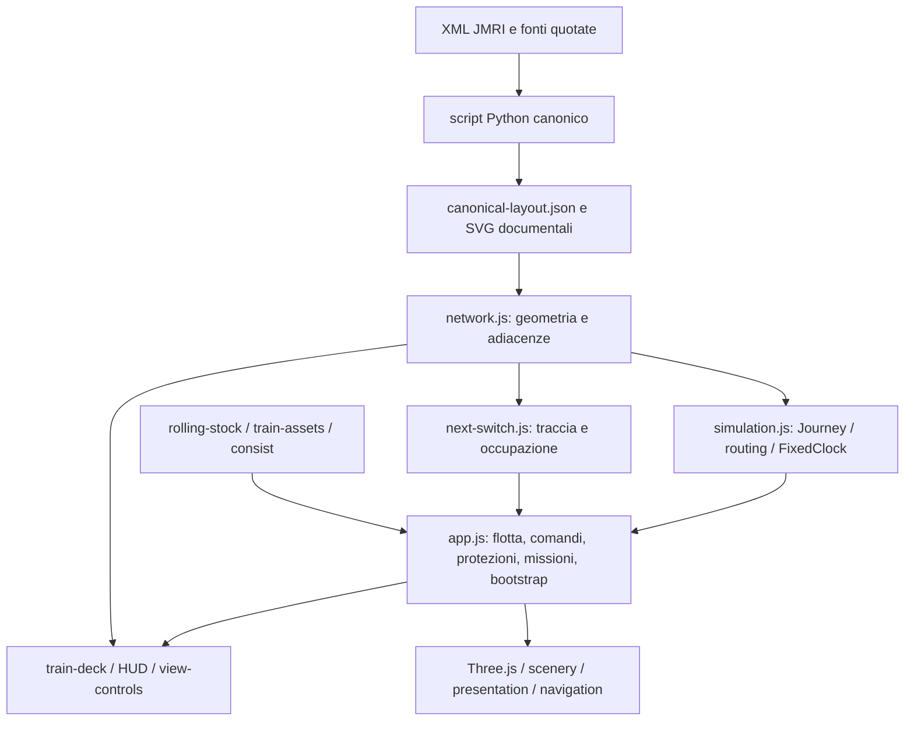

# SerieN — Engineering Audit / Security Assessment — Fase 5A

Data: 29 ottobre 2026. Perimetro: `epivic-lab/SerieN`, v0.12, commit **`618f538563aa7bd6497f6de3fba9744287b7ebb0`**. Branch iniziale `work`, working tree pulito; branch documentale creato: **`audit/phase-5a`**. Il commit che introduce questo documento è il checkpoint conclusivo 5A, identificabile con `git log -1 --format=%H -- docs/ENGINEERING_AUDIT.md`.

## 1. Executive summary

L'applicazione corrente compila e supera le suite ordinarie: **100 test Node, 9 test Python**, rigenerazione canonica identica, collaudo browser Fase 4 e regressioni operative. È confermata anche la lettura del sito pubblico e dei GLB Kenney: il precedente blocco di rete della Fase 4 è risolto nell'ambiente pubblicato.

Questi esiti non provano che il motore sia corretto in ogni stato limite. L'audit riproduce **R01**, un conflitto tra corpi su segmenti adiacenti non fermato dal controllo di prossimità, e **R02**, perdita di parte dell'occupazione di un carro sganciato che attraversa un giunto. Sono priorità di affidabilità per la 5C; non sono vulnerabilità informatiche né rischi di comando a impianti fisici. SerieN non comunica con Z21.

Il nucleo geometrico è già separato, deterministico e ben testato. Il principale problema architetturale è il coordinamento in `app.js`: 967 righe, 22 import e stato condiviso tra rendering, comandi, protezioni, missioni e UI. Non sono emersi cicli nel grafo statico dei moduli locali esaminati. Non è giustificata una riscrittura o migrazione di framework.

**Cybersecurity:** `npm audit` restituisce zero vulnerabilità note; una scansione limitata di 310 blob testuali raggiungibili non trova i pattern di credenziali cercati. Nessuna XSS sfruttabile è stata confermata nei flussi correnti. Esistono rischi preventivi concreti: action a tag modificabili, permessi deploy attivi nel job di build e CSP assente. Non si certifica assenza di vulnerabilità o segreti.

**5A completata come audit. 5B non iniziata.** Nessun codice applicativo, test preesistente, asset o workflow modificato; nessun deployment, aggiornamento dipendenze, push o intervento su altri repository.

## 2. Stato reale delle fasi precedenti

| Fase | Evidenza corrente | Limiti / attività non chiuse |
|---|---|---|
| 0 — Tracciato e operazioni | 70 nodi, 75 archi, una componente, tre anelli e quattro terminali. Test rete: tre giri nei due sensi, instradamento di otto scambi, crossover senza giunzione al diamante, terminali e runaround. Audit XML 9/9. | Profili interni WX310 ricostruiti con provenienza, fouling e lunghezze utili fisiche non certificati. Difetti operativi R01/R02 scoperti ora non annullano i risultati già accettati, ma limitano una dichiarazione di affidabilità generale. |
| 1 — Plancia | Tre consolle dinamiche/MRU, comandi indipendenti e minimappe sul grafo, verificati nelle regressioni browser. | Semantica di alcuni stati di inversione da chiarire; niente prova touch fisica. |
| 2 — Fondamenta grafiche | Materiali, camera e scambi disponibili; build, test specifici Node e rendering High del collaudo Fase 4 passano. | Non rieseguito in 5A l'intero script browser storico Fase 2; GPU desktop/tablet fisiche non misurate. |
| 3 — Paesaggio | Moduli di scena identici alla baseline; test deterministici di ingombri e superfici passano. Nessuna galleria. | Vincoli fisici e realismo restano quelli già dichiarati, non una dima esecutiva. |
| 4 — Rotabili | Catalogo nativo, assali/bielle, carrelli, ganci e miniature verificati. Browser Fase 4 fresco: PASS, inclusi quattro terminali con locomotore corto. | Modelli dimensionali non certificati, BR 216 schematica, GLB Kenney non articolati. Non tutti i convogli lunghi possono entrare in ogni tronchino. Verifica del caricamento Pages ora superata; performance GPU fisica ancora non verificate. |

Il brief parla di oltre 8.000 righe. Con il perimetro usato nella precedente conta, la baseline contiene **6.945 righe fisiche**: applicazione 4.227, test 2.110, script 557, CI 51. Sono inclusi commenti/righe vuote, esclusi dipendenze, bundle, documentazione e codice storico (altri 503 nel conteggio per estensione). LOC e densità non misurano da soli la qualità.

## 3. Architettura e mappa delle dipendenze

[Grafo statico completo e inventario](phase-5a/dependencies.json): 31 moduli JavaScript tra entrypoint e `src`, **zero cicli rilevati** nei loro import relativi. Il risultato non comprende internals Three.js, import dinamici o caricamenti GLB; non è una prova universale di assenza di dipendenze runtime.

| Responsabilità | Implementazione | Valutazione |
|---|---|---|
| Geometria | `canonical-layout.json`, `network.js`, `rail-profile.js` | Fonte condivisa con coordinate/ID originali; buona separazione. Validazione strutturale coperta. |
| Percorso e tempo | `simulation.js` | Indipendente da DOM/Three.js, routing conservativo e clock fisso. Contratti numerici incompleti: R03. |
| Ingombri e consist | `consist.js`, `next-switch.js`, parte di `app.js` | Dati coerenti per treni agganciati; duplicazioni/incompletezza per sganciati e collisioni. |
| Stato e comandi | `app.js` | Flotta, selezione, odometro, missioni, rendering e UI nello stesso ambito lessicale; dipendenze temporali e callback difficili da isolare. |
| UI | `train-deck-state.js`, `train-deck.js`, `next-switch-view.js` | MRU distinta dalla simulazione, testi prevalentemente con `textContent`. DOM montato da moduli, ma callback leggono globali dell'entrypoint. |
| Asset/animazione | `train-assets.js`, `rolling-stock.js`, `rolling-stock-art.js` | Cache/fallback/cancellazione/disposal dei template già testati. Metadati impliciti in `userData`, rig in proprietà custom, convenzioni native/importate/legacy da formalizzare. |
| Scena e qualità | `scenery.js`, `diorama.js`, `zones.js`, moduli stazione, `presentation.js`, `quality.js` | Instancing e batch già presenti; scena costruita all'import dell'entrypoint. Costo e lifecycle completi non coperti dai soli unit test. |

Nessun TypeScript/React: JavaScript ESM, Three.js, esbuild, Python e HTML/CSS. `getSwitchAssistance`, `layoutFor`, `vehiclePositions` ricalcolano viste derivate; `cars` duplica `carObjs.length`; identificativi e indici dei treni coincidono per convenzione. Nei moduli geometrici esistono responsabilità chiare: preservarle.

Codice inutilizzato verificato: import `wagonDetails` e materiali `wagonColors/wagonMats` nell'entrypoint non più usati dalla costruzione dei carri. Gli export di audit, invece, non vanno rimossi solo perché non importati dall'app: sono usati da test/script. Alcune righe hanno migliaia di caratteri (massimo entrypoint 2.026), con molte operazioni per riga: la leggibilità e le metriche di copertura ne risentono.

## 4. Registro dei problemi e rischi

Priorità: P1 prima della dichiarazione di affidabilità ferroviaria; P2 miglioramento pianificato; P3 minore/preventivo. Severità e impatto riguardano il perimetro reale (simulazione locale o pubblicazione), non un sistema di sicurezza ferroviaria fisico. Probabilità è una valutazione qualitativa, non una misura statistica.

| ID | Stato / evidenza | Severità | Probabilità | Impatto | Priorità / fase |
|---|---|---|---|---|---|
| R01 | **Confermato in scenario diagnostico**: due locomotive su T47/T46, centri distanti 20 mm, corpi sovrapposti e velocità ancora 5,4 mm/s dopo il controllo. `app.js:583` usa 17 mm per edge diversi, indipendentemente dall'ingombro. | Alta | Media | Conflitto non rilevato al confine dei segmenti | P1 / 5C |
| R02 | **Confermata incompletezza del modello**: `getSwitchAssistance`, `app.js:475–479`, limita un carro sganciato all'edge del centro. Carrozza centrata a s=5 su T47 occupa anche 79,1 mm di TO4:AC, assenti dal calcolo corrente. | Alta | Media | Occupazione/HUD non rappresentano tutto il veicolo; rischio di protezioni incomplete | P1 / 5C |
| R03 | **Confermato a livello API interna**: `Journey.move(NaN,…)` restituisce true e rende NaN posizione/viaggio; `FixedClock.update(NaN,…)` impedisce i callback successivi. | Media | Bassa nei comandi HTML normali | Corruzione dello stato se un chiamante viola il contratto | P2 / 5C |
| A01 | **Confermato strutturalmente**: `app.js` coordina stato ferroviario, UI, asset, collisioni e tick. Controlli più importanti non importabili come funzioni pure nei test Node. | Media | Alta durante modifiche | Elevato rischio di regressione e difficoltà di diagnosi | P2 / 5B |
| A02 | **Confermato strutturalmente**: convenzioni `userData`, valori di default diversi per extent/front/tail, `cars`/array, ID/indici e codice inutilizzato. Assenza di contratti tipizzati/documentati comuni. | Media | Media | Integrazioni fragili tra nativi, legacy e importati | P2 / 5B |
| A03 | **Rischio da ispezione**: errori di startup riportati nel loader; dopo l'avvio, `loadMsg` è nascosto e il tick pianifica il frame successivo solo alla fine. Manca un recupero applicativo centrale provato per eccezioni runtime/context loss. | Media | Bassa/da misurare | Scena congelata senza diagnosi utente in caso di guasto | P2 / 5B–5E |
| P01 | **Osservato nel sorgente**, costo non ancora attribuito da profiler: nuovi vettori/quaternioni/colori e array nel render loop, traversate dei rotabili, ricostruzioni di assistenza/anteprima. | Media | Alta per frequenza di esecuzione | Pressione allocazioni/CPU; entità da misurare | P2 / 5D |
| P02 | **Misura limitata**: frame molto lenti in SwiftShader; assenza di benchmark ripetuti e budget hardware. Dieci reset non mostrano crescita dei contatori GPU. Nessun leak generalizzato confermato. | Media | Alta nel backend osservato; ignota su GPU fisiche | Fluidità software scarsa, confronto prestazioni non disponibile | P2 / 5D |
| S01 | **Rischio supply-chain**: workflow usa `actions/*@v4/v5` (tag mobili), permessi `pages:write`/`id-token:write` a livello workflow nel job che esegue installazione e build. Nessuna compromissione osservata. | Alta potenziale | Bassa | Un componente compromesso può influenzare la pubblicazione | P2 / 5E |
| S02 | **Difesa mancante**, non XSS dimostrata: nessuna CSP in index/meta/header pubblico. | Media potenziale | Bassa con gli input correnti | Meno contenimento se in futuro appare un'iniezione o una dipendenza compromessa | P2 / 5E |
| S03 | **Dipendenza esterna nella pagina storica pubblicata**: `legacy-v0.1.html:5` importa font Google. Non riguarda il caricamento dell'app attuale. | Bassa | Alta se si apre la pagina storica | Richiesta a terzi/privacy e funzionamento offline | P3 / 5E |
| Q01 | **Lacuna confermata della CI**: unit test/build/parser sì; browser, coverage gate, dependency/security check e regressioni dei difetti R01/R02 non eseguiti dal workflow. | Media | Media | Una build verde non garantisce comportamento browser o sicurezza | P2 / 5B–5E |
| Q02 | **Contratti semantici da chiarire**, non cambiati: stato console usa direzione comandata anche durante frenata; `laps` usa distanza assoluta totale, non una traversata completa del circuito. | Bassa | Media | Stato/missione possono comunicare una semantica diversa da quella attesa | P3 / 5C, previa definizione del comportamento |

### R01: riproduzione e limiti

[Prova browser](phase-5a/local-probes.json), script [browser-audit.py](phase-5a/browser-audit.py) con `--probe`:

1. Sessione nativa isolata, in pausa; sganciare i due carri della V60 e aggiungere la quarta locomotiva corta.
2. API diagnostica: V60 su T47 s=238; BR 216 su T46 s=10, stesso verso.
3. Impostare velocità 25 e avanzare 0,12 secondi mediante il motore reale.
4. Rimangono su edge distinti, centri a 20 mm, entrambe con velocità 5,4: la protezione non interviene. Le casse hanno lunghezze maggiori della distanza tra i centri.

Lo stato limite è costruito tramite diagnostica, non è un incidente raccolto durante gioco ordinario. Il risultato conferma il difetto del predicato nel caso riprodotto, non descrive automaticamente ogni conflitto possibile. [Prova geometrica separata](phase-5a/contract-probes.json): due carri chiusi su quel giunto avrebbero 42,5 mm di sovrapposizione nominale.

### R02/R03: riproduzione e limiti

`node docs/phase-5a/probe-contracts.mjs` usa i moduli originali. `occupiedRanges` di una carrozza sul Journey T47/TO4:AC produce due intervalli; il ramo per carri sganciati dell'entrypoint ne rappresenta uno solo. Non è stato dimostrato che ogni scambio interessato diventi azionabile: in alcuni casi il margine di 30 mm sul segmento adiacente blocca comunque il comando. Distinguere questa incompletezza confermata dal successivo test end-to-end delle conseguenze.

La stessa prova mostra la propagazione di NaN. I range input HTML e `diagnostics.step` limitano già alcuni ingressi: non è una vulnerabilità remota confermata. Servono validazione ai confini delle API e test di rifiuto senza mutazione.

## 5. Security assessment

### Modello di minaccia e ingressi

Applicazione statica senza backend, account, credenziali applicative o connessione a hardware. Dati attuali del tracciato e percorsi asset incorporati nel repository; niente import di file utente, URL arbitrari, upload, API amministrative o persistenza server. Le mutazioni browser dell'audit restano nella sessione locale e sono eliminate chiudendo la pagina. Nessun penetration test eseguito.

`?diagnostics=1` espone comandi per la propria simulazione browser, non segreti o privilegi server. È una superficie di manutenzione da decidere esplicitamente in 5E, non una backdoor dimostrata.

### Dipendenze, asset e credenziali

- [npm-audit.json](phase-5a/npm-audit.json): **0 vulnerabilità note** al momento della consultazione, anche transitive; risultato dipendente dal database remoto e dalla versione del lockfile, non garanzia futura.
- Dipendenze dirette fissate: Three.js 0.163.0, esbuild 0.25.12. Tutte le 28 entry non-root del lockfile hanno `resolved` e `integrity`. `npm ci` è usato in CI; install script di pacchetti resta parte del rischio supply-chain.
- Sei GLB locali Kenney, licenza CC0 con provenienza e testo nel repository; immagini dichiarate `Textures/colormap.png` (stessa origine). Nessuno script incorporato da CDN nell'app corrente; esbuild include Three.js nel bundle. Geometria nuova originale, nessuna dipendenza aggiunta in 5A.
- [Scansione offline](phase-5a/secret-scan.json): 310 blob testuali raggiungibili da tutti i ref locali, zero occorrenze dei pattern di chiavi private, token GitHub e access key ID AWS cercati. Lo scanner non stampa valori. Non usa rilevamento di entropia, non analizza archivi/binari o ref remoti cancellati: **non certifica assenza di segreti**. Binding runtime dichiarati: nessuno; non sono stati letti file di credenziali.

### XSS, injection, URL e policy

`innerHTML` corrente: template statici della plancia e HUD; schema SVG costruito da numeri formattati; lista scambi interpolata da dati canonici fidati. Nomi/stati dei treni e log passano principalmente per `textContent`. Non è stato identificato un flusso attuale da input non fidato a esecuzione di HTML/JavaScript. Un futuro import di layout o nomi richiederebbe revisione di questi sink, non assunzione di sicurezza automatica.

Nessun `eval`/`new Function` identificato nei sorgenti applicativi esaminati. Immagine della planimetria: Blob SVG locale, precedente object URL revocato alla successiva apertura; nessun URL fornito dall'utente. Link esterno del report usa `rel=noopener`. Gli script documentali esaminati non usano `innerHTML` per il JSON caricato.

Header osservati su Pages: HSTS presente, cache 600 secondi; CSP, CSP report-only, Referrer-Policy e X-Frame-Options non presenti tra gli header della risposta osservata. Nessuna meta CSP nell'index. Una policy futura deve essere provata con bootstrap inline, miniature/data URL, Blob SVG, immagini GLB e report con `<object>`. Una meta non implementa `frame-ancestors` e non può simulare header personalizzati non supportati da GitHub Pages.

Impostazioni GitHub di branch protection, dipendenze aggiornate automaticamente, secret scanning del provider e regole dell'environment non sono state lette: non vengono considerate attive o assenti senza evidenza. Il workflow dichiara l'environment `github-pages`, ma questo non prova l'esistenza di approvazioni obbligatorie.

## 6. Rendering, risorse e performance

Aspetti positivi: un renderer principale; batching statico, instancing del paesaggio, materiali condivisi; cache dei template GLB con clonazione, release per target, idempotenza e cancellazione durante caricamenti testate; miniature prerenderizzate. `pagehide` libera controlli, observer, postprocessing, template e risorse di scena. Three.js possiede anche la propria gestione del contesto: l'assenza di una procedura applicativa testata non prova che il renderer non possa ripristinarlo.

Misura 5A: viewport 650×760, Low, Chromium 154, backend **ANGLE/Vulkan SwiftShader**, quattro locomotive dopo i test, reset nativi. [Ambiente](phase-5a/environment.json): Node 24.19, Python 3.12.14, quota CPU 4 core, limite RAM 32 GiB; descrizione host EPYC non equivale a un desktop con GPU.

- Undici campioni (warmup + dieci reset): **402 geometrie e 50 texture** in ogni campione. Nessuna crescita dei contatori in questo esercizio. Non misura heap JS, memoria GPU in byte, teardown completo o leak dopo lunghe sessioni/Cinema.
- Venti intervalli requestAnimationFrame: mediana circa **783 ms**, p95 empirico circa **800 ms** nel backend osservato. Campione breve e singolo, sessione diagnostica in pausa; non benchmark ripetuto, non FPS desktop, non confronto prima/dopo. I dati grezzi sono nel JSON.
- La raccolta degli snapshot diagnostici calcola anche hull e array completi: non va confusa con il costo del normale gioco o tenuta attiva in un benchmark senza dichiararlo.

Hotspot da profilare: `renderVehicles`/layout/locate, allocazioni nel tick, traversate delle ruote, `getSwitchAssistance` per HUD e preview, coppie di veicoli in `updateTrainStatus`, rigenerazione geometrie Route ogni 200 ms quando visibile. Il riuso di snapshot deve essere invalidato a ogni modifica di percorso/convoglio/scambio: non scambiare velocità con stati di sicurezza obsoleti.

Nessuna ottimizzazione eseguita e nessun miglioramento prestazionale dichiarato in 5A. Scena vuota non direttamente selezionabile: l'app assume sempre `trains[0]` e una selezione valida; la matrice 5D richiede un harness dedicato, non nascondere mesh spacciandole per assenza di lavoro CPU.

## 7. Test, copertura ed esiti

| Verifica | Eseguita in 5A | Esito / limite |
|---|---|---|
| Suite Node | `node --test --test-isolation=none tests/*.test.js` | 100 pass, 0 fail/skipped |
| Coverage Node | Stessa suite con `--experimental-test-coverage` | 100 pass; [report](phase-5a/coverage.txt) |
| Audit Python | `python3 -m unittest discover -s tests -p 'jmri_audit_test.py'` | 9 pass |
| Build | `npm run build` | PASS; bundle generato circa 955,2 KiB nel log esbuild |
| Grafo canonico | Generatore su copia temporanea e confronto byte | 4 file identici; nessuna rigenerazione nel checkout |
| Browser Fase 4 | Script esistente su sito locale, output isolato | PASS: tre convogli, animazioni, inversioni, aggancio, quattro terminali, UI e rendering High; [riassunto fresco](phase-5a/phase-four-rerun.json) |
| Regressione operativa | `tests/browser-phase-zero.py`, output isolato | PASS: giri nei due sensi, quarto treno/MRU, HUD, scambi protetti, runaround e arresti; [esito](phase-5a/operations-result.json) |
| Sito pubblico | `browser-audit.py --base https://epivic-lab.github.io/SerieN/` | HTTP 200; miniature e tutti i GLB richiesti caricati, 0 pageerror/richieste fallite/HTTP ≥400. Non è il collaudo operativo completo remoto. |
| Riproduzioni difetti | Probe Node e browser locale, nessuna patch | R01/R02/R03 riprodotti nei limiti dichiarati, non corretti |
| Dieci reset e frame sample | Harness browser locale | Contatori stabili; timing solo software |
| Dipendenze | `npm audit --json` | 0 vulnerabilità note |
| Segreti nella storia | Scanner offline limitato | 0 pattern hit su 310 blob; perimetro limitato |

Copertura strumentata dei **soli moduli caricati dai test Node**, esclusi file test/documentali: **91,28% linee, 89,71% branch, 94,77% funzioni**. Non è la copertura dell'intera app. `app.js`, `train-deck.js`, `scenery.js`, `diorama.js`, `zones.js`, `presentation.js` e `rolling-stock-art.js` non compaiono nella strumentazione Node. La loro esecuzione nel browser non aggiunge automaticamente coverage V8 a quel report. Singoli file mostrano lacune come cattura miniature 22,95% e vista HUD 50% in Node. Le righe dense possono gonfiare l'apparenza di copertura; non sono una prova di validità dei casi limite.

Test mancanti prioritari: R01/R02 come regressioni end-to-end, input non finiti senza mutazioni, cambio modelli fallito atomico e caricamenti parziali, composizioni lunghe a cavallo di più scambi, conflitti simultanei/inseguimenti e rami geometricamente vicini, aggancio tra convogli differenti, perdita/ripristino WebGL, teardown/rimontaggio, asset corrotti/offline e CSP reale. Non sono stati effettuati test su tablet touch o GPU fisiche. Le vecchie immagini nei report non sono scambiate per nuove prove.

## 8. Priorità, rischi e piano 5B–5E

La [roadmap dettagliata](ROADMAP_PHASE5.md) contiene definizioni ufficiali, sequenza, dipendenze, deliverable e gate. Indicazioni sintetiche:

| Fase | Intervento guidato dalle evidenze | Gate / rischio / rollback |
|---|---|---|
| 5B | Estrarre stato ferroviario derivato e assistenza scambi; contratti espliciti, meno globali e duplicazioni, pulizia mirata. | Comportamento valido e coordinate invariati; test unitari di caratterizzazione e browser; rischio medio ai confini UI. Un modulo per commit, revert dedicato. Non mascherare R01/R02 come requisiti corretti. |
| 5C | Correggere collisioni cross-edge e occupazione degli sganciati, quindi input e atomicità; matrice operativa estesa. | Riproduzioni 5A convertite in regressioni corrette; nessuna connessione/occupazione inventata. Rischio alto; correzione e fixture isolate per commit. |
| 5D | Baseline ripetuta per 0/1/3/4 treni, qualità/HUD/scene equivalenti; profiling prima di cache o pooling. | Budget concordati dopo misure, confronto ripetibile, nessuna regressione operativa. Rischio medio di cache stale; conservare risultati e revert. |
| 5E | Audit aggiornato, SHA delle action verificati, separazione permessi build/deploy, CSP provata, validazione asset/ingressi e CI permanente. | Nessuna criticità nota non gestita nel perimetro osservato; browser e distribuzione compatibili. Rischio medio/alto per policy/workflow; staging e pubblicazione solo autorizzati. |

Nessun blocco tecnico impedisce di progettare il primo refactoring 5B. **La nuova istruzione dell'utente è il prerequisito di governance per iniziarlo.** Non si deve dichiarare affidabilità ferroviaria generale prima di risolvere R01/R02. Nessuna vulnerabilità critica confermata richiede una patch d'emergenza fuori ambito 5A.

## 9. Conservazione, ripresa e consegna

[Verifica dei file protetti](phase-5a/preservation.json): 96 file tracked non documentali confrontati byte per byte con `618f538`, tutti identici, inclusi sorgenti, test precedenti, asset e workflow. Gli output build e cache sono locali/ignorati; i test browser e il generatore hanno scritto su copia temporanea. L'unico nuovo codice nel commit è costituito da harness di audit sotto `docs/phase-5a`, consentiti come test non distruttivi; non è codice applicativo.

Leggere [PROGRESS.md](../PROGRESS.md) e roadmap per riprendere. Gli script audit vanno eseguiti dalla root con i tool/dependencies già presenti. Nessun worktree aggiuntivo necessario. Il report è relativo alla baseline indicata, non alla somma delle nuove righe documentali.

Il commit di audit è locale, sul branch documentale, non pushato. Una nuova sessione con lo stesso checkout può ripartire dal commit; la perdita totale della macchina richiede backup/esportazione o push del solo branch autorizzato. Non confondere un commit locale con conservazione remota o pubblicazione.

**Primo intervento raccomandato 5B, non eseguito:** estrarre `layoutFor`, `vehiclePositions` e la raccolta dati di `getSwitchAssistance` in un servizio puro con dipendenze esplicite, aggiungendo test delle viste derivate prima di modificare le regole di collisione.
