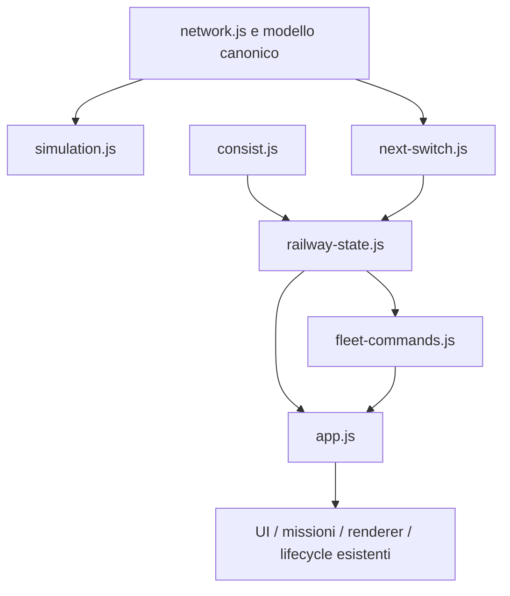

# Fase 5B — Refactoring architetturale

Baseline applicativa: `618f538` (v0.12). Punto di partenza documentale: audit `b819864`. Branch: `refactor/phase-5b`. Autorizzazione: richiesta esplicita «esegui 5b». Nessuna autorizzazione alla 5C, a push o deployment.

## Risultato

Estratti dall'entrypoint due confini testabili, senza cambiare regole ferroviarie, contratti UI, missioni, renderer, asset o dipendenze. `app.js` passa da 967 a 897 righe: non è una riscrittura e il numero di righe totale aumenta per contratti e moduli espliciti.

- [railway-state.js](../src/railway-state.js): `layoutFor`, `vehiclePositions`, `collectRailwayState`, `deriveSwitchAssistance`. Solo stato derivato, nessun DOM/renderer, nessuna mutazione di Journey, nessuna cache. La raccolta occupazione è distinta dalla presentazione dello stato degli scambi.
- [fleet-commands.js](../src/fleet-commands.js): velocità, inversione, stop individuale/globale, luci e aggancio/sgancio. Riceve la flotta, i carri sganciati e il router; muta gli oggetti esistenti. Non aggiorna DOM, scene o missioni.
- [railway-types.js](../src/railway-types.js): contratti JSDoc strutturali per Train, Vehicle, VehicleData, Journey, Couplers, RailwayPoint, OccupiedRange, snapshot, contesto e risultati dei comandi. Type-only, nessun caricamento di Three.js. Non sono validazione runtime o una certificazione ottenuta con un type checker.
- `app.js` mantiene bootstrap, reset/creazione delle mesh, clock e protezioni esistenti. Traduce i risultati dei comandi in effetti UI e flag delle missioni, conservandone ordine e messaggi. Il wrapper dell'assistenza mantiene la firma precedente.

Non è stato introdotto un secondo store. `trains` e `detached` rimangono gli array esistenti; il servizio comandi ne conserva le referenze. `carObjs` continua a rappresentare i carri fisici; dopo i trasferimenti il conteggio legacy `cars` viene riallineato nello stesso comando. Il campo pubblico `cars`, l'indicizzazione per ID e il reset non sono stati trasformati in accessor o rimossi: ciò avrebbe richiesto cambiare contratti e inizializzazione. La convenzione `selected = indice della flotta` è ora esplicita.

## Dipendenze e confini

Il [grafo aggiornato](phase-5b/dependencies.json) non contiene cicli negli import relativi statici dei 34 moduli JS esaminati. I tre moduli aggiunti non importano DOM o Three.js a runtime. L'architettura della plancia e il Next Switch HUD non cambiano.

## Interventi, rischio e ripristino

| Blocco | Motivazione / impatto | Rischio | Verifica | Punto di ripristino |
|---|---|---|---|---|
| Viste ferroviarie | Rendere isolabili layout, posizioni, occupazione e assistenza oggi chiusi nell'entrypoint. Solo lettura dei dati esistenti. | Medio: verso effettivo, offset di coda e protezioni potrebbero divergere durante l'estrazione. | Confronto con funzione storica su 180 stati, identità dei veicoli e Journey congelati; Node, Python e build. | `5a551f7` |
| Comandi | Separare mutazioni della flotta da messaggi/UI e flag missioni. Risultato esplicito `changed/kind/message/group` per aggancio/sgancio. | Medio: trasferimenti doppi, perdita dei carri, callback in ordine diverso. | Confronto differenziale con comandi storici, identità/posizione dei gruppi, stop di tutta la flotta, guardie e messaggi; regressioni browser. | `afd50db` |
| Pulizia mirata | Rimossi import `wagonDetails` e quattro materiali inutilizzati `wagonMats`, non più usati dai carri. | Basso: regione sorgente delle miniature firmata cambia anche senza cambiare il builder. | [Equivalenza del builder](phase-5b/native-source-preservation.json) dopo la sola rimozione delle due dichiarazioni inutilizzate. PNG invariati; aggiornato soltanto hash di provenienza della regione sorgente nel manifest. | Incluso in `afd50db` |
| Chiusura | Test browser comparativo, evidenze e stato di avanzamento. | Basso: documentazione incongruente o artefatti vecchi. | File originali protetti, JSON e collegamenti verificati; test scrivono in copia temporanea. | Commit che introduce questo report e aggiorna PROGRESS |

Rollback: su un branch dedicato e con working tree verificato, applicare revert dei commit 5B in ordine inverso, incluso il checkpoint documentale quando pertinente. Non usare reset distruttivi e non sovrascrivere modifiche successive/altrui. I commit 5A e la baseline v0.12 rimangono disponibili.

## Caratterizzazione e regressioni

Gli oracle in `tests/fixtures/*-v012.js` sono estratti espliciti dal commit `618f538`, destinati soltanto ai test. Non costituiscono una seconda implementazione di produzione. Permettono il confronto indipendente dell'estrazione; la fixture dei comandi riusa il layout estratto, a sua volta confrontato con il layout storico. La [provenienza](phase-5b/characterization-source.txt) registra il digest dell'estratto delle viste.

- **106 test Node passati**: 100 preesistenti più sei nuovi test. Due test delle viste coprono 180 combinazioni di scambi, velocità effettiva/comandata, selezione e metadati legacy/nativi/importati; verificano referenze e assenza di mutazioni del Journey. Quattro test dei comandi coprono transizioni/messaggi storici, identità del gruppo sganciato e riagganciato, rifiuti per distanza/orientamento/capacità/spazio e stop globale. [Log](phase-5b/node-tests.txt).
- **9 test Python** dell'audit JMRI passati. [Log](phase-5b/python-tests.txt).
- **Build riuscita** con le dipendenze già fissate; nessuna modifica a package manifest o lockfile. [Artefatto](phase-5b/build.json).
- **Confronto browser prima/dopo PASS**: due build separate v0.12 e 5B, eseguite in sequenza. Sei snapshot completi identici: iniziale, tre treni in moto, sgancio, riaggancio, quarto treno/consolle nascosta, stop. Confrontati geometrie/hull, animazioni, Journey, composizioni, HUD, consolle, messaggi e missioni. Esclusi contatori renderer e tempi dei frame, che non sono contratti funzionali. [Esito](phase-5b/browser-comparison.json), [script](../tests/browser-phase-five-b.py).
- **Browser Fase 4 PASS**: movimenti simultanei, ruote/bielle, arresti/inversioni, sgancio e ritorno al carro, quattro terminali reali, lunghezze nelle consolle, Low e immagini High responsive. [Esito](phase-5b/phase-four-rerun.json).
- **Browser operativo PASS**: anelli nei due sensi, quarto convoglio e MRU, comandi/protezioni scambi, Next Switch HUD, entrambi i rami del runaround, STOP ALL. [Log](phase-5b/browser-phase-zero.txt).
- **Regressioni Kenney PASS**: spaziatura, cambio nativi/importati, sgancio/riaggancio, inversione, reset e ripristino. [Log](phase-5b/browser-consist.txt).

Browser: Chromium/SwiftShader nell'ambiente cloud. Nessuna misura su GPU fisica, nessuna ottimizzazione o affermazione di miglioramento prestazionale. Il confronto v0.12 usa una copia temporanea e un server locale separato, non un worktree o una pubblicazione.

## Conservazione e problemi rinviati

[File protetti](phase-5b/preservation.json): grafi, Journey/router/clock, rotaie, assistenza base, HUD, rotabili, asset manager, plancia, camera, scenografia, CSS, index, manifest delle dipendenze e workflow sono identici alla baseline. Le uniche variazioni applicative riguardano l'entrypoint e i moduli estratti; il manifest delle miniature cambia soltanto il digest di provenienza del builder, non i PNG o i modelli.

I difetti dell'audit **non sono stati corretti né dichiarati comportamenti desiderabili**:

- **R01:** funzione di controllo collisioni byte per byte identica alla baseline; la soglia cross-edge resta da correggere in 5C.
- **R02:** il ramo di occupazione dei carri sganciati, ora chiaramente isolato in `collectRailwayState`, resta tagliato all'edge del centro. Il limite è marcato nel sorgente e nei [probe](phase-5b/known-defects.json), non approvato come requisito corretto.
- **R03:** Journey/FixedClock non modificati; NaN continua a poter corrompere lo stato interno nei casi dell'audit. Nessuna validazione nuova è stata introdotta surrettiziamente durante l'estrazione.

Non sono stati cambiati error handling globale, recovery WebGL o lifecycle del renderer: restano i punti già segnalati per stabilizzazione 5E. I comandi ora rendono espliciti i fallimenti operativi ai chiamanti, senza introdurre un'interfaccia o messaggi differenti.

## Stato della fase

5B conclusa come refactoring mirato con regressioni e checkpoint. Nessun push, deployment, versione nuova, dipendenza aggiunta o intervento su altri repository. 5C–5E non iniziate. Prima di procedere alla 5C occorre nuova istruzione dell'utente; priorità R01 e R02 con regressioni che dimostrino le correzioni, preservando i nuovi confini modulari.
