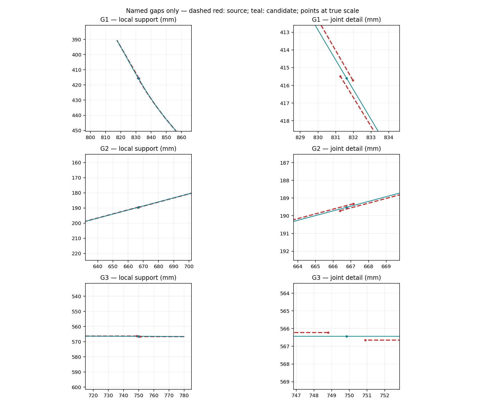
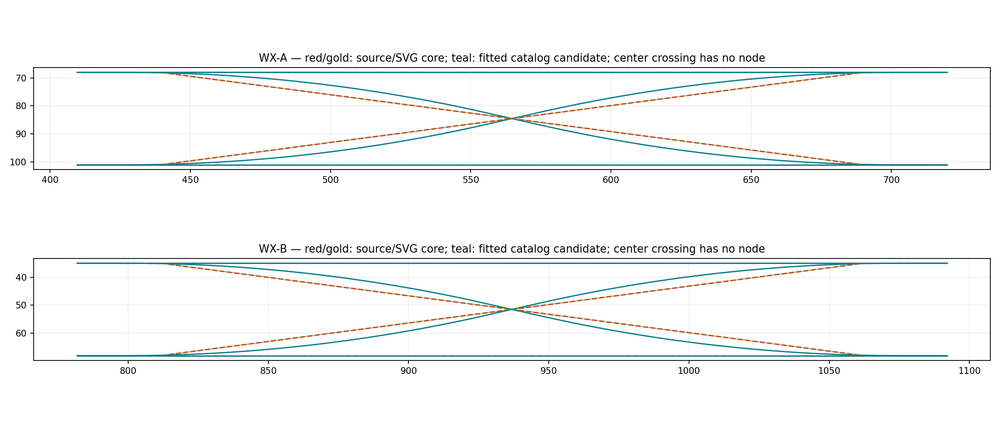
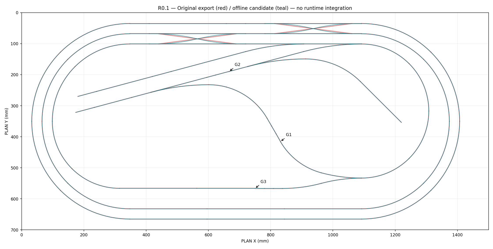
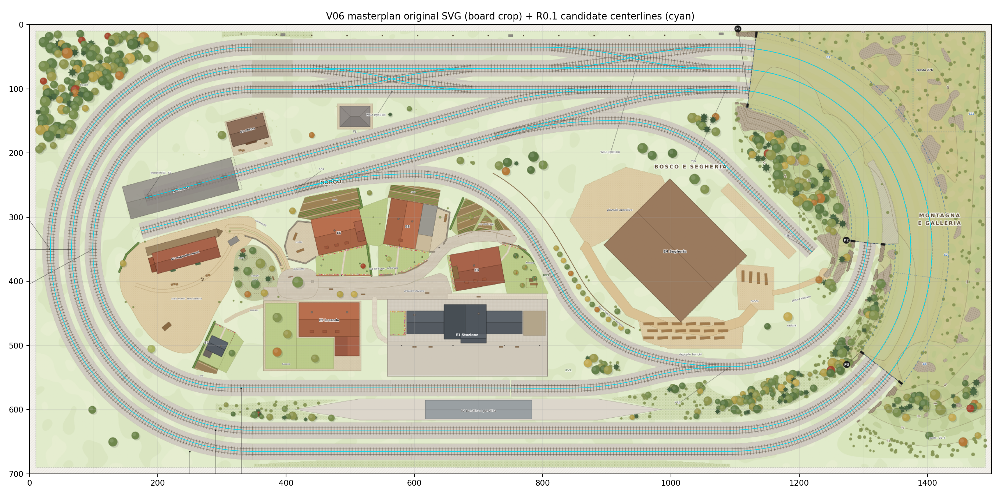

# SERIE N — R0.1: Continuity Resolution

13 novembre 2026, Europe/Rome. Branch: `codex/scenario-v06-r01-continuity`, derivato esattamente da R0 `c527134ebcd51c18b5714177946535d325499dc2`. Mandato: [decisione vincolante della Regia nella PR #11](https://github.com/epivic-lab/SerieN/pull/11#issuecomment-6850569493). Letti AGENTS, audit M0.1 con addendum prevalente e rapporto R0. Checkout iniziale `work`/`f33377c…`, pulito; fetch R0 e branch nuovo, senza reset, rebase o sovrascritture. R0 remoto confermato al checkpoint indicato; branch R0.1 prima inesistente.

## 1. Executive summary e gate

**G1/G2/G3 RISOLTI nella geometria candidata.** Non sono alias, tolleranze maggiorate o soli collegamenti di tabella: i punti degli assi ora coincidono esattamente, con raccordo delle tangenti. A/B/C chiudono realmente sulle coordinate candidate; 79 pezzi coperti, 69 assi immutati, tre soli terminali intenzionali. Nessun codice ferroviario, asset originale, UI o backend è stato cambiato.

**WX-A/WX-B: quattro percorsi completi ciascuno, continuità geometrica VERIFICATA; fedeltà del profilo fisico V06 APERTA.** La ricostruzione deterministica usa fatti numerici del catalogo secondario Kato 20-210 XTrackCAD, adattati esclusivamente alle bocche V06. Il confronto indipendente col master SVG verifica che questo riproduce i nuclei rettilinei incompleti dell'export: il profilo ricostruito se ne discosta fino a **3,334752 mm** nel dominio comune. Non è dimostrato che quei nuclei fossero intesi come corde schematiche del dispositivo reale. Non si dichiara certificata la sostituzione della loro forma.

**Raccomandazione R1: NO-GO fino alla risoluzione del blocco WX di §5.** Sono consegnati candidato continuo, misure, alternative scartate, verifiche ed evidenze; **R0.1 non è dichiarata PASS complessivo del criterio di fedeltà AS-BUILT**, né tracciato pronto per l'attivazione. Il limite è circoscritto: non impedisce e non annulla la chiusura dei tre gap. Nessuna R1, merge o deploy.

Livelli utilizzati:

- **VERIFICATO:** byte, coordinate, misure o controlli ripetibili sul candidato e sulle fonti identificate.
- **INFERITO:** profilo WX fit da fonte secondaria; mapping dei componenti e semantica funzionale ereditati da R0, non firma del produttore.
- **APERTO:** profilo WX fisico/autore, aghi/attuazione, riconciliazione revisioni, limiti di sicurezza e compatibilità del motore nelle fasi successive.

## 2. File prodotti e confine dell'intervento

| Percorso | Contenuto |
| --- | --- |
| [candidate/R01/track.json](candidate/R01/track.json) | Dataset offline separato: 79 percorsi, 74 nodi, stati, tre terminali, metadati delle trasformazioni e primitive WX. Nessun import applicativo. |
| [candidate/R01/README.md](candidate/R01/README.md) | Schema, unità, limiti e uso esclusivamente di laboratorio. |
| [tools/scenario-v06](../../../tools/scenario-v06) | Quattro script separati: generatore, validatore indipendente, metrologia/figure, alternative WX. Percorso repository effettivo: `tools/scenario-v06/`. |
| [evidence/R01/README.md](evidence/R01/README.md) | Indice delle prove e comandi riproducibili. |
| [source-axes.json](evidence/R01/source-axes.json) | Estratto dei 79 assi originali e intervalli nascosti, conservato distinto dal candidato. |
| [masterplan-rail-reference.json](evidence/R01/masterplan-rail-reference.json) | Riferimento geometrico estratto dallo SVG originale, con trasformazione e precisione dichiarate; nessuna connessione dedotta da esso. |
| [provenance.json](evidence/R01/provenance.json) | Lock documentale detached delle fonti effettivamente usate e limiti di provenienza. |
| [metrology.json](evidence/R01/metrology.json), [verification.json](evidence/R01/verification.json) | Coordinate, spostamenti, lunghezze, curvature locali, matrici, circuiti e test. |
| [JUNCTIONS.md](evidence/R01/JUNCTIONS.md) | Tutti i 74 nodi e le 158 incidenze di estremità, con terminali e vincoli di transito. |
| [junction-matrix.csv](evidence/R01/junction-matrix.csv), [wx-64-cases.csv](evidence/R01/wx-64-cases.csv), [simple-90-cases.csv](evidence/R01/simple-90-cases.csv) | Matrici finali complete, incluse le transizioni vietate. |
| `PROGRESS.md`, `docs/_active/scenario-v06/{README,STATUS}.md` | Aggiornamento dello stato R0.1; rapporti storici M01 e R0 immutati. |

Gli altri file nuovi sono immagini, estratto numerico catalogo, log baseline/finali, alternative e ricevuta di preservazione. L'elenco definitivo è nel commit della consegna, pubblicato sul solo branch dedicato; SHA effettivo e URL vengono verificati dopo il push, senza anticipare un identificativo nel rapporto.

## 3. Origine e versione dei dati

| Fonte | Identità e verifica |
| --- | --- |
| `railway_alignment.json` | Drive `14Hb5zkGRUZaQMSbqGTCEVdAQe5hEW7DP`, 85.535 byte; nuovamente scaricato, SHA-256 **`6a494928707609f1cf6aa9b535a510ca721b9a3458eca0910dfc250c978f46ea`**, uguale al lock R0. Tutti i 615 punti e gli intervalli nascosti dell'estratto confrontati con i byte ricevuti. |
| Masterplan V06 SVG | Drive `1zLrS0Lu1AEU5GS2xVim7zui4W5ikEZ-z`, 3.757.460 byte; SHA **`868751dc5d17885161e7ff1a7dac46d556d2af2dee578c787db80a6f5e489022`**. Esaminato graficamente e geometricamente, senza risalvarlo. |
| Tavola ferroviaria V3 PDF | Drive `17mx-0Wc5BE-Blwegco7WvOv7XDE53027`, 43.432 byte; SHA **`2cca66a03e1c77265c27fe7817ccc4b1abcf457a574cb1a8000c0bb0f0189d5d`**. Disegno e testo controllati: due WX310 e disposizione complessiva. |
| Record Kato 20-210 secondario | [XTrackCAD, revisione immutabile `236f93e4…`](https://github.com/ankon/xtrkcad/blob/236f93e4a0b35429dfae2d292ef4407b462f1f01/app/lib/params/N-Kato%20Track%20and%20Structures.xtp). Git blob `9fdff5303f12fd38d1db09fd130abbccf77ff0a8`; contenuto al ref mobile confrontato con la revisione pin e identico. Estratto ASCII conservato con LF; non è CAD ufficiale Kato. |
| Manuale / mapping / truth table | Fonti e misure congelate nella consegna R0; registro, matrice pezzi e sequenze usati come oracolo indipendente dal nuovo builder. Il manuale non è stato riscaricato: la sua evidenza resta quella di R0. |

PLAN_MM: X destra, Y verso spettatore; quota ferro **8,4 mm**; scala N già applicata. Nessun fit alla geometria legacy e nessuna seconda conversione 1:160. I quattro script non importano `src/canonical-layout.json` o il suo generatore. I parametri catalogo coincidono con fatti numerici già documentati nel repository, ma le porte, pose e lunghezze qui sono esclusivamente V06.

**Provenienza APERTA, distinta dalla continuità:** non si riscrivono i digest errati di `scene_manifest.json` ed `EXPORT_REPORT.md`. I mismatch e la relazione fra revisioni PDF/SVG/native/export restano quelli di R0. `provenance.json` identifica i byte utilizzati, non pretende di riparare la catena del produttore. Servono ancora lock revisioni approvato, assi a precisione piena e mapping nativo dei componenti.

## 4. Correzione locale dei tre gap

Scelta deterministica: nodo comune nel **punto medio**, che minimizza il massimo spostamento dei due estremi (`gap/2`). Tangente comune nella bisettrice delle direzioni di percorrenza, con ripartizione uguale della rotazione. Questa è un'ottimalità locale degli estremi, **non** una dimostrazione di minimo globale di energia elastica o di spostamento dell'intera curva.

Su ciascun asse viene applicato un campo di spostamento quintico compatto su `L=min(lunghezza pezzo,62,026 mm)` dall'estremo corretto. Il supporto è limitato a un tratto modulare corto e non oltrepassa altri componenti. All'altra estremità del supporto spostamento, derivata e derivata seconda sono nulli. Il campo è C2; la polilinea originale conserva la propria discretizzazione interna. Nessuna rettifica globale delle curve originali.

Con `t` crescente verso il giunto: `h=10t³−15t⁴+6t⁵`, `g=−4t³+7t⁴−3t⁵`; `d(t)=Δ h + σ L δv g`. `σ` tiene conto di S/E, `δv` è la correzione della tangente nel verso originale S→E. Campionamento delle sole zone corrette ≤0,25 mm, con vertici originali e limiti del supporto inclusi. Il builder conserva le formule e i parametri, il candidato anche i punti risultanti.

| Gap / estremo | Originale (X,Y) mm | Nuovo comune (X,Y) mm | Δ (X,Y) mm | Spostamento estremo mm | Max campo campionato mm |
| --- | --- | --- | --- | ---: | ---: |
| G1 `27.E` | 831,264; 415,483 | 831,620; 415,5995 | +0,356; +0,1165 | 0,374577 | 0,374577 |
| G1 `48.S` | 831,976; 415,716 | 831,620; 415,5995 | −0,356; −0,1165 | 0,374577 | 0,400359 |
| G2 `38.S` | 666,382; 189,720 | 666,7605; 189,521 | +0,3785; −0,199 | 0,427625 | 0,427625 |
| G2 `40.S` | 667,139; 189,322 | 666,7605; 189,521 | −0,3785; +0,199 | 0,427625 | 0,427625 |
| G3 `70.S` | 748,797; 566,221 | 749,8465; 566,4345 | +1,0495; +0,2135 | 1,070996 | 1,070996 |
| G3 `71.E` | 750,896; 566,648 | 749,8465; 566,4345 | −1,0495; −0,2135 | 1,070996 | 1,070996 |

**G2 start↔start:** nessun pezzo viene invertito nel dataset. La percorrenza valida è `40− → 38+`, o il reciproco `38− → 40+`; le tangenti S→E dei due pezzi sono opposte al giunto. Confrontarle con lo stesso segno darebbe erroneamente circa 180°.

| Giunto | Gap prima mm | Residuo geometrico mm | Disallineamento tangenti dei segmenti terminali prima → dopo |
| --- | ---: | ---: | --- |
| G1 | 0,749155 | **0**, uguaglianza esatta | 1,512163° → 0,000715° |
| G2 | 0,855250 | **0**, uguaglianza esatta | 0,000138° → 0,000021° |
| G3 | 2,141992 | **0**, uguaglianza esatta | 0° → 0,000272° |

Le tangenti analitiche del campo coincidono esattamente; i piccoli residui sopra sono misure indipendenti sulle corde dei punti campionati. Non si usa un epsilon per creare il nodo. Le estremità opposte sono immutate.

Raggi minimi degli **interni lisci** dovuti al campo di correzione: p27 1962,48 mm; p48 **280,67 mm**; p38 6951,54 mm; p40 3718,08 mm; p70 3251,31 mm; p71 742,76 mm. Nessun ripiegamento del parametro; derivate finite e campo C2 ai limiti. Queste misure escludono gli angoli delle polilinee sorgente: non certificano una curvatura globale fisica. Il raggio nominale originale R216 non è sostituito con R1962: quest'ultimo descrive i tratti lineari interpolati più il campo locale.

## 5. WX-A / WX-B: ricostruzione, confronto e blocco preciso

### 5.1 Perché non basta aggiungere otto piccole prolunghe

I nuclei p12/p13/p16/p17 sono rette di circa 250,102 mm inclinate di 7,50004°. Per WX-A la porta UL è `(409,659;68,018)`, mentre p12.E è `(440,741;68,203)`: **31,082 mm** longitudinali, appena **0,185 mm** di dislivello trasversale.

Raccordare in quel solo intervallo una tangente orizzontale alla tangente 7,5° mantenendo il nucleo intatto genera una geometria diversa dal catalogo. Una prova quintica con posizione/tangente/curvatura ai due capi produce **R minimo circa 64,3 mm** e uscita verso l'esterno dell'host di circa **0,665 mm**: alternativa **SCARTATA**, non inclusa nel candidato. Con rotazione monotona 0→7,5° e R≥583,184 mm servirebbero almeno `R sin(7,5°)=76,121 mm` longitudinali, oltre i 31,082 disponibili. Questa dimostrazione è limitata a quel tipo di raccordo, non prova l'impossibilità di ogni curva artificiale. [Misure riproducibili](evidence/R01/reconstruction-alternatives.json).

La proiezione ortogonale all'host creerebbe invece una bocca interna e lascerebbe uno spigolo: non viene usata. Nemmeno una retta porta→porta soddisfa la tangente orizzontale alle bocche.

### 5.2 Profilo candidato motivato da fonte secondaria

Il record 20-210 XTrackCAD specifica quattro bocche nominali 310×33 mm, due itinerari longitudinali in Normal e due incrociati in Reverse. Le diagonali usano archi di raggio **22,960 pollici = 583,184 mm** e un rettifilo centrale di vettore `(0,688;0,157)` pollici, lunghezza **17,924429 mm**.

Il candidato mantiene questi due parametri, usa archi opposti simmetrici e risolve univocamente la rotazione `θ` e i due tratti iniziale/finale uguali sulle **porte V06 immutate**:

`|ΔY| = 2R(1−cos θ) + c sin θ`

`lead = [ΔX − 2R sin θ − c cos θ] / 2`.

| Unità | Pezzi N / X | ΔX mm | ΔY mm | θ | Lead simmetrico mm | Lunghezza X candidata mm |
| --- | --- | ---: | ---: | ---: | ---: | ---: |
| WX-A | 59/60 / 12/13 | 310,126 | 33,014 | 12,812014° | 17,001141 | 312,740376 |
| WX-B | 61/62 / 16/17 | 310,126 | 33,013 | 12,811806° | 17,003194 | 312,740256 |

Sono cinque primitive per strada: retta–arco–retta–controarco–retta, campionate ≤0,5 mm. Raggio preservato, nessuna piega all'indietro, tangenti orizzontali alle quattro bocche, posizione e tangente continue alle primitive. Le normali restano gli hosts originali. Le X sostituiscono i nuclei incompleti con un percorso intero, mantenendo gli ID e il verso **S→E da destra a sinistra**. I punti originali sono conservati nell'estratto sorgente, con lineage esplicito. Le primitive non diventano archi ferroviari distinti: ogni strada rimane un unico percorso logico porta→porta della stessa unit.

La curvatura è quella del modello circolare Kato secondario: salti finiti `0↔1/583,184 mm`, tangenti continue; **non** raccordi C2 o clotoidi. Non si inventano transizioni di curvatura non presenti nel catalogo. Non sono stati copiati coordinate, nodi o lunghezze del tracciato legacy.

### 5.3 Confronto indipendente con il master e limite di fedeltà

Dal master originale sono state estratte le 152 tracce di rotaia `#3b3631`, accoppiate in 76 assi grafici con uguale campionamento. Trasformazione foglio→PLAN: `(paper−[20,30])/0,3733`; arrotondamento SVG 0,01 mm carta, cioè circa 0,02679 mm plastico. Le coppie 12/13/16/17 sono controllate contro gli estremi dei nuclei, non assunte uguali agli ID perché vicine. Il confronto è grafico/metrico, **non** crea giunzioni.

| Pezzo | Originale → asse SVG, massimo mm | Profilo candidato → nucleo, massimo nel dominio X comune mm | Estremi vecchio nucleo → profilo, massimo mm |
| --- | ---: | ---: | ---: |
| 12 | 0,008654 | **3,334752** | 0,014949 |
| 13 | 0,007596 | **3,334752** | 0,014949 |
| 16 | 0,005802 | **3,334127** | 0,014024 |
| 17 | 0,005890 | **3,334127** | 0,014024 |

Il candidato passa molto vicino alle otto estremità originali, ma cambia le tangenti e la forma all'interno: non si nasconde questa differenza dietro il buon allineamento alle estremità. Le distanze nella terza colonna sono verso le rette originali, non una Hausdorff globale fra percorsi di estensione diversa.

**Blocco tecnico di fedeltà WX:** le fonti V06 disponibili mostrano nuclei rettilinei a 7,5°, il catalogo secondario un profilo curvo con tangente centrale circa 12,81°. Nessuna fonte autorevole acquisita stabilisce che le rette V06 siano soltanto una rappresentazione schematica da sostituire con quel profilo. Il fit non è arbitrario ed è interamente verificabile, ma non dimostra da solo quale forma abbia richiesto il progettista. La ricostruzione numerica è consegnata come **INFERITA**, non come nuovo AS-BUILT approvato.

Per chiudere il blocco occorre **uno** dei seguenti riscontri, con revisione e unità esplicite:

1. Export dal progetto autore/CAD Kato dei quattro percorsi completi per ciascun WX, con porte, tangenti e raccordi; oppure
2. Conferma tecnica documentata che i nuclei V06 sono corde schematiche e che il profilo Kato fit qui descritto è ammesso, con accettazione esplicita dello scarto massimo 3,335 mm e confronto visuale coerente.

Sono inoltre necessari posizione/forma delle quattro punte e parti mobili, corsa, polarità e comando accoppiato. **Le primitive operative non sono geometria degli aghi.** Non si anima né si identifica una lama a partire dal punto iniziale di un arco. Il GLB ferroviario non è stato ispezionato in R0.1 e non viene dichiarato allineato al candidato modificato. Non sono state inviate richieste al produttore.

## 6. Matrice finale delle connessioni e transizioni

**Geometria candidata VERIFICATA:** 74 nodi, 158 incidenze di estremità, 79 percorsi; 58 nodi di grado 2, 13 di grado 3 e tre di grado 1. Una componente nell'unione degli stati, rango ciclico 6. Questi conteggi derivano dalle coordinate esatte del candidato, non da alias a distanza positiva.

Le 13 triple comprendono i cinque comuni semplici e le otto bocche WX, alle quali normale e deviata condividono posizione ma sono alternative. Non autorizzano transiti fra due percorsi dello stesso dispositivo. [Tutti i nodi](evidence/R01/JUNCTIONS.md), [97 coppie incidenti e vincoli](evidence/R01/junction-matrix.csv): 84 coppie esterne potenzialmente percorribili nei rispettivi stati e 13 coppie interne escluse come prosecuzione diretta. Le coppie esterne non sono tutte attive simultaneamente.

| Unità | Stato | Coppie bidirezionali ammesse | Vietate |
| --- | --- | --- | --- |
| WX-A e WX-B | N | UL↔UR, LL↔LR | UL↔LL, UR↔LR, diagonali, auto-transizioni |
| WX-A e WX-B | X | UL↔LR, LL↔UR | UL↔LL, UR↔LR, longitudinali, auto-transizioni |
| C07/C12/C13/N07/N14 | S0 | A↔B | A↔C, B↔C, auto-transizioni |
| C07/C12/C13/N07/N14 | S1 | A↔C | A↔B, B↔C, auto-transizioni |

Conservati **tutti i 64 casi ordinati R0 dei WX**: 16 ammessi, 48 vietati, nessuna discrepanza. Ulteriori 90 casi per i cinque semplici/Y: 20 ammessi, 70 vietati. Verificate 128 configurazioni dei sette comandi, **17.920 arrivi orientati** su percorsi attivi: nessuna continuazione multipla ammessa nel modello standalone.

Le X si incrociano ai centri `(564,722;84,525)` e `(936,873;51,5115)`, senza nodo, porta, arresto o cambio di strada. L'incrocio fisico richiederà comunque protezione dell'intera unit e collision prevention: assenza di nodo non significa assenza di conflitto.

## 7. Circuiti, triangolo, scalo e terminali

Le sequenze sono quelle congelate in [route-checks R0](evidence/R0/route-checks.json), verificate nuovamente nelle coordinate candidate, **nei due versi**. Le lunghezze sotto sono ricalcolate dai punti, non somme dei valori arrotondati dell'export.

| Percorso | Continuità candidata | Lunghezza mm | Stato richiesto / limite |
| --- | --- | ---: | --- |
| Anello A | Chiuso, ogni giunto e ritorno al primo punto esatti | 3468,164116 | WX-B N |
| Anello B | Chiuso, ogni giunto e ritorno esatti | 3260,781635 | WX-A N, WX-B N |
| Anello C | Chiuso, incluso G3 | 2933,790700 | C07/C12/C13 S0, WX-A N |
| S1 comune N07 → N10 | Continuo | 250,101011 | Fine `43.S`, tampone |
| S2 comune C13 → N20 | Continuo | 746,267230 | C13 S1; fine `20.S`, tampone |
| T-SEG comune N14 → N16 | Continuo | 569,714881 | N14 S1; fine `51.S`, **aperta** |
| Ciclo geometrico triangolo | G1/G2 chiusi, coordinate continue | Nel JSON di verifica / sequenza R0 | Non percorribile come giro senza manovra N07 |

N07.C→N07.B resta **vietata**. Un controllo negativo rifiuta proprio la sequenza geometrica R0 `32−→31−`. Per la manovra si percorre C→A in S1, si avanza sul comune N08–N10 fino a liberare tutto N07, si arresta prima del terminale con margine, si commuta a S0 a unit libera e si inverte per A→B. Sequenza inversa simmetrica verificata geometricamente. Il test separa le due tratte e l'evento di arresto/cambio/inversione, senza simulare un treno o attribuirgli una capienza.

**250,101 mm sono un limite geometrico superiore**, non lunghezza utile certificata. Il test che raggiunge l'estremo N10 è soltanto testimone di raggiungibilità topologica, **non istruzione di fermarsi sul respingente**. Anchor sicuro, sagoma limite, coda libera, frenata e composizioni ammesse rimangono APERTI.

La ricerca indipendente di percorsi da C trova N20 e N10 con stati statici coerenti. **Non trova N16 con un unico assetto statico senza inversione**: per arrivarvi da C si usa la manovra nel comune di N07 e poi N07.B→38→N14.A, N14 S1→N15→N16. Entrambe le tratte e i reciproci sono verificati; nessun ramo↔ramo fittizio introdotto. I testimoni sono in `terminal_reachability_witnesses` di `verification.json`.

Le nove geometrie con intervalli nascosti (`0,10,18,19,22,23,26,28,29`) sono incluse nei circuiti e nel grafo; punti e intervalli sono immutati. La visibilità non è stata trasformata in disconnessione. I tre soli terminali restano `20.S`, `43.S`, `51.S`; N16 resta fine aperta secondo la preferenza vincolante della Regia, senza modificare/rimuovere il paraurti artistico dell'export. Lo stop sicuro a fine N16 sarà una prova del motore nelle fasi autorizzate successive: non esiste ancora un test dinamico V06 qui.

## 8. Evidenze visive

Figure statiche di laboratorio ottenute dai dati e dallo SVG originale, **non screenshot di integrazione nel gioco**. Ispezionate: overview, tre dettagli gap, entrambi i WX e overlay originale/candidato. Nessuna trasformazione del master per inseguire il candidato. La scala del ritaglio raster limita la misura pixel; le misure numeriche usano i path vettoriali estratti.

La forma complessiva e le bocche coincidono; nei WX lo scostamento locale è mostrato e misurato, non dichiarato approvato. Il PNG del master è un ritaglio del rendering Inkscape della fonte hashata, conservata immutata.

## 9. Test eseguiti e risultati

| Controllo nuovo R0.1 | Esito |
| --- | --- |
| Baseline e fine lavoro `npm test` | **PASS 254 Node**, zero fail/cancelled/skipped |
| Baseline e fine lavoro JMRI | **PASS 9** |
| Baseline e fine lavoro build | **PASS**, bundle SHA-256 `1ac2022b781311ca3fcc03e6373a55fc56c45eabd714c56694e7107d12352378`, identico a R0 |
| Rigenerazione del candidato | **PASS**, confronto byte per byte con seconda generazione in directory temporanea |
| Copertura / coordinate / lunghezze / tunnel | **PASS**, 79/79; 69 assi non corretti byte-equivalenti come array; lunghezze finite coerenti, nessun segmento degenere |
| Gap, circuiti, terminali e matrici | **PASS geometrico/offline**, dettagli §§4–7 |
| WX quattro porte, tangenti, raggio, crossing | **PASS candidato**; profilo fisico/GLB **APERTO** |
| Transiti vietati / univocità | **PASS**: 64 WX, 90 semplici, 128 configurazioni; nessuna falsa quinta porta |
| Test negativi del validatore | **PASS 6/6 mutanti rifiutati**: riapertura G2, nodo diamond, stato WX errato, pezzo tunnel rimosso, movimento di pezzo protetto, riferimento nodo errato |
| Preservazione file legacy / fonti originali | **PASS**, ricevuta e hash in `preservation.json`; soli nuovi dati/script/documenti autorizzati |
| Curve globali, sicurezza e circolazione V06 nel motore | **NOT VERIFIED**; nessuna attivazione del candidato |
| Fedeltà fisica WX / parti mobili | **APERTO / blocco R1**, non trasformato in PASS dai test |

Il validatore non importa il builder. Ricostruisce i giunti dalle coordinate, confronta i nodi dichiarati con quelli osservati, esegue ricerca orientata di percorsi con vincoli, usa matrici e itinerari R0 congelati e controlla anche i casi vietati. I sei mutanti mostrano che gli invarianti non sono soltanto expected emessi dal generatore. La ricerca e la funzione di ammissione standalone non sono una modifica o certificazione del router di produzione.

Ambiente: Node 24.19.0, npm 11.9.0, Python 3.12.14; nessuna dipendenza applicativa aggiunta. NumPy/Matplotlib e Inkscape preesistenti usati esclusivamente per misure e figure. Log iniziali/finali e comando standalone in [evidence/R01](evidence/R01/README.md).

## 10. Scarti residui, rischi e arresto

1. **WX: fino a 3,334752 mm dal nucleo/master, blocco di fedeltà** descritto precisamente in §5; per chiuderlo servono geometria autorevole o conferma tecnica esplicita. Non basta un'approvazione dei test topologici.
2. **Polilinee sorgente:** al giunto non modificato `50.E↔52.S` resta un mismatch delle corde di **3,391156°**, massimo dei transiti esterni; molti giunti fra curve hanno circa 3,026°. Sono angoli già presenti nella discretizzazione originale, non buchi. Non sono stati lisciati globalmente per far apparire C1 l'intera rete. La continuità C0 e i tre raccordi locali sono verificati; una rete interamente liscia/metrologicamente certificata **non** è consegnata.
3. **Aghi, attuazione, protezione e visuale:** profili di percorso distinti dalle parti mobili; agganci ai GLB, confini di occupazione/fouling, sagome e convenzioni degli stati ancora da validare. Il profilo catalogo contiene salti finiti di curvatura dichiarati.
4. **Capienze e N16:** raggiungibilità non equivale a capacità per qualsiasi convoglio; stop anticipato fail-closed, front/tail, margini e inversione nel comune N07 richiedono prove future. Nessun indebolimento dei guard esistenti.
5. **Provenienza:** mismatch manifest/rapporto e revisione nativa/export restano aperti; lock locale esplicito, nessuna riscrittura degli originali.
6. **Compatibilità del motore:** dati candidati separati, ID V06, sette dispositivi contro otto legacy, tre terminali contro quattro e nuovo triangolo. Il riuso delle logiche esistenti dovrà essere dimostrato nelle fasi autorizzate; il PASS legacy attesta preservazione, non funzionamento V06.

**Consegna R0.1 con candidato geometricamente continuo e blocco WX documentato; NO-GO R1.** Nessuna modifica a Railway Core, stato runtime degli scambi, profilo attivo, UI V2.1/HUD/console, Supabase/persistenza, originali Claude o workflow. Nessun merge/deploy. Unica prossima azione: revisione Regia delle evidenze e del riscontro tecnico WX; R1 non è iniziata e richiederà autorizzazione esplicita separata.
