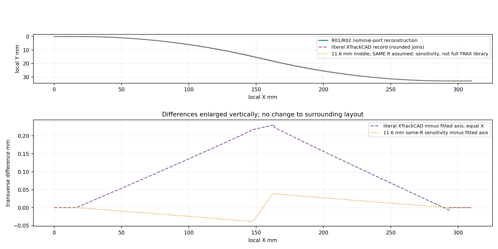
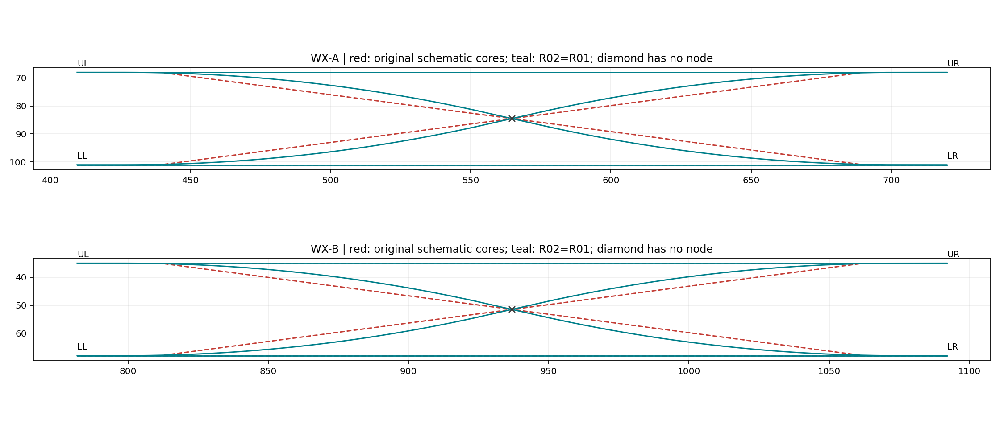
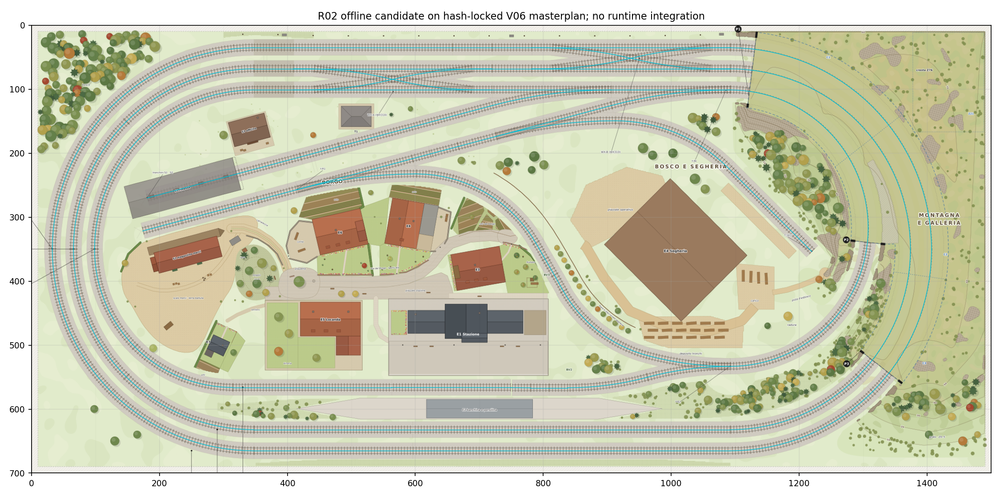

# SERIE N — R0.2: validazione autonoma e consolidamento WX310

13 novembre 2026, Europe/Rome. Branch `codex/scenario-v06-r02-wx-validation`, derivato **esattamente** dalla baseline R0.1 `65ec1675510700fef503c16af2cfbe725817568a`, [Draft #12](https://github.com/epivic-lab/SerieN/pull/12). Microfase autorizzata: soltanto R0.2. Nessun altro agente coinvolto.

## 1. Decisione e risultato

**PASS delle verifiche geometriche/offline R0.2. Raccomandazione: CONDITIONAL GO alla successiva R1, subordinato al Quality Gate e al mandato separato della Regia.** Non è autorizzazione alla circolazione, al caricamento della visuale o al rilascio.

Si conserva integralmente la ricostruzione R0.1: **R = 583,184 mm**, rettifilo centrale **17,924429 mm**, due archi opposti e due brevi rettifili alle bocche. Non è emersa una sostituzione dimostrabilmente più fedele al componente fisico. Copiare il record XTrackCAD alla lettera introdurrebbe discontinuità numeriche e piccole asimmetrie; sostituire il solo rettifilo con il valore TRAX non sarebbe una verifica del suo profilo completo.

Il mandato R0.2 ammette esplicitamente la differenza locale rispetto ai nuclei rettilinei V06. **Il precedente impedimento alla proposta della forma WX è quindi risolto per questo candidato**, con scarto, assunzioni e piano visuale dichiarati. Non si afferma che il produttore abbia certificato questa geometria, né che le rette del master siano state dimostrate storicamente come corde intenzionali.

Il [dataset R02](candidate/R02/track.json) è separato e versionato. Tutti i **79 record pezzo**, 74 nodi, sette controller, porte/stati, tre gap corretti e tre terminali sono uguali a R0.1; cambiano solo metadati superiori di versione/validazione. **Nessuna modifica geometrica**, neppure locale, è risultata necessaria. [Consolidatore](../../../tools/scenario-v06/consolidate-r02.py) e [validatore](../../../tools/scenario-v06/validate-r02.py) hanno il percorso repository effettivo `tools/scenario-v06/`.

## 2. Baseline, concorrenza e provenienza

Letti `AGENTS.md`, `PROGRESS.md`, audit M01 con addendum prevalente, contratto R0 e rapporto R01. Checkout iniziale `work`, HEAD `f33377c3460ddf99bc5f5303f3fe0aa2a3da7fc1`, working tree pulito, un solo worktree locale. Nessun altro processo di modifica del repository osservato; ciò non esclude lavori esterni non pubblicati. Controllate le PR aperte: #10/#11/#12 sono la catena documentale V06; #7 è una consegna release distinta. `git ls-remote --heads` e metadati PR #12 confermano la baseline richiesta. Il fetch standard era limitato a main: effettuato fetch esplicito del branch R01 prima di creare il nuovo branch, senza cambiare altri branch.

Riacquisiti raw e verificati con SHA-256: `railway_alignment.json`, master SVG, `object_inventory.json`, `scene_manifest.json`. I loro byte coincidono con i lock precedenti. Tutti i 615 vertici originali e gli intervalli nascosti sono nuovamente confrontati con `source-axes.json`; le misure sul master sono estratte dal suo XML originale, non soltanto riusate dal rapporto precedente. [Lock e riferimenti](evidence/R02/source-facts.json).

Restano documentati i mismatch storici del manifest e dell'EXPORT_REPORT e l'assenza di certificazione nativa AS-BUILT. Il lock detached identifica questa specifica revisione candidata; non ripara o riscrive il manifest del produttore. Il PDF/manuale non sono riscaricati: sequenze/mapping funzionali provengono dall'evidenza R0 congelata.

## 3. Confronto delle fonti

| Fonte | Confermato dalla fonte acquisita | Limite |
| --- | --- | --- |
| [Kato, articolo 20-210](https://www.unitrack-kato.com/line-up-pocket-line-en-3) | Denominazione e lunghezza nominale **310 mm** del doppio crossover | La pagina non fornisce profilo analitico, raggio o quote delle lame |
| [Kato, standard doppio binario](https://unitrack.katomodels.com/products/line_single/double_track_line) | Interasse standard Unitrack **33 mm** | Non è una tolleranza di fabbricazione del singolo WX |
| [XTrackCAD, revisione immutabile](https://github.com/ankon/xtrkcad/blob/236f93e4a0b35429dfae2d292ef4407b462f1f01/app/lib/params/N-Kato%20Track%20and%20Structures.xtp) | Porte circa 310×33; raggio **22,960 in = 583,184 mm**; segmento centrale `(0,688; 0,157) in`, lungo **17,924429 mm**; due assetti funzionali | Libreria CAD secondaria, giunti arrotondati e profilo leggermente asimmetrico |
| [TRAX3D, costruzione dei pezzi](https://trax3d.com/documentation/opbouw-van-railstukken) e [indice librerie](https://trax3d.com/documentation/railbibliotheken) | Modello con arco–retta–controarco centrato; rettifilo del 20-210 indicato circa **11,6 mm** | Non recuperati i valori numerici completi di raggio e angolo della libreria; non si presume uguaglianza a XTrackCAD |
| Master V06 / alignment | Porte effettive e nuclei originali a circa 7,50004°; forma schematica misurabile | Non descrivono un percorso deviato completo con tangenti orizzontali alle porte |

Il file XTrackCAD completo, nuovamente acquisito al commit pin, ha SHA `7724f7ae4c246bbaf7f84f910e51a99a2758c9484f2ecd4088e558aecd9fe25d`. Il record estratto coincide esattamente con l'estratto R01; SHA LF `ba02f04b85239595f77ac71977be43cff045b98fa57f1b74003622aecff02194`.

**Confronto numerico letterale XTrackCAD.** Interpretate le primitive senza correzioni con `x=cx+|r|sin(a)`, `y=cy+|r|cos(a)` e verso del percorso esplicito. Porte nominali 309,9999896×32,9999848 mm; archi 12,874–12,880° e rettifili terminali circa 16 mm. Nei cinque tratti concatenati di ciascuna diagonale, i residui massimi sono:

| Diagonale catalogo sinistra→destra | Gap interno massimo | Disallineamento tangenti massimo |
| --- | ---: | ---: |
| Superiore→inferiore | 0,007731 mm | 0,145° |
| Inferiore→superiore | 0,007678 mm | 0,147° |

Sono misure dei numeri pubblicati, non difetti dimostrati dell'oggetto fisico. Il candidato risolve esattamente posizione e tangente invece di assumere connessi quei punti arrotondati.

**TRAX: confronto limitato ma quantitativo.** Il valore centrale differisce di **6,324429 mm** da XTrackCAD. Il singolo dato arrotondato non determina univocamente raggio e angolo. Per misurarne la sensibilità, mantenendo **per ipotesi** R=583,184 e le porte V06, `c=11,6` darebbe θ=13,106493°/13,106285°, lead=17,170304/17,172359 mm e una differenza trasversale massima di circa **0,038470 mm** dal candidato a uguale X. Questo esperimento non ricostruisce né certifica il profilo completo TRAX: raggio/angolo restano non acquisiti. Accesso HTTP diretto negato dal proxy; la pagina è stata letta tramite ricerca web, il tentativo di record JSON non è risultato accessibile. Non si inventano parametri mancanti.

## 4. Ricostruzione scelta e accuratezza

Con larghezza `W` e interasse `D` delle porte V06, mantenuti R e c del record secondario, si risolvono:

`D = 2R(1−cos θ) + c sin θ`

`lead = [W − 2R sin θ − c cos θ]/2`.

Il nuovo validatore usa la soluzione analitica chiusa, mentre R01 era generata per bisezione. Verifica il luogo di ogni punto con una funzione indipendente `y(x)`, centri/raggi, lunghezze, vettori tangenti e giunti delle primitive; non importa alcun builder.

| Unità | W / D mm | θ | Lead mm | Lunghezza analitica X mm | Lunghezza polilinea X mm |
| --- | --- | ---: | ---: | ---: | ---: |
| WX-A | 310,126 / 33,014 | 12,812013573° | 17,001141 | 312,740383948 | 312,740375972 |
| WX-B | 310,126 / 33,013 | 12,811806071° | 17,003194 | 312,740264387 | 312,740256411 |

Le porte differiscono dal nominale di **+0,126 mm** longitudinali e **+0,014/+0,013 mm** trasversali. Non si spostano per inseguire il catalogo, né si deforma il tracciato circostante. Queste differenze sono dati di posa del candidato, non tolleranze ufficiali Kato.

**Accuratezza confermata:** dimensioni nominali ufficiali; byte e coordinate delle fonti; continuità del modello, tangenti, raggio e misure del candidato. **Modello CAD verificato:** adattamento continuo della fonte secondaria, non copia letterale. **Assunzioni aperte:** profilo fisico esatto, completa parametrizzazione TRAX, lame/cinematica e sagome degli asset. Il fatto che due parametrizzazioni possano avere porte uguali non prova che abbiano lo stesso luogo interno.

## 5. Misure originali e scarti finali

Il master conserva 152 tracce grafiche di rotaia, accoppiate in 76 riferimenti d'asse; trasformazione `(paper−[20,30])/0,3733`. Precisione grafica 0,01 mm carta, circa 0,02679 mm plastico. Le quattro coppie WX sono identificate contro gli estremi noti dei nuclei, non usate per inferire connessioni.

| Pezzo | Estremi nucleo originale→SVG max mm | Asse analitico→nucleo, max nel dominio X comune mm | XTrackCAD registrato sulle porte→candidato, Hausdorff campionata mm |
| --- | ---: | ---: | ---: |
| 12 | 0,008654 | **3,334762** | 0,224646 |
| 13 | 0,007596 | **3,334762** | 0,130516 |
| 16 | 0,005613 | **3,334136** | 0,224614 |
| 17 | 0,005715 | **3,334136** | 0,130485 |

Il massimo R01 **3,334752 mm** era stimato sui punti del candidato. Il confronto analitico fitto, passo X circa 0,01 mm, lo precisa di circa **0,000010 mm**, senza variazioni geometriche. Non è una nuova deviazione o regressione. Gli scarti verso il nucleo non sono Hausdorff globale: il nucleo è incompleto e ha estensione diversa.

Il confronto XTrackCAD usa entrambi i sensi delle distanze punto→segmento con archi catalogo campionati in 1001 punti; registrazione diagonale X/Y da dimensioni nominali alle porte V06, dichiarata e mai adottata nel dataset. È una misura campionata fra modelli, non un bound di fedeltà al pezzo reale. Non si usa il fit per nascondere i piccoli gap originali del catalogo, misurati separatamente.

**R01→R02: scarto esattamente zero su tutti i 79 assi e su tutte le primitive.** Le alternative che conservavano i nuclei con raccordi corti restano scartate: R01 ha misurato raggio minimo circa 64,3 mm e uscita dal corridoio; l'aggiunta di sole connessioni non le rende valide.

## 6. Porte, stati, continuità e interferenze

| Unità | UL | UR | LL | LR |
| --- | --- | --- | --- | --- |
| WX-A | 409,659;68,018 | 719,785;68,018 | 409,659;101,032 | 719,785;101,032 |
| WX-B | 781,810;35,005 | 1091,936;35,005 | 781,810;68,018 | 1091,936;68,018 |

Ogni unità conserva quattro percorsi completi: **N:** UL↔UR, LL↔LR; **X:** UL↔LR, LL↔UR. Tutti e quattro sono controllati nei due versi, comprese lunghezza positiva, orientamento S→E originale e tangenti orizzontali alle bocche. Esattamente **64 casi ordinati: 16 ammessi e 48 vietati**, inclusi auto-transiti e collegamenti verticali. Invariata la matrice congelata R0.

Le diagonali sono retta–arco–retta–controarco–retta. Residuo G0 fra primitive **0**; residuo G1 numerico dell'ordine di 10⁻¹⁴ gradi; errore del luogo dei punti inferiore a 10⁻⁹ mm. Campionamento massimo <0,5 mm, bound della freccia di corda **0,000054 mm**, differenza lunghezza analitica/polilinea circa 0,000008 mm. Le lunghezze operative rimangono quelle delle polilinee dichiarate.

Curvatura a tratti `0, +1/R, 0, −1/R, 0` o speculare, `|κ|=0,001714725 mm⁻¹`. **G1, non G2/C2**: salti finiti di curvatura, nessuna clotoide inventata o pretesa di regolarità superiore. Il percorso è monotono in X, quindi senza autoripiegamento/intersezione propria.

Un solo incrocio fra le due diagonali per unità: WX-A `(564,722;84,525)`, WX-B `(936,873;51,5115)`, angoli circa 25,624027°/25,623612°. **Nessun nodo, porta o cambio strada al diamond.** La ricerca delle intersezioni segmentali di ciascuna diagonale contro tutti i percorsi estranei all'unità rileva solo i giunti esterni alle porte e **zero intersezioni inattese**; include casi collineari. Le sovrapposizioni dei lead con le normali nello stesso apparecchio sono intenzionali come alternative di percorso e richiedono una sola rotaia fisica condivisa nella visuale. Il diamond resta un conflitto di occupazione, anche senza nodo.

Gli assi rimangono dentro il rettangolo delle quattro porte: nessun ampliamento longitudinale o trasversale dell'impronta d'asse originale. Gli offset analitici ±4,725 mm restano nel corridoio già occupato dalle normali: WX-A X409,659–719,785/Y63,293–105,757; WX-B X781,810–1091,936/Y30,280–72,743. Raggio interno d'offset **578,459 mm**, Jacobiano minimo **0,991898 > 0**: nessuna cuspide da offset. Il bound comprende i centri delle rotaie; **non certifica il bordo del ballast, i tiranti o una sagoma veicolo completa**. L'ingombro materiale completo richiederà il buffer GLB o una variante fisica quotata, senza usare la sola bbox d'asse come maschera di taglio.

## 7. Regressione ferroviaria e compatibilità preliminare rotabili

Nuova esecuzione del validatore R01 originale sul dataset R02, senza modificare il suo codice o le sue asserzioni: **79 pezzi, 74 nodi, una componente nell'unione degli stati, rango ciclico 6, tre soli terminali**. Sono preservati gli ID, la provenienza dei 79 assi, tutti i nove intervalli nascosti, due WX e cinque semplici/Y. I sei pezzi dei gap non sono rigenerati o ritoccati.

| Controllo | Esito R02 |
| --- | --- |
| G1/G2/G3 | Residuo esatto 0; tangenti campionate entro 0,001°; correzioni identiche a R01 |
| Anelli A/B/C nei due versi | Chiusi esattamente; **3468,164116 / 3260,781635 / 2933,790700 mm** |
| S1, S2, segheria | Continui; **250,101011 / 746,267230 / 569,714881 mm** |
| Terminali | `43.S` N10 e `20.S` N20 con tampone; `51.S` N16 aperto; nessun altro endpoint isolato |
| Raggiungibilità | Testimoni orientati con stati consistenti per N10/N20; N16 tramite inversione/manovra N07 |
| Triangolo | Ciclo geometrico chiuso; **N07.C↔B diretto rifiutato**, due tratte e reciprocità verificate con evento stop–liberazione–commutazione–inversione |
| Transizioni e giunzioni spurie | 64 casi WX + 90 semplici; **128 configurazioni, 17.920 arrivi orientati**, nessuna continuazione multipla |

La capacità S1 resta un limite superiore di **250,101 mm**, non una lunghezza utile o una posizione di arresto. Devono ancora essere fissati margini, sagome limite e composizioni ammesse. Il massimo mismatch ereditato delle corde ai giunti non corretti resta **3,391156°**: geometria poligonale sorgente, non discontinuità C0 né nuova regressione da WX. Non si dichiara l'intera rete analiticamente liscia.

**Rotabili, controllo preliminare:** esaminati i sette tipi nativi `STOCK` in `src/rolling-stock.js`. Per un rettangolo rigido tangente a un arco R583,184, con semilunghezza longitudinale massima `a` e larghezza `b`, il bound esterno `sqrt((R+b/2)²+a²)−R` è massimo per il coach165×17,7: **14,570554 mm**. Due di questi bound rispetto a 33,013 mm lascerebbero **3,871891 mm**. È soltanto uno studio locale circolare conservativo per questa convenzione di posa; non dimostra spazzamento su S, articolazioni, carrelli, ganci o transito simultaneo sulle diagonali. Nel diamond le traiettorie si intersecano: protezione dell'intera unità obbligatoria nelle fasi runtime.

I centri ruota nativi sono ±4,7 mm con battistrada grafico largo 1,1 mm, contro ±4,725 mm dichiarati per le rotaie V06: differenza **0,025 mm**. Una testa ipotizzata larga 0,45 mm darebbe 9 mm fra facce interne, ma tale sezione non è certificata dai metadati. Il master SVG disegna invece centri delle tracce a circa 9 mm (mediana 9,000804): tratto schematico e scartamento interno non vanno confusi. Il renderer legacy usa centri ±4,5 mm e quota superiore 5,95 mm; V06 dichiara quota **8,4 mm**, differenza **2,45 mm**. Serviranno profilo ferroviario esplicito e contatto ruote per asset: non si spostano globalmente o riscalano i rotabili in R02. Kenney/altri asset, flangia, fouling e dinamica **NOT VERIFIED**.

## 8. Ferrovia visuale e parti mobili

Riacquisiti e hashati i metadati originali. Inventario game: sette oggetti ferroviari aggregati, **970.193 triangoli**, senza mappa per WX o parti mobili. `RAIL_rails` contiene corsa/controrotaie/ali/aghi; `RAIL_throw_bars` aggrega tiranti anche di altri scambi. `masterplan_ref` non identifica componenti. Il manifest dichiara otto nodi, sette mesh, quota rotaia 8,4 mm e GLB da 40.139.988 byte. [Estratto verificato dei metadati](evidence/R02/visual-metadata.json).

**Binario GLB NOT VERIFIED:** ottenuto il riferimento raw autenticato; il trasferimento Sediment rifiuta oltre 32 MiB, il prelievo dal riferimento autenticato è negato dal proxy (403). Nessun checksum del buffer, triangolo, trasformazione effettiva o contenuto di lama viene attestato verificato. Le geometrie dichiarate nei metadati suggeriscono diagonali originali schematiche, ma non si asserisce di averle osservate nei triangoli.

Piano preferito: **successiva variante ferroviaria dedicata e versionata**, che conserva gli originali e sostituisce soltanto i due WX con una generazione procedurale dagli stessi assi/primitive R02. Prima va separata l'intera geometria originale di ogni WX, compresi lead, aghi, frog, controrotaie/ali, traverse/piastre, tiranti e ballast locale, dagli aggregati `RAIL_rails`, `RAIL_sleepers`, `RAIL_base_plates`, `RAIL_throw_bars`, `RAIL_ballast_open`.

Non basta nascondere il nodo globale o cancellare triangoli in base al loro centro dentro una bbox. Occorrono ID di provenienza oppure mapping binario di componenti/triangoli, taglio e ricucitura alle quattro sezioni di porta, assegnazione esclusiva di ogni triangolo e QC del perimetro fisico. Ogni superficie resta **una sola volta**, nella porzione conservata o nel dispositivo sostitutivo. Il ballast tunnel dichiarato è fuori dalle finestre WX, da confermare sui byte trasformati prima dell'uso. Tiranti o altre superfici che attraversano il limite devono essere identificati esplicitamente. Gli aggregati originali non restano sovrapposti ai sostituti.

Il generatore futuro dovrà costruire **una volta** le rotaie condivise ai lead; quattro estrusioni complete sovrapposte non sono una soluzione. Frog, check rails e interruzioni fisiche delle rotaie nel diamond devono essere modellati: l'intersezione di offset matematici non costituisce una superficie ferroviaria finita corretta.

Se non è verificabile la partizione locale, l'ibrido è bloccato: eventuale alternativa interamente procedurale richiederà mandato separato ed esclusione totale di `railway_visual`. Non si nascondono le sette mesh per sostituire soltanto i WX, perdendo il resto della ferrovia.

Quattro gruppi mobili funzionali UL/UR/LL/LR per unità, con destinazioni N/X della matrice operativa. Geometria della punta, lama, corsa e cinematica **non si deducono dall'inizio degli archi**. Occorrono due assetti espliciti coerenti e mappa di attuazione; gli intermedi grafici non concedono transito. Un comando proposto accoppiato guida gruppi e tiranti; la conferma fisica/polarità resta requisito della futura fase. Le parti statiche dello scambio originale devono essere rimosse anche se la futura lama si anima. Guard, occupazione e crossing conflict rimangono autorità del motore.

Il [contratto visuale](candidate/R02/visual-contract.json) specifica proprietari, seam, profilo, stati e prove future. **In R02 nessun GLB originale, variante GLB o renderer è stato modificato.**

## 9. Test ed evidenze

| Verifica eseguita | Risultato |
| --- | --- |
| Baseline e finale Node | **PASS 254/254**, zero fail/cancelled/skipped |
| Baseline e finale JMRI | **PASS 9/9** |
| Baseline e finale build | **PASS**, bundle legacy SHA-256 `1ac2022b781311ca3fcc03e6373a55fc56c45eabd714c56694e7107d12352378` invariato |
| R02 riproducibile | Seconda generazione e confronto byte; regressione integrale di tutti i record R01 |
| Primitive e fonti | Luogo analitico indipendente, G0/G1/raggi/campioni; file XTP pin, alignment e SVG hashati |
| Regressione R01 originale | Continuità, matrici, raggiungibilità, manovra, giunti, hidden e lunghezze PASS |
| Test negativi originali | **6/6 rifiutati**: gap G2, nodo diamond, stato WX, pezzo nascosto omesso, pezzo protetto spostato, riferimento nodo errato |
| Nuovi test negativi | **3/3 rifiutati**: punto interno fuori asse analitico, centro arco errato, sweep errato |
| Interferenze di asse | Zero intersezioni estranee inattese; un diamond per unità senza nodo |
| Confronti visuali | Tre figure statiche nuove esaminate: WX, CAD con differenze, overlay sul master originale |
| Invarianti e sicurezza | Scope limitato a documenti/dataset/script offline; sorgenti, asset, test e workflow preesistenti invariati; nessun segreto o URL firmato nelle evidenze |
| Circolazione runtime V06 / browser V06 / prestazioni | **NOT VERIFIED**, dataset non attivato; le figure non sono screenshot del simulatore |

[Indice prove e riproduzione](evidence/R02/README.md), [metrologia](evidence/R02/metrology.json), [regressione/matrici](evidence/R02/regression/verification.json), [ricevuta scope e controlli](evidence/R02/checks-summary.json). Il checker R01 conserva la dicitura storica `PHYSICAL_WX_FIDELITY_OPEN`: indica correttamente che non certifica la geometria manifatturiera; la decisione R02 è distinta e documentata qui. Nessuna asserzione storica è stata indebolita per ottenere PASS.

## 10. Rischi bloccanti e Quality Gate R1

**Nessun difetto geometrico WX dimostrato rimasto bloccante per consegnare il candidato offline.** L'eccezione locale consente di proporre il profilo verificato senza certificazione manifatturiera. La libreria TRAX completa non acquisita è un limite della comparazione, non prova contraria al candidato né motivo per inventarne una variante.

| Gate / rischio effettivo | Quando blocca | Condizione di chiusura proposta |
| --- | --- | --- |
| Accettazione del candidato e revisione di riferimento | **Prima di iniziare R1** | Regia accetta R02 e la sua eccezione WX; congela digest/fonti e assume le limitazioni documentate di provenienza, senza definirle certificazione AS-BUILT |
| Perdita di invarianti nel futuro adapter | Prima di accettare R1 | 79 pezzi/74 nodi/sette comandi/tre terminali verificati, regole di unit e 64 casi invariati, circuiti e manovre nei due versi; legacy selezionabile e testato |
| GLB aggregato e visuale duplicata/incoerente | **Prima di utilizzare la visuale V06**, non blocca questo laboratorio geometrico | Lettura binaria/hash, mapping e proprietà esclusive, seam, gauge/contatto ruote, parti mobili N/X e rollback dimostrati |
| Capacità/anchor/stop e conflitti WX | **Prima di circolazione effettiva o attivazione** | Confini protetti, unit libera prima della commutazione, occupazione front/tail e collisioni fra le diagonali, arresti fail-closed N16 e terminali, capacità N07 per composizione e inversioni provati nel motore |
| Parametri fisici esatti non acquisiti | Blocca una pretesa di replica manifatturiera certificata | Documentazione quotata o misura fisica; non necessaria per accettare consapevolmente questo modello CAD candidato |

Proposta di Quality Gate: accettare la soluzione WX e la continuità qui dimostrate, congelare R02 come input separato alla sola microfase R1 di dataset/validatore/adattamento autorizzato, conservare i requisiti visuali e di sicurezza per i rispettivi gate successivi. R1 dovrà confrontare il router effettivo con le matrici e rifiutare transiti vietati, giunzioni spurie e profili non validati; non può dedurre il proprio PASS di circolazione dalla sola suite offline.

**CONDITIONAL GO, in attesa del Quality Gate Regia.** La consegna è un commit atomico e checkpoint remoto sul solo branch dedicato, PR Draft collegata alla #12. SHA e URL effettivi nella ricevuta di consegna dopo verifica remota. Nessun Railway Core, UI/HUD, backend, dataset legacy, originale scenografico o workflow modificato; nessun merge/deploy. **STOP al termine R0.2: R1 non iniziata.**
