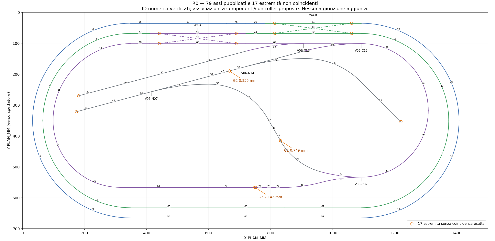

# SERIE N — R0: contratto ferroviario AS-BUILT V06

Data di verifica: **13 novembre 2026 (UTC)**. Mandato: sola R0, successiva all'accettazione dell'audit M0.1-R. Base documentale e Git: `ffba29fd40dcda874124ca4d8f6b8b169d7b2298`; branch dedicato `codex/scenario-v06-r0-contract`.

**Esito: analisi R0 consegnata con copertura 79/79 pezzi e classificazione 17/17 estremità; contratto operativo ancora NON CERTIFICABILE. NO-GO R1 con le fonti attualmente disponibili.** Le matrici seguenti sono una proposta da verificare alla fonte, non un dataset attivabile nel simulatore. Non sono stati creati collegamenti per vicinanza, prolunghe WX o correzioni alle coordinate. Nessuna implementazione, merge o deploy.

È stato letto integralmente [M01_AUDIT_REPORT.md](M01_AUDIT_REPORT.md), in particolare l'addendum §15, che prevale sulla precedente prescrizione di conservare la geometria legacy. V06 deve sostituire sia geometria visuale sia rete operativa; restano da preservare gli algoritmi e le regole del simulatore. Il rapporto M01 è conservato byte per byte, SHA-256 `e32d7a4d7113e7b6b29a359d9ea2e2581d69f669daeed8a228f1f70830ee0980`.

## 1. Criteri di evidenza e perimetro

- **V — verificato:** contenuto esplicito di una fonte identificata, byte/hash ricevuti oppure misura ripetibile sui dati pubblicati. Una coincidenza numerica verifica coordinate, non la liceità ferroviaria di una transizione.
- **D — dedotto/proposto:** associazione ricostruita da ordine di montaggio, tipo, posizione e continuità; richiede conferma del progettista. Le connessioni proposte, anche quando plausibili, non sono certificate.
- **M — mancante/non verificato:** informazione non presente o non decodificata nelle fonti accessibili. Non equivale a inesistenza nel progetto originale.

R0 comprende lettura delle fonti e produzione di documentazione, CSV, tabelle JSON di evidenza e un diagramma diagnostico. Il piccolo script di audit in `evidence/R0/` legge gli assi e produce queste evidenze: non genera dati per il runtime, non è importato dall'applicazione, non modifica il masterplan e non avvia R1. Le verifiche applicative sono regressioni della baseline legacy, non prove funzionali V06.

## 2. Fonti riesaminate e recupero sorgenti

Sono stati recuperati nuovamente i byte delle 13 fonti seguenti e calcolati i loro hash. Il [lock as-received](evidence/R0/source-lock-as-received.json) conserva URL/ID Drive, dimensioni, timestamp disponibili e SHA-256 completi, separando quanto osservato da quanto dichiara il manifest. Non è un nuovo manifest di produzione.

| Fonte (alias locale) | Byte ricevuti | SHA-256 ricevuto | Uso e limite |
| --- | ---: | --- | --- |
| [railway_alignment.json](https://drive.google.com/file/d/14Hb5zkGRUZaQMSbqGTCEVdAQe5hEW7DP/view) | 85535 | `6a494928707609f1cf6aa9b535a510ca721b9a3458eca0910dfc250c978f46ea` | 79 assi, 615 vertici, cinque coppie semplici, due WX e metadati visuali; nessuna tabella completa di giunzioni operative. |
| [scene_manifest.json](https://drive.google.com/file/d/1wjpWfFwvorgs8H4LcJrJ1EiwEV0kzHe4/view) | 14262 | `234d93ac089d1c23a1c07c9e35160cc1e78608ad27ff0753986e97a77648c6c2` | Revisione corrente: 39 file dichiarati; confronto integrità. |
| [previous_manifest.json](https://drive.google.com/file/d/1Smbjdd8uXbwlWMbUs8lYUUIYrzkCTO4L/view) | 11861 | `f378e1c1c7eae96b8eb9287d2e16843aaa6e53b67de0686e3adc15bec7085f69` | Revisione precedente: 23 file dichiarati; confronto di provenienza. |
| [master.svg](https://drive.google.com/file/d/1zLrS0Lu1AEU5GS2xVim7zui4W5ikEZ-z/view) | 3757460 | `868751dc5d17885161e7ff1a7dac46d556d2af2dee578c787db80a6f5e489022` | Tavola V06 vettoriale, leader delle etichette, posizioni e contesto; non registro di porte. |
| [master.layout](https://drive.google.com/file/d/17by8J6xuo-dLkXpWPTrmwMeNii-iixyA/view) | 87878 | `22b4901a4fa1be323d615f02924083ee803a56a43f749f39a05c9b8533d36fd7` | Originale nativo binario disponibile; schema componenti/porte non decodificato. |
| [master.pdf](https://drive.google.com/file/d/1UyIsIxQAKf2UOdrpdBv4Zu46kkOalLfr/view) | 25021219 | `a02e3b63b0c8b5d3666c39adb6bc28b137c7c8d07d2989b763989c80e803a27e` | Masterplan V06, 4 pagine; riferimenti ai sorgenti e contesto AS-BUILT. |
| [manual.pdf](https://drive.google.com/file/d/1PrOFO5NY1gQG4uNtnqYTrPwbGxR8oZ77/view) | 6136144 | `8d930b0960f3cad57cc1651b6be65269abcab39321ca5f431f461f299cf531d3` | Manuale V3, 20 pagine; sequenze e distinta di 68 elementi. |
| [layout-drawing.pdf](https://drive.google.com/file/d/17mx-0Wc5BE-Blwegco7WvOv7XDE53027/view) | 43432 | `2cca66a03e1c77265c27fe7817ccc4b1abcf457a574cb1a8000c0bb0f0189d5d` | Tavola ferroviaria V3, 1 pagina; confronto schema e tipi. |
| [EXPORT_REPORT.md](https://drive.google.com/file/d/1Kjl3s5rgrXrzZ59CWDhk83Q7SjmF0HyB/view) | 28926 | `68df4c4a97d254ea82d6c3f86df969a47222edc0223a6659041106972376c772` | Dichiarazioni del produttore su export, fonti e limiti visuali. |
| [coordinate_system.json](https://drive.google.com/file/d/15BhqV_p_UMHSPLacZbV9ZOTQC4pLUVzZ/view) | 2167 | `ca0f6913339a3ae70e9ed90dcc8f044f7b6d0e8365f1a39f8b8831c06bbd269b` | PLAN_MM, trasformazioni, base e quota piano del ferro. |
| [object_inventory.json](https://drive.google.com/file/d/1nwaU09WPDZ5HL3fYAkrchkll5LU7ClnH/view) | 118236 | `a89687ee6010ba251e070091765270c038aa3ddcbb37b750126deed2ad315425` | Inventario grafico, non tabella di connessioni/attuazione. |
| [asset_dependencies.json](https://drive.google.com/file/d/1aPZbEPEsHcrlu-izWyfMEwe6Ctwic1W6/view) | 52640 | `3fc347c0c618f0285aa476eab889d7d2b12324e567bde1b3af6af19c516521f0` | Dipendenze della scena, non grafo ferroviario operativo. |
| [validation_report.json](https://drive.google.com/file/d/1nOu_KXw5Zp0lsjsUxkPKWbxrZf8n2kVy/view) | 28912 | `039ff388ea91c1d6bd860dd82f99231b184ab3dbb875bcae9c3f7249bed18582` | QC export; non certifica transizioni o circolazione del simulatore. |

### 2.1 Recuperabilità effettiva

**V:** `railway_alignment.json` dichiara come sorgente `build_data/track_centrelines_mm.json`, SHA-256 `b52b732166db502d4d906a5b471bfe4344f6bfdab632514ffc6775102a800ec7`, e `build_data/roadbed_mm.json`, SHA-256 `7aa208bd5104e5e38669c1e920f20773c1d30ffcbecfc7af91e8485ae9c05552`. Il masterplan cita anche `tracciato.pdf`, `masks_1mm.npz` e `master-plan-v1.json`. Sono riferimenti a file sorgente, non allegati contenuti nell'export.

**V sull'esito della ricerca:** la ricerca Drive per nome esatto di questi cinque file non ha restituito i sorgenti; la ricerca della cartella `build_data` è vuota. La ricerca testuale `track_centrelines` trova riferimenti nel master PDF e nell'EXPORT_REPORT, non il JSON originale. La cartella metadata accessibile contiene i sette JSON dell'export; la ricerca locale non trova i sorgenti citati. Query e perimetro sono in [source-recovery-search.json](evidence/R0/source-recovery-search.json). Non si dichiara una ricerca universale su account o progetti non accessibili.

**V:** il `.layout` nativo è stato acquisito integralmente (87.878 byte; prefisso `576b53740000000f772dc840001daf81`, firma testuale `WkSt`). Non è XML, ZIP o plist leggibile con i controlli eseguiti; scansione limitata senza stream zlib validi o firme gzip/BZh. **M:** nessun decoder supportato/applicazione autrice è stato utilizzato: componenti, porte e giunzioni non sono stati estratti. Non si attribuisce un significato certo ai campi binari, né si afferma che siano cifrati.

PDF master e tavola non hanno allegati incorporati; il manuale contiene soltanto `Content Credentials`, non un contratto topologico. Lo SVG è grafica appiattita: non espone un registro semantico di componenti/porte/giunti. Le mesh della cartella Rail non vengono promosse a fonte topologica. **M:** i sorgenti completi rimangono da richiedere a Claude/progetto autore, o da esportare con l'applicazione nativa competente. Non sono stati inviati messaggi esterni.

### 2.2 Provenienza delle revisioni e checksum

**V:** il manifest corrente dichiara package `SERIE_N_V3_SCENARIO_V06_V1`, data letterale `2026-11-12 12:01:06`; il precedente `2026-11-12 10:30:41`. Non è dichiarato il fuso di questi campi. Le date Drive sono UTC e non vanno equiparate automaticamente. I PDF/SVG V06 su Drive risultano modificati il 13/11, il `.layout` e il manuale il 09/11: un titolo V06 o una data di upload non certifica una catena di derivazione comune.

Il confronto dei manifest dà **16 aggiunte, nessuna rimozione, 10 file cambiati e 13 identici**. Cambiano sei moduli game (sawmill, scenery_details, village_buildings, technical_reference, railway_service_buildings, station_platform), due moduli source-resolution (sawmill e village_buildings), full_scene e object_inventory. I digest dichiarati di alignment, coordinate e railway_visual restano identici. Questa osservazione confronta dichiarazioni dei manifest; i GLB non sono stati nuovamente scaricati né verificati byte per byte in R0. Il digest dichiarato del `.blend` sorgente è `990c572703f8a1475b5d7066923e4314df38874aaffae5eb4a3bdc617d1ed34a`; il `.blend` non è stato verificato.

| File | SHA dichiarato dal manifest | SHA dei byte ricevuti | Esito |
| --- | --- | --- | --- |
| scene_manifest.json | `8a3c009bc0f72390cba00f231b7626fd7d3191a210678d29ca954cfde8371ff3` | `234d93ac089d1c23a1c07c9e35160cc1e78608ad27ff0753986e97a77648c6c2` | **MISMATCH**, dimensione identica |
| EXPORT_REPORT.md | `102b04f5d712f8f4a9f9fb357c1a829d69fe8d543b5b76dfa5373415b59bd1e1` | `68df4c4a97d254ea82d6c3f86df969a47222edc0223a6659041106972376c772` | **MISMATCH**, dimensione identica |
| previous_manifest e altri cinque JSON metadata acquisiti | Digest completi nel lock | Identici ai digest dichiarati | **PASS** per i sei file verificati |

Per manifest e rapporto la cronologia Drive accessibile espone una sola revisione ciascuno, `previousRevisionId = null`. ID revisione, data e dimensione sono registrati senza dati personali in [revision-reconciliation.json](evidence/R0/revision-reconciliation.json). **M:** non è recuperabile da questa cronologia una revisione precedente che spieghi i due mismatch. Un problema d'ordine di generazione/autohash è un'ipotesi, non una causa accertata.

**Decisione richiesta:** il produttore deve riconciliare le due voci e consegnare un lock immutabile con relazione esplicita PDF/SVG/.layout/manuale/assi/export. Non sostituire arbitrariamente gli hash attesi con quelli ricevuti e non risalvare il manifest originale. Fino ad allora il lock R0 prova cosa è stato esaminato, non certifica la revisione AS-BUILT approvata.

## 3. Contratto geometrico osservato e modello topologico proposto

**V:** 79 pezzi indicizzati 0–78, 615 vertici, 44 rette e 35 poligonali; base nominale 1500×700 mm, quota ferro 8,4 mm. In PLAN_MM X va a destra, Y verso lo spettatore, origine posteriore sinistra. La scala N è già applicata: non moltiplicare/dividere nuovamente per 160. Trasformazione dichiarata e controllata sui punti: `(x,y,z) glTF = (X,8.4,Y)/1000`. Coordinate e lunghezze del rapporto sono in mm del plastico.

**V:** ricontando le estremità con uguaglianza esatta delle coordinate pubblicate si ottengono 85 gruppi: 63 doppi, cinque tripli e 17 singoli. Sono gruppi geometrici, non nodi approvati. Le lunghezze ricalcolate sulle polilinee differiscono dai campi arrotondati di meno di 0,0005 mm per pezzo. Ciò verifica coerenza interna dell'export, non accuratezza rispetto alla sorgente a precisione piena o continuità delle tangenti.

**D:** il modello consigliato usa giunzioni esterne esplicite, componenti fisici e percorsi interni dipendenti dallo stato. Ogni semplice/Y ha tre porte, ogni WX quattro; una croce grafica non è una giunzione. Un percorso completo WX deve raggiungere le bocche esterne: i suoi eventuali sottoelementi geometrici non diventano controller distinti né una quinta porta al diamond. Il numero finale di archi operativi non è fissato al numero 79.

La corrispondenza proposta ricostruisce i **68 elementi del manuale**: 61 assi ordinari (inclusi i due elementi con tampone), dieci percorsi di cinque semplici/Y e otto percorsi dei due WX = 79 pezzi geometrici. Il confronto indipendente del testo della distinta a pagina 19 conferma tipi e codici di tutti i 68 elementi. **D:** l'associazione fra quei codici C/N/B/A e gli indici geometrici è ricostruita qui; la distinta non la certifica.



Il diagramma mostra le coordinate ricevute, senza saldature o prolungamenti. Colori e nomi dei componenti/controller seguono la proposta, non una certificazione dell'autore.

## 4. Matrice esaustiva dei 79 pezzi

**V per tutte le righe:** ID numerico, punti S/E, lunghezza dichiarata e coincidenze dei punti. **D per tutte le righe:** componente fisico, ruolo, controller e liceità del collegamento. S/E sono i versi del file, non il senso di marcia. `NONE` indica nessuna estremità esattamente coincidente. Due riferimenti nella stessa cella individuano un gruppo triplo: non autorizzano un passaggio ramo→ramo.

La [matrice CSV](evidence/R0/piece-matrix.csv) conserva anche codice Kato, tipo geometrico, gruppi J*, intervalli nascosti e note; [component-mapping.json](evidence/R0/component-mapping.json) esplicita i raggruppamenti fisici, tutti marcati come dedotti. G1–G3 sono analizzati in §5. La parte WX X rappresenta soltanto la diagonale pubblicata, non il percorso completo.

| Pezzo | Componente proposto / tipo | L mm | S (X,Y) → E (X,Y) verificati | Estremità coincidenti S / E | Ruolo proposto o eccezione |
| ---: | --- | ---: | --- | --- | --- |
| 0 | B05 · R282-45 | 221.522 | (1374.051, 350.133) → (1291.422, 549.619) | 19.E / 1.S | tratto ordinario |
| 1 | B04 · R282-45 | 221.522 | (1291.422, 549.619) → (1091.936, 632.248) | 0.E / 67.S | tratto ordinario |
| 2 | B14 · R282-45 | 221.521 | (347.633, 632.248) → (148.148, 549.619) | 65.S / 3.S | tratto ordinario |
| 3 | B13 · R282-45 | 221.522 | (148.148, 549.619) → (65.519, 350.133) | 2.E / 4.S | tratto ordinario |
| 4 | B12 · R282-45 | 221.522 | (65.519, 350.133) → (148.148, 150.648) | 3.E / 5.S | tratto ordinario |
| 5 | B11 · R282-45 | 221.522 | (148.148, 150.648) → (347.633, 68.018) | 4.E / 77.E | tratto ordinario |
| 6 | A12 · R315-45 | 247.444 | (124.804, 127.304) → (347.633, 35.005) | 7.E / 55.E | tratto ordinario |
| 7 | A13 · R315-45 | 247.444 | (32.505, 350.133) → (124.804, 127.304) | 8.E / 6.S | tratto ordinario |
| 8 | A14 · R315-45 | 247.445 | (124.804, 572.963) → (32.505, 350.133) | 9.E / 7.S | tratto ordinario |
| 9 | A15 · R315-45 | 247.444 | (347.633, 665.262) → (124.804, 572.963) | 56.S / 8.S | tratto ordinario |
| 10 | A05 · R315-45 | 247.445 | (1407.065, 350.133) → (1314.766, 572.963) | 23.E / 11.S | tratto ordinario |
| 11 | A04 · R315-45 | 247.445 | (1314.766, 572.963) → (1091.936, 665.262) | 10.E / 58.E | tratto ordinario |
| 12 | C14 · WX310 | 250.102 | (688.703, 100.848) → (440.741, 68.203) | NONE / NONE | WX-A:X:UL-LR; WX-A missing full lead/port route geometry; WX-A missing full lead/port route geometry |
| 13 | C14 · WX310 | 250.102 | (688.703, 68.203) → (440.741, 100.848) | NONE / NONE | WX-A:X:LL-UR; WX-A missing full lead/port route geometry; WX-A missing full lead/port route geometry |
| 14 | C16 · R249-45 | 195.599 | (171.492, 173.992) → (347.633, 101.032) | 15.E / 78.E | tratto ordinario |
| 15 | C17 · R249-45 | 195.599 | (98.532, 350.133) → (171.492, 173.992) | 24.E / 14.S | tratto ordinario |
| 16 | B08 · WX310 | 250.103 | (1060.855, 67.834) → (812.892, 35.189) | NONE / NONE | WX-B:X:UL-LR; WX-B missing full lead/port route geometry; WX-B missing full lead/port route geometry |
| 17 | B08 · WX310 | 250.103 | (1060.855, 35.189) → (812.892, 67.834) | NONE / NONE | WX-B:X:LL-UR; WX-B missing full lead/port route geometry; WX-B missing full lead/port route geometry |
| 18 | B07 · R282-45 | 221.523 | (1091.936, 68.018) → (1291.422, 150.648) | 62.S / 19.S | tratto ordinario |
| 19 | B06 · R282-45 | 221.521 | (1291.422, 150.648) → (1374.051, 350.133) | 18.E / 0.S | tratto ordinario |
| 20 | N20 · TAMPONE | 62.025 | (180.747, 269.987) → (240.659, 253.934) | NONE / 54.E | N20 BUFFER_IN_MANUAL_P10 |
| 21 | N18 · S62F | 62.026 | (480.306, 189.720) → (420.394, 205.774) | 45.S / 54.S | tratto ordinario |
| 22 | A07 · R315-45 | 247.445 | (1091.936, 35.005) → (1314.766, 127.304) | 61.S / 23.S | tratto ordinario |
| 23 | A06 · R315-45 | 247.444 | (1314.766, 127.304) → (1407.065, 350.133) | 22.E / 10.S | tratto ordinario |
| 24 | C18 · R216-45 | 169.677 | (161.823, 502.931) → (98.532, 350.133) | 25.E / 15.S | tratto ordinario |
| 25 | C19 · R216-45 | 169.676 | (314.620, 566.221) → (161.823, 502.931) | 64.S / 24.S | tratto ordinario |
| 26 | C09 · R216-45 | 169.676 | (1308.024, 317.120) → (1244.734, 469.917) | 28.E / 37.S | tratto ordinario |
| 27 | N01 · R216-45 | 169.676 | (962.474, 516.164) → (831.264, 415.483) | 34.E / NONE | G1 N01 -> N02 |
| 28 | C10 · R216-45 | 169.676 | (1244.734, 164.323) → (1308.024, 317.120) | 29.E / 26.S | tratto ordinario |
| 29 | C11 · R216-45 | 169.677 | (1091.936, 101.032) → (1244.734, 164.323) | 30.E 68.S / 28.S | tratto ordinario |
| 30 | C12 · #6 SX | 188.039 | (906.029, 125.507) → (1091.936, 101.032) | 41.S / 29.S 68.S | V06-C12:S1 |
| 31 | N07 · #6 DX | 186.076 | (595.148, 208.612) → (415.412, 256.772) | 39.E / 32.S 53.E | V06-N07:S0 |
| 32 | N07 · #6 DX | 188.040 | (415.412, 256.772) → (601.320, 232.297) | 31.E 53.E / 50.S | V06-N07:S1 |
| 33 | C13 · #6 SX | 188.040 | (719.953, 125.507) → (905.861, 101.032) | 45.E / 68.E 69.S | V06-C13:S1 |
| 34 | C07 · Y | 130.947 | (1091.936, 533.208) → (962.474, 516.164) | 35.E 37.E / 27.S | V06-C07:S1 |
| 35 | C07 · Y | 130.947 | (962.474, 550.252) → (1091.936, 533.208) | 36.S / 34.S 37.E | V06-C07:S0 |
| 36 | C06 · R481-15 | 125.970 | (962.474, 550.252) → (837.932, 566.648) | 35.S / 72.S | tratto ordinario |
| 37 | C08 · R216-45 | 169.677 | (1244.734, 469.917) → (1091.936, 533.208) | 26.E / 34.S 35.E | tratto ordinario |
| 38 | N13 · S62 | 62.024 | (666.382, 189.720) → (726.293, 173.667) | NONE / 41.E 42.S | G2 N12 -> N13 |
| 39 | N11 · S29 | 29.012 | (623.171, 201.103) → (595.148, 208.612) | 40.E / 31.S | tratto ordinario |
| 40 | N12 · S45.5 | 45.519 | (667.139, 189.322) → (623.171, 201.103) | NONE / 39.S | G2 N12 -> N13 |
| 41 | N14 · #6 DX | 186.076 | (906.029, 125.507) → (726.293, 173.667) | 30.S / 38.E 42.S | V06-N14:S0 |
| 42 | N14 · #6 DX | 188.040 | (726.293, 173.667) → (912.201, 149.192) | 38.E 41.E / 49.S | V06-N14:S1 |
| 43 | N10 · TAMPONE | 62.024 | (173.833, 321.503) → (233.744, 305.450) | NONE / 44.E | N10 BUFFER_IN_MANUAL_P8 |
| 44 | N09 · S124 | 124.051 | (353.568, 273.344) → (233.744, 305.450) | 53.S / 43.E | tratto ordinario |
| 45 | N17 · S248 | 248.101 | (480.306, 189.720) → (719.953, 125.507) | 21.S / 33.S | tratto ordinario |
| 46 | N03 · S29 | 29.012 | (817.470, 390.591) → (802.964, 365.466) | 48.E / 47.S | tratto ordinario |
| 47 | N04 · S29 | 29.012 | (802.964, 365.466) → (788.458, 340.341) | 46.E / 52.E | tratto ordinario |
| 48 | N02 · S29 | 29.012 | (831.976, 415.716) → (817.470, 390.591) | NONE / 46.S | G1 N01 -> N02 |
| 49 | N15 · R249-45 | 195.599 | (912.201, 149.192) → (1088.342, 222.152) | 42.E / 51.E | tratto ordinario |
| 50 | N06 · R216-15 | 56.562 | (601.320, 232.297) → (657.248, 239.660) | 32.E / 52.S | tratto ordinario |
| 51 | N16 · S186 | 186.076 | (1219.918, 353.727) → (1088.342, 222.152) | NONE / 49.E | N16 OPEN_END_WITHOUT_BUFFER_IN_MANUAL_P9_EXPORT_BUFFER_CONFLICT |
| 52 | N05 · R216-45 | 169.676 | (657.248, 239.660) → (788.458, 340.341) | 50.E / 47.E | tratto ordinario |
| 53 | N08 · S64 | 64.026 | (353.568, 273.344) → (415.412, 256.772) | 44.S / 31.E 32.S | tratto ordinario |
| 54 | N19 · S186 | 186.075 | (420.394, 205.774) → (240.659, 253.934) | 21.E / 20.E | tratto ordinario |
| 55 | A11 · S62F | 62.026 | (409.659, 35.005) → (347.633, 35.005) | 57.E / 6.E | tratto ordinario |
| 56 | A01 · S248 | 248.101 | (347.633, 665.262) → (595.734, 665.262) | 9.S / 63.S | tratto ordinario |
| 57 | A10 · S248 | 248.101 | (657.760, 35.005) → (409.659, 35.005) | 75.E / 55.S | tratto ordinario |
| 58 | A03 · S248 | 248.101 | (843.835, 665.262) → (1091.936, 665.262) | 63.E / 11.E | tratto ordinario |
| 59 | C14 · WX310 | 310.126 | (719.785, 68.018) → (409.659, 68.018) | 74.E / 77.S | WX-A:N:UL-UR |
| 60 | C14 · WX310 | 310.126 | (719.785, 101.032) → (409.659, 101.032) | 69.E / 78.S | WX-A:N:LL-LR |
| 61 | B08 · WX310 | 310.126 | (1091.936, 35.005) → (781.810, 35.005) | 22.S / 76.S | WX-B:N:UL-UR |
| 62 | B08 · WX310 | 310.126 | (1091.936, 68.018) → (781.810, 68.018) | 18.S / 74.S | WX-B:N:LL-LR |
| 63 | A02 · S248 | 248.101 | (595.734, 665.262) → (843.835, 665.262) | 56.E / 58.S | tratto ordinario |
| 64 | C01 · S248 | 248.101 | (314.620, 566.221) → (562.721, 566.221) | 25.S / 70.E | tratto ordinario |
| 65 | B01 · S248 | 248.101 | (347.633, 632.248) → (595.734, 632.248) | 2.S / 66.E | tratto ordinario |
| 66 | B02 · S248 | 248.101 | (843.835, 632.248) → (595.734, 632.248) | 67.E / 65.E | tratto ordinario |
| 67 | B03 · S248 | 248.101 | (1091.936, 632.248) → (843.835, 632.248) | 1.E / 66.S | tratto ordinario |
| 68 | C12 · #6 SX | 186.075 | (1091.936, 101.032) → (905.861, 101.032) | 29.S 30.E / 33.E 69.S | V06-C12:S0 |
| 69 | C13 · #6 SX | 186.076 | (905.861, 101.032) → (719.785, 101.032) | 33.E 68.E / 60.S | V06-C13:S0 |
| 70 | C02 · S186 | 186.076 | (748.797, 566.221) → (562.721, 566.221) | NONE / 64.E | G3 C02 -> C03 |
| 71 | C03 · S29 | 29.012 | (779.908, 566.648) → (750.896, 566.648) | 73.E / NONE | G3 C02 -> C03 |
| 72 | C05 · S29 | 29.012 | (837.932, 566.648) → (808.920, 566.648) | 36.E / 73.S | tratto ordinario |
| 73 | C04 · S29 | 29.012 | (808.920, 566.648) → (779.908, 566.648) | 72.E / 71.S | tratto ordinario |
| 74 | B09 · S62 | 62.025 | (781.810, 68.018) → (719.785, 68.018) | 62.E / 59.S | tratto ordinario |
| 75 | A09 · S62 | 62.025 | (719.785, 35.005) → (657.760, 35.005) | 76.E / 57.S | tratto ordinario |
| 76 | A08 · S62 | 62.025 | (781.810, 35.005) → (719.785, 35.005) | 61.E / 75.S | tratto ordinario |
| 77 | B10 · S62F | 62.026 | (409.659, 68.018) → (347.633, 68.018) | 59.E / 5.E | tratto ordinario |
| 78 | C15 · S62 | 62.026 | (409.659, 101.032) → (347.633, 101.032) | 60.E / 14.E | tratto ordinario |

## 5. Classificazione delle 17 estremità non coincidenti

Tutte le estremità singole sono incluse sotto. **V:** coordinate e assenza di coincidenza esatta. **D:** identità fisica e abbinamenti proposti. Classificare una estremità non equivale a correggerla. Nessuna connessione per nearest-neighbor, snap o soglia di 2,5 mm è stata creata.

| Estremità | Componente D | Punto (X,Y) V | Classificazione / evidenza / esito |
| --- | --- | --- | --- |
| 12.S | C14 | (688.703, 100.848) | WX-A: diagonale interna verso LR; manca raccordo fino alla bocca |
| 12.E | C14 | (440.741, 68.203) | WX-A: diagonale interna verso UL; manca raccordo fino alla bocca |
| 13.S | C14 | (688.703, 68.203) | WX-A: diagonale interna verso UR; manca raccordo fino alla bocca |
| 13.E | C14 | (440.741, 100.848) | WX-A: diagonale interna verso LL; manca raccordo fino alla bocca |
| 16.S | B08 | (1060.855, 67.834) | WX-B: diagonale interna verso LR; manca raccordo fino alla bocca |
| 16.E | B08 | (812.892, 35.189) | WX-B: diagonale interna verso UL; manca raccordo fino alla bocca |
| 17.S | B08 | (1060.855, 35.189) | WX-B: diagonale interna verso UR; manca raccordo fino alla bocca |
| 17.E | B08 | (812.892, 67.834) | WX-B: diagonale interna verso LL; manca raccordo fino alla bocca |
| 20.S | N20 | (180.747, 269.987) | Terminale N20, tampone nel manuale p10; contratto finale da approvare |
| 27.E | N01 | (831.264, 415.483) | G1 con 48.S: intenzione N01→N02, manuale p7; gap 0,749155 mm |
| 38.S | N13 | (666.382, 189.72) | G2 con 40.S: intenzione N12→N13, manuale p8; gap 0,855250 mm |
| 40.S | N12 | (667.139, 189.322) | G2 con 38.S: entrambi gli estremi sono S; orientamento da mantenere |
| 43.S | N10 | (173.833, 321.503) | Terminale N10, tampone nel manuale p8; contratto finale da approvare |
| 48.S | N02 | (831.976, 415.716) | G1 con 27.E: nessuna saldatura eseguita |
| 51.S | N16 | (1219.918, 353.727) | Terminale N16 aperto SENZA tampone nel manuale p9; export in conflitto |
| 70.S | C02 | (748.797, 566.221) | G3 con 71.E: intenzione C02→C03, manuale p3; gap 2,141992 mm |
| 71.E | C03 | (750.896, 566.648) | G3 con 70.S: impedisce la chiusura metrica di C |

Le otto estremità WX sono interne agli hosts: diagonali a due punti lunghe circa 250,102 mm contro hosts da 310,126 mm. Esempio verificato: `12.E = (440.741,68.203)` dista 0,185 mm in Y dalla retta host 59 a Y=68,018, ma non è la bocca UL a X=409,659. Le proiezioni cadono a circa 31,082/279,044 mm lungo gli hosts. L'identità di apparecchio spiega la loro presenza; non recupera la forma dei raccordi, le tangenti o la posizione degli aghi.

Per G1–G3 il manuale fornisce l'intenzione di montaggio, quindi non si tratta di una scelta basata soltanto sulla vicinanza. Tuttavia il mapping è dedotto e la geometria pubblicata rimane discontinua. Serve confronto con porte native e assi originali per distinguere arrotondamento, offset/export oppure errore reale. Le distanze sono troppo informative per essere eliminate da una tolleranza generica.

Per N10/N20 è documentato il tampone; per N16 il manuale scrive espressamente «Fine binario aperta nel PDF, senza respingente» e ribadisce che non esiste il terzo respingente nella tavola. L'export dichiara invece un paraurti dedotto in quella zona. **Decisione richiesta:** confermare fine aperta, eventuale variante AS-BUILT con tampone e conseguente anchor/limite di arresto; R0 non aggiunge né rimuove il paraurti.

## 6. Registro proposto dei cinque semplici/Y

Gli ID `V06-*` sono proposti per evitare di ereditare significati dai vecchi ID. Tutti i punti sotto sono **V come coordinate**; associazione fisica, porte semantiche, stato e alias sono **D**. A è la porta comune; B e C sono i due rami. Quota ferro di tutte le porte: 8,4 mm. La posizione di riferimento è la porta comune, non una coordinata certificata della punta degli aghi.

| ID proposto | Componente / Kato | A comune | B | C | S0 | S1 | Alias grafico candidato |
| --- | --- | --- | --- | --- | --- | --- | --- |
| V06-C07 | C07 / 20-222 Y | (1091.936, 533.208) | (962.474, 550.252) | (962.474, 516.164) | A↔B, p35 | A↔C, p34 | Y-R2 |
| V06-C12 | C12 / 20-202 #6 SX | (1091.936, 101.032) | (905.861, 101.032) | (906.029, 125.507) | A↔B, p68 | A↔C, p30 | Y-IN |
| V06-C13 | C13 / 20-202 #6 SX | (905.861, 101.032) | (719.785, 101.032) | (719.953, 125.507) | A↔B, p69 | A↔C, p33 | non assegnato |
| V06-N07 | N07 / 20-203 #6 DX | (415.412, 256.772) | (595.148, 208.612) | (601.320, 232.297) | A↔B, p31 | A↔C, p32 | Y-R1 |
| V06-N14 | N14 / 20-203 #6 DX | (726.293, 173.667) | (906.029, 125.507) | (912.201, 149.192) | A↔B, p41 | A↔C, p42 | non assegnato |

**Tabella completa semplice/Y, valida come proposta per ognuno dei cinque apparecchi:** S0 ammette solo A→B e B→A; S1 solo A→C e C→A. Sono vietati B→C, C→B e tutte le auto-transizioni in entrambi gli stati; la terza porta non ha un'uscita autorizzata nello stato incompatibile. Su C07 Y, B/C non vanno denominati rettilineo/deviato. Sugli altri, S0 è il percorso geometricamente principale proposto; non è una polarità elettrica né uno stato iniziale confermato.

**V/D sui leader dello SVG:** riportando il foglio alla base PLAN_MM (rettangolo a x20/y30, scala circa 0,3733 mm carta/mm plastico), il leader Y-R1 termina vicino al comune di N07, Y-IN vicino a C12, mentre **Y-R2 termina vicino a C07**, non a N14. Le associazioni sono indizi grafici, non ID di comando certificati. C13 e N14 non ricevono un alias arbitrario. WX-A/B hanno analoghi leader sulle coppie occidentale/orientale.

**M per tutti e cinque:** identificativo nativo stabile, nomi originali delle porte, coordinata effettiva delle punte e parti mobili, corsa/forma degli aghi per stato, polarità e raggruppamento di comando, default approvato, limiti di occupazione/fouling e punti di arresto. Il [registro JSON](evidence/R0/proposed-port-registry.json) marca questi campi mancanti e tutti i controller come proposti/non certificati. Il conteggio fisico sette è documentato; sette controller logici a due stati rimane una proposta di attuazione.

### 6.1 Collegamenti esterni dei sette apparecchi

Questa tabella elenca le altre estremità esattamente coincidenti con ciascuna porta proposta. **V:** coincidenza; **D:** equivalenza giunzione/porta. È particolarmente importante la giunzione C12.B↔C13.A, che mette in comunicazione due apparecchi diversi senza autorizzare inversioni all'interno di uno di essi.

| Porta proposta | Estremità esterne coincidenti |
| --- | --- |
| V06-C07.A | 37.E |
| V06-C07.B | 36.S |
| V06-C07.C | 27.S |
| V06-C12.A | 29.S |
| V06-C12.B | 33.E, 69.S |
| V06-C12.C | 41.S |
| V06-C13.A | 68.E |
| V06-C13.B | 60.S |
| V06-C13.C | 45.E |
| V06-N07.A | 53.E |
| V06-N07.B | 39.E |
| V06-N07.C | 50.S |
| V06-N14.A | 38.E |
| V06-N14.B | 30.S |
| V06-N14.C | 49.S |
| WX-A.UL | 77.S |
| WX-A.UR | 74.E |
| WX-A.LL | 78.S |
| WX-A.LR | 69.E |
| WX-B.UL | 76.S |
| WX-B.UR | 22.S |
| WX-B.LL | 74.S |
| WX-B.LR | 18.S |

## 7. WX310: quattro porte, stati, aghi e transizioni

**V:** due apparecchi fisici 20-210 nel manuale: C14 e B08. I metadati raggruppano hosts 59/60 con diagonali 12/13, e hosts 61/62 con diagonali 16/17. **D:** corrispondenza rispettivamente WX-A (C/B, occidentale) e WX-B (A/B, orientale), coerente con manuale e leader SVG.

UL/UR sono sinistra/destra del binario superiore (Y minore), LL/LR del binario inferiore (Y maggiore), senza dipendere dalla camera. I centri sono riferimenti geometrici calcolati, non porte o punte degli aghi. Le quattro porte sotto sono gli estremi esterni degli hosts; nessuna delle otto estremità isolate delle diagonali è una quinta porta.

| Unità D / componente | Centro V | UL V | UR V | LL V | LR V | N proposto | X proposto, incompleto geometricamente |
| --- | --- | --- | --- | --- | --- | --- | --- |
| WX-A / C14 | (564.722, 84.525) | (409.659, 68.018) | (719.785, 68.018) | (409.659, 101.032) | (719.785, 101.032) | UL↔UR p59; LL↔LR p60 | UL↔LR nucleo p12; LL↔UR nucleo p13 |
| WX-B / B08 | (936.873, 51.511) | (781.810, 35.005) | (1091.936, 35.005) | (781.810, 68.018) | (1091.936, 68.018) | UL↔UR p61; LL↔LR p62 | UL↔LR nucleo p16; LL↔UR nucleo p17 |

### 7.1 Matrici complete per entrata/uscita e per stato

Le quattro matrici seguenti coprono **64 casi ordinati**: 2 WX × 2 stati × 4 entrate × 4 uscite. `A` = ammessa nella proposta, `—` = vietata. Tutte sono **D, NON CERTIFICATE DAL PRODUTTORE**. Per ogni matrice ci sono quattro transizioni dirette ammesse e dodici vietate, incluse le quattro auto-transizioni. N e X sono nomi logici proposti, non valori certi di `on`, polarità o comandi hardware.

**WX-A — N proposto**

| Entrata ↓ / uscita → | UL | UR | LL | LR |
| --- | --- | --- | --- | --- |
| UL | — | A | — | — |
| UR | A | — | — | — |
| LL | — | — | — | A |
| LR | — | — | A | — |

**WX-A — X proposto**

| Entrata ↓ / uscita → | UL | UR | LL | LR |
| --- | --- | --- | --- | --- |
| UL | — | — | — | A |
| UR | — | — | A | — |
| LL | — | A | — | — |
| LR | A | — | — | — |

**WX-B — N proposto**

| Entrata ↓ / uscita → | UL | UR | LL | LR |
| --- | --- | --- | --- | --- |
| UL | — | A | — | — |
| UR | A | — | — | — |
| LL | — | — | — | A |
| LR | — | — | A | — |

**WX-B — X proposto**

| Entrata ↓ / uscita → | UL | UR | LL | LR |
| --- | --- | --- | --- | --- |
| UL | — | — | — | A |
| UR | — | — | A | — |
| LL | — | A | — | — |
| LR | A | — | — | — |

Non sono ammesse svolte laterali UL↔LL o UR↔LR, né scambi di strada al centro del diamond. Le due strade dello stato X si intersecano geometricamente ma rimangono percorsi distinti; ciò richiede protezione dai conflitti e non autorizza occupazione simultanea sicura.

### 7.2 Posizioni degli aghi: parte ricostruita e parte mancante

**D funzionale:** il WX viene proposto come un comando accoppiato a due posizioni. In N i quattro gruppi di aghi presso UL, UR, LL, LR instradano rispettivamente verso UR, UL, LR, LL; in X verso LR, LL, UR, UL. Questo definisce l'orientamento funzionale richiesto per ogni bocca e rende espliciti tutti i passaggi vietati.

**M geometrico e di attuazione:** non sono recuperate le coordinate reali delle quattro punte, le lame mobili, la corsa, i raccordi curvi fino al diamond, la cinematica/polarità del comando né la conferma dell'accoppiamento dei quattro gruppi. I punti di proiezione a circa 31 mm dagli estremi degli hosts non vengono dichiarati posizioni degli aghi. N non è uno stato iniziale certificato. Se il sorgente/manufatturiero indica un'attuazione diversa, occorrerà la sua matrice completa prima del dataset, senza introdurre stati combinatori ipotetici.

**Esito WX-A e WX-B:** topologia funzionale proposta e quattro bocche identificate sui dati; percorsi deviati geometricamente incompleti e posizioni fisiche degli aghi non verificabili. Le tabelle non colmano questi dati mancanti. Per la migrazione si richiedono percorsi porta→porta continui, tangenti, corrispondenza alle parti visuali e confini dell'unit protetta. `railway_visual.glb` non contiene automaticamente tale contratto; nessuna triangolazione di mesh è stata utilizzata per certificarlo.

## 8. Continuità degli anelli, triangolo, scalo e tronchini

La notazione `p+` segue S→E nel JSON, `p-` il verso inverso. Le lunghezze sono **V come somme dei campi arrotondati dell'export**, escluse eventuali correzioni dei gap, raccordi mancanti, sagome limite e margini di arresto. Le sequenze e gli stati sono **D**. Un percorso metricamente continuo non dimostra da solo routing, dinamica o sicurezza operativi.

| Percorso proposto | Pezzi e versi | Somma mm | Verifica / limite |
| --- | --- | ---: | --- |
| A | 56+ 63+ 58+ 11- 10- 23- 22- 61+ 76+ 75+ 57+ 55+ 6- 7- 8- 9- | 3468.162 | Coincidenze esatte e chiusura metrica V; WX-B=N D. |
| B | 65+ 66- 67- 1- 0- 19- 18- 62+ 74+ 59+ 77+ 5- 4- 3- 2- | 3260.781 | Coincidenze esatte e chiusura metrica V; WX-A=N e WX-B=N D. |
| C | 64+ 70- 71- 73- 72- 36- 35+ 37- 26- 28- 29- 68+ 69+ 60+ 78+ 14- 15- 24- 25- | 2931.690 | NON chiuso metricamente: G3 2,142 mm. C07/C12/C13=S0, WX-A=N D. |
| S1_FROM_N07_COMMON | 53- 44+ 43- | 250.101 | Da comune N07 a tampone N10; giunti esatti. |
| S2_FROM_C13_COMMON | 33- 45- 21+ 54+ 20- | 746.267 | Da comune C13 a tampone N20, attraverso C13 S1; giunti esatti. |
| TSEG_FROM_N14_COMMON | 42+ 49+ 51- | 569.715 | Da comune N14 a fine aperta N16, attraverso N14 S1; giunti esatti. |
| TRIANGLE_GEOMETRIC_CYCLE | 34+ 27+ 48+ 46+ 47+ 52- 50- 32- 31- 39- 40- 38+ 41- 30+ 29+ 28+ 26+ 37+ | 2177.389 | G1 e G2 irrisolti; passaggio 32→31 vietato come transito diretto in N07. |

### 8.1 Circuiti e trasferimenti WX

Il manuale p3–6 costruisce C; p11–13 B, riutilizzando C14 senza contarlo due volte; p14–16 A, riutilizzando il lato superiore di B08. Questo sostiene la proposta A esterno/B medio/C interno. Non è una conversione automatica dei vecchi indici `lane 0/1/2`.

In N, WX-A separa B e C e WX-B separa A e B. In X, WX-A propone trasferimenti B→C e C→B tramite le rispettive diagonali, WX-B A→B e B→A, nei due versi esplicitati dalle matrici. Non esiste un unico percorso A→C nello stesso WX: un itinerario fra A e C deve percorrere entrambi e una porzione di B, con versi, stati, occupazioni e possibilità di successiva manovra da validare sul grafo completo. Nessun giro chiuso in stato X è certificato qui.

### 8.2 Triangolo e inversione: vincolo di manovra

La sequenza C07.C→N01…N06→N07.C, poi N11…N14.B→C12.C e ritorno verso C07, suggerisce un ciclo geometrico. Però la sequenza numerica della tabella passa da `32` a `31`: sono i due rami C e B del medesimo scambio **V06-N07**. **Questa transizione diretta è vietata in entrambi gli stati.** Non va implementata con una svolta nello stesso nodo.

**D manovra necessaria:** da N07.C occorre entrare sul comune A con S1, avanzare nel tronchino N08–N10 fino a liberare completamente l'apparecchio, fermare, cambiare stato solo a unit libera, invertire e rientrare verso B con S0; percorso inverso simmetrico. Il comune punta quindi verso il tronchino S1, non verso un prolungamento infinito. I 250,101 mm fra comune N07 e fine N10 sono un limite geometrico superiore alla capacità, prima di sagoma limite, occupazione della coda, ingombro del tampone e margine di frenatura. Non è certificata la possibilità di invertire un convoglio arbitrario.

G1 e G2 impediscono inoltre la chiusura metrica del ciclo. Mancano sezioni di arresto e lunghezze utili: **continuità e fattibilità operativa del triangolo rimangono M**, pur essendo descritta la manovra candidata. Il sistema elettrico LK200 menzionato dal manuale riguarda il plastico fisico; non comporta un controller elettrico reale nel simulatore.

### 8.3 Scalo, fermate e itinerari necessari

| Obiettivo | Percorso/stati proposti | Evidenza disponibile | Dati/condizioni ancora necessari |
| --- | --- | --- | --- |
| Giri A e B | Sequenze §8 con WX richiesti in N | Chiusura esatta dei vertici pubblicati | Conferma porte/stati, anchor di spawn e fermata, confronto visuale, prove di circolazione |
| Giro C | C07/C12/C13 S0, WX-A N | Sequenza manuale + assi | Risolvere G3 alla fonte; poi stesse verifiche A/B |
| Accesso triangolo da C | C07 S1 verso N01…N07.C | Montaggio manuale p3/p7 | G1, porte certificate e capacità utile S1 |
| Ritorno triangolo verso C | N07.B→N11…N14.B→C12.C | Manuale p8 indica giunto N14–C12 | G2; N14 S0, C12 S1; stop/inversione presso N07, senza ramo→ramo |
| S1 / tronchino N10 | N07 comune→53-44+43- | Terminale manuale p8, giunti esatti | Posizione stop, clearance e capacità per ogni composizione |
| S2 / scalo verso N20 | Da C via C13 S1: 33-45-21+54+20- | Manuale p10 e giunti esatti | Anchor/capacità, eventuali punti di sgancio; occupazione unit C13 |
| T-SEG / segheria N16 | Da N14 S1: 42+49+51- | Manuale p9, giunti esatti | Decidere fine aperta/tampone; stop fail-closed e capacità |
| Trasferimenti A↔B e B↔C | Matrici WX-B e WX-A X, in entrambi i versi | Semantica proposta di §7 | Raccordi completi, aghi/stati certificati, protezione incrocio e prove |
| A↔C, sganci/riprese e inversione convoglio | Composizione dei percorsi precedenti | Raggiungibilità soltanto condizionata | Tabella manovre approvata, verso, capienze, front/tail, punti di arresto e occupazioni |

Gli ID S1/S2 scenici non sono automaticamente anchor ferroviari. Nessuna posizione di fermata è ricavata dal centro di un edificio o dall'oggetto paraurti. Missioni/runaround e il quarto tronchino legacy non ricevono equivalenti inventati: la configurazione proposta ha tre fine-binario documentate (due con tampone, una aperta) e un triangolo con manovra, da riconciliare con le funzionalità storiche.

### 8.4 Connettività condizionata, non grafo operativo

Un controllo astratto separato, dichiarando **solo** G1–G3 come giunzioni intenzionali e le quattro diagonali WX come futuri percorsi completi alle porte, produce una componente con 74 nodi astratti/79 archi e rango dei cicli 6. È l'unione di tutti gli stati, **non una configurazione simultaneamente percorribile**. Non prova le manovre e non stabilisce i conteggi del futuro dataset. Il risultato è in [conditional-connectivity.json](evidence/R0/conditional-connectivity.json), marcato condizionale; nessun punto grezzo è stato cambiato e non è stato scritto un grafo runtime.

## 9. Dipendenze applicative e comportamento da preservare

La ricognizione del codice e la matrice old→V06 del §15.3–15.8 dell'audit rimangono il riferimento. R0 precisa i dati necessari, senza adattare l'applicazione.

| Ambito | Decisione contrattuale R0 / dipendenza per le fasi successive |
| --- | --- |
| Algoritmi riusabili | Campionamento lungo assi, routing con vincoli, frenatura, fermate/inversioni, occupazione front/tail, SAT/sweep, coupling e comandi: candidati al riuso con nuovi dati e prove, non riscrittura autorizzata. |
| Factory/ID/stati | Il legacy ha 75 archi/70 nodi/otto controller (sei semplici + due WX); V06 propone cinque semplici/Y + due WX. Nuovo registro indipendente; niente alias automatici TO*/Y-* né conteggi o 256 configurazioni copiati. Sette booleani darebbero 128 configurazioni solo se il modello di comando viene confermato. |
| Vincolo di routing interno | Un percorso WX completo può avere molti punti ma deve rispettare l'identità dell'unit e la regola esistente contro il transito fra rami dello stesso dispositivo. Il caso N07 dimostra perché non basta un grafo non orientato. |
| Sicurezza/occupazioni | Stessa quota 8,4 mm nei dati rende plausibile il riuso del modello planare. Mancano confini protetti, fouling e margini reali; le diagonali WX si incrociano su archi distinti. Vietato interpretare una freccia/stato selezionato come via libera. |
| Itinerari/missioni/fermate | Sostituire riferimenti geometrici e certificare nuovi obiettivi; capienza utile S1 è un vincolo del triangolo. Ruoli legacy runaround/quarto siding richiedono decisione di equivalenza o indisponibilità esplicita, non una connessione falsa. |
| HUD, Next Switch, minimappe, console | In futuro dovranno usare il medesimo contratto e registro; nessuna modifica UI V2.1 in R0. I leader SVG sono indizi, non ID backend. |
| Visualizzazione e aghi | Mesh aggregate e metadati scenici non definiscono nodi, parti mobili o picking per stato. Servono corrispondenze pezzo/percorso/oggetto e geometria certificata degli aghi; nessuna importazione GLB in R0. |
| Rollback e pipeline | Legacy e suoi generatori/test restano integri; il futuro profilo V06 sarà separato, selezionabile e reversibile solo dopo mandato. CI legacy non deve rigenerare silenziosamente il vecchio tracciato sopra il V06. R0 aggiunge esclusivamente documenti/evidenze. |

## 10. Integrazione precisa da richiedere a Claude/progetto sorgente

Le seguenti informazioni **non sono recuperate con certezza dalle fonti accessibili**. Questa è una richiesta documentale pronta per il responsabile del progetto; non è stata inviata all'esterno e non autorizza modifiche o R1.

| ID | Consegna richiesta | Origine e modalità di recupero | Criterio verificabile di accettazione |
| --- | --- | --- | --- |
| F01 | `track_centrelines_mm.json` originale a precisione piena; `roadbed_mm.json`, `tracciato.pdf` e, per la catena di derivazione, maschere/master-plan e script/versioni | Cartella build_data/progetto autore; file grezzi senza risalvataggio. Se irreperibili, export dichiarato dal nativo con nuova revisione esplicita | Confrontare i due SHA dichiarati in §2.1; associare ogni pezzo 0–78 a un asse sorgente. Se differiscono, spiegazione della revisione, non sostituzione silenziosa |
| F02 | Registro 68 componenti con ID nativi, Kato, trasformazione/posa e mapping verso tutti i 79 pezzi | Applicazione autrice del `.layout`, sua Part List e export componenti; conferma del tecnico/progettista | Copertura univoca, nessuna omissione/duplicazione; conferma o correzione della matrice §4. Nomi C/N/B/A sono passi manuale, non SKU |
| F03 | Porte nominate e giunzioni esplicite con coordinate/tangenti/quote a precisione piena, versi e connessioni consentite | Export nativo di componenti/porte/join o tabella firmata dal progetto; confronto masterplan | Chiarire tutti i gruppi esatti e G1–G3; per ogni join identità delle due porte, trasformazione, precisione e motivazione della differenza. Vietato solo nearest-neighbor |
| F04 | Quattro percorsi porta→porta completi per ciascun WX, bocche esterne, punti interni, quattro gruppi aghi e geometria per stato | Libreria Kato 20-210/progetto autore e geometria procedurale che ha generato i WX | Convalida 59/60/12/13 e 61/62/16/17; continuità/tangenti alle porte, nessun nodo diamond, risolte otto estremità; posizioni vere degli aghi e mapping alla resa visuale |
| F05 | Attuazione dei cinque semplici/Y e due WX: unit, comandi accoppiati, nomi/polarità/default e truth table | Configurazione nativa o conferma progettista/manufatturiero | Convalida/corregge tutti i casi ammessi/vietati di §6–7, nei due versi. Se stati diversi, tabella completa motivata |
| F06 | Terminali, anchor di arresto/fermata/inversione e punti limite; decisione N16 | Tavola AS-BUILT e manuale aggiornato/annotazione approvata | Risoluzione esplicita del terzo paraurti dedotto; limiti front/tail, sagome/fouling, capacità utile dei tre rami, condizioni di inversione N07 |
| F07 | Itinerari e manovre richiesti: giri A/B/C, WX reciproci, scalo, triangolo, sgancio/ripresa; composizioni ammissibili | Progettista + responsabile funzionale del simulatore, sulla rete confermata | Archi/porte/versi/stati, fermate e inversioni esplicite; lunghezze utili e disponibilità per lunghezza convoglio; equivalenze/limitazioni rispetto alle missioni legacy |
| F08 | Catena immutabile revisione/sorgenti/export e risoluzione dei due mismatch | Script originali export, manifest esterno non autoreferenziale o procedura di firma/hash documentata | Congelare file esatti e revisione approvata; spiegare PDF/SVG del 13/11 vs assi del 12/11 e nativo/manuale del 09/11; controlli indipendenti senza alterare questo export ricevuto |

Non occorre inventare un nome locale o uno schema proprietario del `.layout` per soddisfare F02/F03. Se l'applicazione non esporta porte/giunzioni, il progettista può consegnare una tabella esplicita e verificabile con riferimenti ai componenti e un export geometrico a precisione dichiarata. La revisione deve attestare le associazioni; R0 non può certificarle leggendo soltanto una tavola raster o le mesh GLB.

## 11. Ambiguità, rischi e decisioni della Regia

| Decisione / rischio | Evidenza e impatto | Condizione di chiusura |
| --- | --- | --- |
| D01 — Revisione AS-BUILT effettiva | Date/fonti eterogenee e due hash incoerenti; rischio di unire revisioni diverse | F08 e lock produttore accettato dalla Regia; nessuna modifica arbitraria agli originali |
| D02 — Mapping componenti/porte | 79/79 associati, ma relazione nativa non disponibile | F02/F03: conferma esplicita di ogni riga/giunzione o elenco delle correzioni |
| D03 — Tre gap metrici | A/B chiusi, C e triangolo discontinui; rischio salto di posizione o false occupazioni | F01/F03: risolvere G1/G2/G3 alla fonte con identità del join e coordinate certificate |
| D04 — WX incompleti e aghi | Topologia proposta, otto estremità interne, raccordi e attuazione non verificati | F04/F05 per entrambi i WX; 64 casi di transizione con prova indipendente, senza quinta porta |
| D05 — Fine N16 | Manuale aperto vs paraurti dedotto export | F06: variante fisica scelta e anchor/limite di arresto approvati |
| D06 — Triangolo e capacità | Vietata la transizione diretta N07.C↔B; necessario ricovero nel comune | F06/F07: composizioni ammesse, clearance/capacità S1 e sequenza stop–throw–reverse revisionata |
| D07 — Equivalenza funzionale legacy | Cinque semplici anziché sei, tre terminali anziché quattro, nuovo triangolo | Registro/missioni approvati senza promettere equivalenza 1:1; preservare logiche e rollback, esplicitare gli obiettivi effettivamente realizzabili |
| D08 — Protezione e coerenza visuale | Metadati/GLB non certificano topologia o sicurezza; collisioni fra archi diversi | Confini protetti/percorsi/parti visuali sullo stesso contratto; prove future senza riduzione dei margini |

Queste decisioni non sono conferite al rapporto mediante deduzione. Le proposte possono essere accettate come base di revisione; non possono sostituire dati sorgente mancanti con una certificazione implicita.

## 12. Verifiche R0 e limiti della consegna

| Verifica | Esito e natura dell'evidenza |
| --- | --- |
| Byte di 13 fonti nuovamente acquisiti | **PASS osservazione**: lock completo, originali immutati; due mismatch restano espliciti |
| Copertura geometrica | **PASS**: ID 0–78 una sola volta; 615 vertici, estremi e trasformazioni coerenti; lunghezze entro arrotondamento |
| Distinta manuale | **PASS**: 68 tipi/codici confrontati con p19; mapping geometrico ancora D |
| Classificazione estremità | **PASS 17/17**: 8 WX, 6 in tre gap, 3 terminali; nessun endpoint residuo non classificato |
| Registro / truth table | **PASS coerenza della proposta**: cinque semplici/Y, due WX; 64 casi WX controllati, quattro ammessi per stato. **M** certificazione fisica/attuazione |
| Continuità | **PASS metrica A/B sui dati**; C e triangolo **NON RISOLTI**; tre rami con giunti esatti ma capienze non certificate |
| Test applicativi legacy | **PASS nuova esecuzione R0: 254 test Node, 9 test JMRI, build**; log in evidence/R0 |
| Bundle | SHA-256 `1ac2022b781311ca3fcc03e6373a55fc56c45eabd714c56694e7107d12352378`, identico alla baseline M0.1-R |
| Invarianti di ambito | Solo rapporto/indice/stato/evidenze scenario e appendice PROGRESS; codice/geometria/asset/UI/backend/dipendenze/workflow non modificati. Rapporto M01 invariato |
| Browser, treni su V06, hardware, performance V06 | **NOT VERIFIED**, fuori dal lavoro documentale R0; nessuna prova dinamica V06 dichiarata |

Comandi e strumenti: `npm test`, `python3 -m unittest discover -s tests -p 'jmri_audit_test.py'`, `npm run build`; Node v24.19.0/npm 11.9.0, dipendenze già disponibili e nessun aggiornamento. Lo script di audit usa la libreria standard Python; esame PDF e diagramma sono operazioni documentali con PyMuPDF/Matplotlib, non nuove dipendenze applicative. Le evidenze pubblicate non contengono sorgenti Drive integrali, GLB, credenziali, URL firmati o dati personali degli autori delle revisioni.

Riproduzione dell'analisi sulle fonti acquisite, senza accesso all'app:

```sh
python3 docs/_active/scenario-v06/evidence/R0/audit-contract.py /percorso/fonti-r0 /percorso/output-audit
```

La directory fonti deve contenere il `railway_alignment.json` esatto del lock. La configurazione dei raggruppamenti nello script è la proposta documentale di questo rapporto: le asserzioni ne controllano copertura/coerenza, non ne dimostrano indipendentemente la verità AS-BUILT. [validation-summary.json](evidence/R0/validation-summary.json), [route-checks.json](evidence/R0/route-checks.json) e [source-examination.json](evidence/R0/source-examination.json) distinguono questi livelli.

## 13. Quality Gate R0 e arresto

**R0 ANALISI COMPLETATA CON DIPENDENZE APERTE — CONTRATTO NON CERTIFICATO; R1 NON AUTORIZZATA.** Il checkpoint documentale viene pubblicato con commit atomico e push normale sul solo branch dedicato, secondo AGENTS.md. SHA effettivo e verifica remota sono riportati nella consegna; questa frase non sostituisce un push riuscito. Base applicativa main `f33377c3460ddf99bc5f5303f3fe0aa2a3da7fc1`; nessun merge/deploy.

Per autorizzare in seguito l'implementazione occorrono: revisione immutabile riconciliata; conferma della matrice componenti/porte/giunzioni; assi e raccordi WX completi; chiusura G1–G3; matrici di attuazione e aghi dei sette dispositivi; terminali/limiti/capienze e manovre approvati. Solo dopo questi elementi la Regia potrà accettare il contratto e autorizzare espressamente la microfase successiva. L'accettazione dell'analisi delle lacune non equivale alla loro risoluzione.

**Prossima e unica azione:** Quality Gate della Regia su R0, con assegnazione delle integrazioni F01–F08 e decisioni D01–D08. Non è stata iniziata R1; nessun dato dedotto diventa automaticamente la nuova fonte di verità del simulatore.
