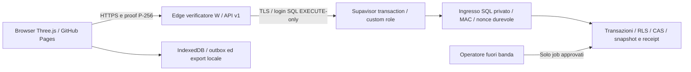

# 6A.12-R — Architettura gratuita browser-first

**DESIGN PROPOSTO — decisione Regia PENDING — implementazione e produzione NON autorizzate.**
Data: 5 novembre 2026, Europe/Rome. Repository `epivic-lab/SerieN`, solo
`feature/train-management`; checkpoint approvato `55d6bd6ef8211e9f136468090ff195f4ac791bde`.
R1 ferroviaria immutabile `348bfeff12c4005657098d89ea1d3c2ccdda9910`.

## Esito e scelta proposta

GitHub Pages + Supabase Edge Functions + PostgreSQL è una destinazione plausibile
entro Free, senza Mac o processo Node/broker sempre acceso. **Non è un semplice
deploy del laboratorio:** D09=A oggi richiede broker privato persistente, login
SQL per device e pool singleton. Non trasferire queste assunzioni ai worker Edge.

Raccomandazione da approvare: **W — mantenere WebCrypto P-256 e ownerless**, con
verifica della proof in Edge e ingresso SQL attestato, ristretto e transazionale.
È una nuova variante della precedente opzione C in
[D09 storico](6A7_ARCHITECTURE_DECISIONS.md), non l'attuazione di A e neppure
verifica P-256 nel DB. Cambia il confine fidato e richiede una nuova decisione D09.
La variante **AAuth — Auth anonima con RLS** resta alternativa esplicita:
[decisione e confronto](6A12R_D09_D10_DECISION.md). Nessun utente Auth viene creato.

Nessuna API SQL generica, tabella pubblica o credenziale privilegiata al browser.
Il motore continua a girare nel browser; la rete salva checkpoint e recupera dati,
non esegue fisica, tick, router, segnali o controllo Z21.

## Confine HTTP e identità W

1. HTTPS Pages conserva `/SerieN/`; endpoint Edge versionato nello stesso progetto
   reale. La nuova audience è l'origine HTTPS effettiva del backend, con ref
   `vehfrjgifzjjgamrgwze`; il path firmato include prefisso funzione/versione,
   workspace/layout/operazione. Fissare il mapping esatto con vettori prima del codice:
   il path locale `/v1/workspaces/...` non si copia senza adattamento.
2. Parser rigoroso riusato: tipi, JSON senza chiavi duplicate, UUID canonici, digest
   corpo, encoding JCS, dominio/versione/metodo/path/audience, nonce stringa e
   firma P1363 verificata da `crypto.subtle` ECDSA P-256/SHA-256. Non accettare
   una chiave pubblica arbitraria fornita dal chiamante come chiave già registrata.
3. Lookup chiave tramite sola procedura privata di registry, input limitato e
   risposta minima; binding device/workspace e versioni ricontrollati nel DB.
   Cache warm è un'ottimizzazione: revoca/expiry/epoch non dipendono da essa.
4. Bootstrap pubblico deve poter creare workspace senza operatore permanente:
   nuova chiave candidata + proof di possesso, quota globale/workspace/device,
   admission antiabuso, creazione atomica di registry/head0 e recovery kit.
   Nessun ruolo DDL nel runtime. Pairing richiede approvazione firmata da owner
   esistente, ticket monouso vincolato alla chiave candidata e diniego cross-workspace.
   Rotazione richiede possesso vecchia+nuova chiave; recovery kit offline monouso
   revoca le vecchie capacità e registra il nuovo device. Bootstrap/recovery non
   sono autorizzati dalla sola conoscenza di workspaceId o fingerprint.
5. Il controllo JWT della piattaforma va configurato coerentemente col protocollo
   custom: per W una eventuale `verify_jwt=false` rimuove solo quel filtro.
   Il handler resta **deny-by-default fino alla verifica P-256 e DB**; nessuna
   operazione privilegiata è autorizzata da publishable key, CORS o origine.
   Origin ammesso `https://epivic-lab.github.io` (i path non sono origini), preflight
   e header consentiti espliciti, nessun credential cookie. CORS non ferma client ostili.

## Ingresso SQL minimo da specificare e provare localmente

Nomi sotto **proposti**, nessun SQL o migrazione prodotto in questa fase.

| Componente | Permesso target | Verifica obbligatoria |
|---|---|---|
| Login `serien_edge_runtime_v1` | LOGIN, USAGE schema privato e EXECUTE di lookup, claim, dispatch, lifecycle ristretto | NO superuser/CREATEROLE/BYPASSRLS/ownership/raw DML/SET ROLE verso executor |
| Verificatore SQL | Autentica attestazione MAC, seleziona registry e crea contesto privato | Chiave MAC non leggibile dal login; search_path vuoto; PUBLIC EXECUTE revocato atomicamente |
| Executor NOLOGIN | DML colonna minimo, soggetto a RLS; append-only per archivi | Non proprietario tabelle, NOBYPASSRLS; non assegnabile al login |
| Contesto privato | workspace/device/scope/op/versioni/digest vincolati alla transazione | Solo verificatore scrive; chiave backend+xid della transazione, nessun contesto residuo nel pool |
| Operatore | DDL, rotazione issuer/login e manutenzione approvati fuori banda | Nessun accesso pubblico a authorizer, ruoli o impostazioni |

Attestazione interna W: dominio distinto, issuer/kid, audience ref+API version,
workspace/layout/device, device/workspace epoch, keyVersion, scope massimo,
operation, request_id, nonce browser, issuedAt, bodyDigest, digest del wire/proof,
jti e scadenza breve proposta 30s. Encoding binario length-prefixed con vettori,
HMAC-SHA-256 e confronto resistente a timing da progettare e testare con pgcrypto;
non fingere che `jsonb::text` equivalga a JCS. Chiave diversa dalla CryptoKey browser,
custodita in Edge Secrets e registro SQL privato. SQL ricalcola i digest sul corpo
effettivo, controlla kid/revoca e non considera affidabili scope o workspace ricevuti
senza confronto al registry. Il login non può scrivere una GUC che conferisca autorità.

Protocollo a **due commit**, necessario anche sui fallimenti:

1. Edge verifica proof originale e firma attestazione. Transazione `claim_v1`:
   valida MAC/tempo/audience/digest e capacità corrente, prende lock ordinati
   workspace→device, applica rate/quota, inserisce unicità `(device_id,nonce)` e
   `(issuer,jti)` con contesto completo. COMMIT separato confermato prima dei dati.
   Finestra browser esistente ±120s; retention almeno 5min e comunque fino a
   issuedAt+120s. Un nonce non è cancellabile mentre potrebbe tornare valido.
2. `dispatch_v1` riceve lo stesso corpo/attestazione, verifica claim corrispondente,
   ricalcola digest e capacità corrente sotto lock, e prende il claim FOR UPDATE.
   Un claim consente un solo dispatch committato; marcarlo consumato è atomico coi
   dati. Due dispatch concorrenti non eseguono due volte. Se i dati falliscono,
   il nonce già consumato nella prima transazione rimane durevole; il client ritenta
   con proof/nonce nuovi e medesimo request_id/envelope immutabile.
3. Contesto RLS creato internamente per questa sola transazione e operazione,
   eliminato prima del commit e invalidato comunque dal cambio xid. Nessun
   helper eseguibile dal login può saltare il verificatore. Lo stato non attraversa
   richieste/pool/rollback. Testare prepared statement disabilitati e assenza di
   dipendenze di sessione in transaction pooling, TLS con CA+hostname verificati.
4. Riutilizzare **la semantica**, non chiamare direttamente le vecchie API basate su
   session_user: read_head/read_snapshot/list_history/read_receipt/save/recover
   devono usare il nuovo contesto verificato. Deduplica receipt prima del CAS;
   snapshot/proiezioni/head/ricevuta in una transazione; risposta solo dopo COMMIT.
   Recovery crea nuova revisione, mai riscrittura dello storico.

La separazione processo ingresso/broker del laboratorio **non esiste nel medesimo
isolate Edge**. Il verificatore possiede attestante e login: se compromesso può
impersonare i device nel suo ambito. SQL limita danni, scope e funzioni; non verifica
la firma browser indipendentemente. Inoltre Edge può ricevere credenziali progetto
privilegiate predefinite: non usarle nel codice non equivale a rimuoverle dal processo.
Questa ampiezza del trusted computing base va verificata/accettata dalla Regia;
nessuna equivalenza di isolamento con D09=A è dichiarata.

## Durabilità, concorrenza e quote

Registry, lifecycle/recovery verifier, replay, rate bucket, revisioni e ricevute
risiedono in PostgreSQL. Nessun filesystem Edge, timer background, RAM o Mac è
autorità durevole. Cleanup nonce/rate scaduti in batch limitati all'ingresso;
se non basta, eventuale Cron SQL separatamente revisionato, senza worker sempre acceso.
Snapshot e receipt non vengono potati per rientrare in Free: al limite si blocca la
scrittura, si conserva/exporta lo storico e si chiede una decisione di retention.

**L01 non chiuso:** pool da 1 per isolate non impone un cap globale. Nuovo ruolo
unico facilita budget Supavisor per user/db/mode, ma dimensione e semantica reale
non sono state verificate. Proporre ammissione SQL di massimo 8 transazioni dati
con slot advisory xact non bloccanti, statement timeout4s/lock3s: questo limita il
lavoro ammesso, **non le connessioni** necessarie a chiedere lo slot.
Serve un cap backend aggregato verificato nel gestito (proposta budget16 più riserva
servizi separata), misurando tutte le repliche/generazioni e autenticazioni del
custom role. CONNECTION LIMIT e pool settings sono difese da provare, non un
teorema sul cap globale. Saturazione→429/503 con Retry-After, nessun pool extra.
Se non dimostrabile, NO-GO; un budget diverso richiede decisione Regia esplicita.

Edge vicino a `eu-west-3` riduce i round-trip DB; misurare browser→Edge→DB con
claim e dati separati, cold/warm, errore e reconnect distinti. Nessuna latenza
hosted è misurata qui. Il salvataggio è asincrono rispetto al tick ferroviario.
Versionare endpoint, wire, DTO, contesto, key/kid, migration e build SHA; fissare
dipendenze/lock Deno. Vecchi client ricevono errore compatibilità, nessun fallback
a API meno sicura. Rollback funzione soltanto con schema/contratto compatibili.

## Provenienza e stato delle verifiche

Codice letto: `app.js`, `src/simulation.js`, protocol/parser gateway,
broker/transport/pool, adapter envelope/history e cinque migrazioni locali6A.3–6A.10.
Il runtime non contiene capture/hydrate/outbox generali; `jcs-profile-v1` resta
fixture chiusa. La proposta non amplia quel validatore di nascosto.

Git via shell fallisce per proxy irraggiungibile, non per storia divergente.
Connettore GitHub conferma branch esattamente al checkpoint; compare API conferma
12 commit dopo R1, behind0 e merge-base R1. Checkout originale `/workspace/SerieN`
pulito su `work`/`5c8f0f5` conservato, stash assenti; nessun WIP6A.12-L rilevato
nei percorsi disponibili o nel tree del checkpoint. Non si certificano file su
Mac o ambienti non collegati. Nessun reset/clean/stash applicato.

Checkout di lavoro isolato `/workspace/work/6A12-R/checkout`: 108 blob mancanti,
172 tree e commit esatto ricostruiti da letture GitHub e verificati SHA Git;
oggetti già disponibili riusati in sola lettura. Clone shallow, checkout sparse
esclude solo evidenze storiche Train Management e due .DS_Store mancanti, conservati
nel tree. Non è una nuova storia: parent del checkpoint intatto e documentazione
storica preservata. Verifica pubblicazione via Git Data API fast-forward con lease,
stesso tree/commit verificati localmente prima di spostare il solo branch autorizzato.

Fonti ufficiali aggiornate, quote e limiti: [registro fonti](6A12R_FREE_LIMITS_AND_RISKS.md).
Audit produzione in sola lettura e piano: [migrazione](6A12R_PRODUCTION_MIGRATION_PLAN.md).
**STOP6A.12-R: nessun deploy, migrazione reale, modifica applicativa, main o servizio a pagamento.**
