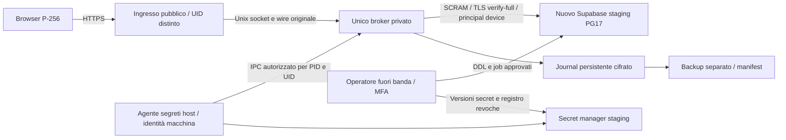

# 6A.12-P — Hosting e decisione L01

**DESIGN ONLY. Nessuna installazione, account, risorsa o deploy autorizzato.**
Stato, base, fonti e blocker: [readiness](6A12_STAGING_READINESS.md).
D09/D10 invariati; L01 resta aperto per il multi-broker.

## Due configurazioni concrete

| Aspetto | A — AWS EC2 fissa, proposta principale | B — Render, alternativa gestita |
|---|---|---|
| Ingresso |HTTPS su reverse proxy e ingresso Node, UID separati sullo stesso host; solo443 pubblico |Web service ingresso con TLS pubblico gestito |
| Broker |Un processo privato con UID dedicato, socket Unix660 in dir750; nessun listener pubblico |Un private service con disco persistente; canale ingresso/broker mTLS, non HTTP anonimo sulla rete privata |
| Replica/deploy |Un instance ID autorizzato, nessun ASG/Spot/blue-green; unità singleton e lock kernel per tutta la vita del processo |Un service ID autorizzato; disco impedisce scaling multiplo e rolling overlap documentato [H04]; avvio subordinato al gate SQL |
| Fencing |Stop ingresso, drain, stop broker/VM e rete, osservazione zero sessioni prima del subentro |Suspend/stop del servizio e conferma piattaforma più verifica SQL; comportamento effettivo da provare, altrimenti NO-GO |
| SQL |Direct TLS su IPv6, regione vicina allo staging; eventuale IPv4 add-on richiede altro costo/consenso |Egress e IPv6 da verificare; fallback Supavisor session solo dopo probe identità/cache/budget |
| Identità segreti |Instance profile temporaneo accessibile al solo agente host; ingress/broker senza accesso IMDS o token AWS |OIDC limitato al subject esatto workspace/environment/service broker, niente wildcard; workspace Pro+ [H05] |
| Provisioner |Postazione operatore distinta, identità MFA/ruolo temporaneo; nessun DDL dalla VM dati |Job operatore distinto; né build/pre-deploy né web service contengono credenziali DDL |
| Journal |Volume EBS cifrato persistente, fsync file+directory; backup cifrato fuori host e manifest |Disco cifrato persistente; snapshot giornaliero documentato ma non sufficiente per replay/lifecycle senza perdita |
| Rete privata |IPC e namespace locali privati; SQL verso Supabase è rete pubblica con TLS/CIDR, non peering privato implicito |Rete privata Render per ingress/broker; Supabase resta remoto con TLS/CIDR. mTLS richiesto |
| Log/monitor |Log redatti separati, osservatore fuori data plane per inventory e pg_stat_activity |Log piattaforma e metriche SQL esterne, senza statement/payload/secret |
| Manutenzione |OS, TLS, patch, agent, backup e dismissione in carico al team |Meno OS, due servizi/provider e più vincoli su stop, filesystem e identità |
| Costo |VM+EBS/backup+IPv4+secret/log: quote da completare |Due compute, disco, workspace Pro/OIDC, secret manager esterno; quote da completare |
| Disponibilità |Singolo punto di guasto, fermo durante manutenzione; nessun SLA promesso |Downtime per disco/deploy, nessun HA; zero vecchi backend resta prerequisito, non effetto presunto |

Le fonti H01/H04/H05 documentano primitive dei provider. Tutta la configurazione
SerieN, inclusi permessi, stop ed esclusione di cloni, **RICHIEDE PROVA STAGING**.
Non si approva B soltanto perché il provider dichiara una replica o un disco.
A è preferita per controllare direttamente PID, UID, socket, lifetime del lock,
egress e stop dell'unico host; il prezzo operativo è maggiore manutenzione.
Se nessuna delle due passa i gate D09/L01: **ARCHITECTURE BLOCKED**, decisione Regia.

## Confine proposto per A

Nessuna freccia dall'ingresso a DB, secret store, journal o Docker. Il browser
non riceve password SQL, ruolo/DSN o chiavi amministrative. L'ingresso può leggere
risposte lecite e servire JavaScript: il suo compromesso non è neutralizzato da
questa separazione; non si promette cifratura applicativa end-to-end.
Il reverse proxy TLS deve preservare body, metodo/path e origine HTTPS approvata;
il broker verifica di nuovo la proof sul wire. Limiti pubblici5s header/15s body,
2MiB request/256KiB response, niente estensione automatica dei timeout del lab.
La nuova verifica va fatta sul bordo TLS, non soltanto su Node dietro il proxy.

## Esclusività prima dell'accesso SQL

A non usa un servizio di leader election. Modello a **host fisso e sostituzione
seriale**, accettando indisponibilità. Il normale deploy può aggiornare soltanto
servizi sull'instance ID approvato. Il suo ruolo di deploy non può creare/clonare
VM, associare altri instance profile, cambiare allowlist SQL o autorizzare nuovi
service ID. Tali operazioni restano fuori banda e richiedono gate separato.

Sul singolo host, supervisor e lock kernel esclusivo su directory root-owned
precedono il rilascio dei segreti e l'apertura SQL. Il descriptor resta detenuto
fino a fine processo/chiusura client. Directory non scrivibile dal broker per
impedire unlink/sostituzione del lock. Agente segreti controlla UID, PID/cgroup
dell'unica unità autorizzata; nessun secondo processo dello stesso UID ottiene
un bootstrap. Namespace/egress isolano ingress e altri processi. Questi sono
interventi di packaging proposti, non proprietà del codice attuale.

L'instance profile da solo **non** garantisce esclusività: AWS consente lo stesso
ruolo su più VM [H01]. Occorrono anche policy di deploy, binding dell'agente alla
macchina approvata, controllo dell'accesso a metadata e sorgente egress fissa
nell'allowlist SQL. Un clone con nuovo ID/IP deve fallire **prima** di ottenere
secret o SQL. Nessun ripiego su chiavi statiche o rete aperta se il binding non
si può imporre. Il test deve verificare questa esclusione e la negazione della
seconda unità locale, senza aprire deliberatamente un secondo pool sullo staging.

Se inventory, identità o esclusività non sono verificabili, ingresso chiuso503,
nessuna nuova attivazione e nessun subentro. Se sono rilevati due processi/host
potenzialmente attivi: chiudere ingresso e fermare/fence entrambi, verificare
sessioni e job prima di autorizzarne uno. Il monitoraggio è controllo di sicurezza,
non un modo per tollerare brevemente32connessioni. Administrator/root malevolo
resta fuori dal modello di protezione; una garanzia contro tale attore richiederebbe
un'altra architettura. Nessun automatismo di failover dopo crash dell'host.

## Procedura di sostituzione

| Stato | Operazione futura | Condizione per procedere |
|---|---|---|
| RUNNING |Chiudere nuova ammissione sul bordo HTTPS; mantenere solo health senza dati |Finestra approvata e nessuna nuova richiesta accettata |
| DRAIN |Attendere lease/transazioni; eventuali timeout non autorizzano a perdere dati |Identificare request_id/COMMIT incerti; retry futuro con receipt |
| STOPPED |Fermare broker, mantenere DB/journal/secret store; in cambio host, stop VM e blocco egress |Conferma esterna del fence, non sola mancanza di heartbeat |
| SQL-ZERO |Osservatore fuori banda controlla ruoli, application_name/generazione, IP e inventario vecchi PID |Zero backend vecchi in due osservazioni separate; qualunque dubbio blocca |
| RECONCILE |Verificare job, grant/revoche, manifest secret, orologio, integrità journal |Nessun rollback di epoch o secret revocato; recovery plan se stato incompleto |
| START |Consentire unico PID e segreti correnti, quindi aprire connessioni |Nessun vecchio processo/host può tornare a collegarsi |
| READY |Probe con principal sintetico, replay pre-restart negato e contatori validi |Solo allora riaprire traffico limitato |

L'osservatore non si fida del solo application_name, modificabile dal client.
Serve correlazione con ruoli/IP/generazione autorizzati. Non termina sessioni dei
servizi Supabase; se non può osservare o neutralizzare quelle del broker resta
STOPPED. Un SQL-zero vuoto senza fence non basta: il vecchio host potrebbe tornare.
Cambiare una regola di rete o revocare IAM non prova la chiusura di TCP già
aperti: serve fence effettivo e osservazione SQL-zero. Hibernation/snapshot RAM
esclusi: potrebbero conservare cache e credenziali di un processo precedente.
Il drain non annulla una transazione già committata; nessuna risposta di successo
prima del COMMIT e nessuna cancellazione di receipt per ripetere il deploy.

## Budget e monitoraggio

`C_broker <= 16` include dispositivi e redeemer, anche connessioni in chiusura.
`C_totale = C_broker + C_operatori + C_osservatori + C_servizi + C_pooler_residui`.
Non si imposta16 come max_connections dell'intero progetto: i servizi devono
poter funzionare. Riserva e picchi vanno misurati secondo [test](6A12_TEST_AND_RECOVERY_PLAN.md).
Supavisor non fornisce per il nostro caso un cap globale16 documentato.

Monitorare connessioni reali, queue/open/timeout/rejected/idle/LRU, latenza normale
separata dai lock, CPU/RSS, filesystem/inode, età backup/journal, job bloccati,
secret error, revoche e fatturazione. Nessun query text con password o payload.
Policy proposta: se broker>16 o più di un'istanza ammessa, chiusura immediata e
NO-GO; metriche mancanti durante deploy impediscono READY. La frequenza del
monitor non è una dimostrazione di limite istantaneo: i controlli preventivi
sono obbligatori. RTO/RPO e fermo tollerabile da approvare, non promessi.

## Eventuale multi-broker futuro

Resta **NON SUPPORTATO**, non un'opzione di deploy di questo piano. Occorrerebbe
una decisione separata su budget aggregato/ammissione, fencing e identità, replay
lifecycle condiviso, secret availability, upgrade e fault concorrenti. Costi:
almeno altro compute/ingresso, più operazioni secret/log e attività di audit;
consumo SQL non può crescere automaticamente di16 per replica. Nessun prezzo o
numero di ore è certificato. Un coordinatore o store usato per distribuire lease
sarebbe una modifica architetturale da proporre alla Regia, non da implementare.
