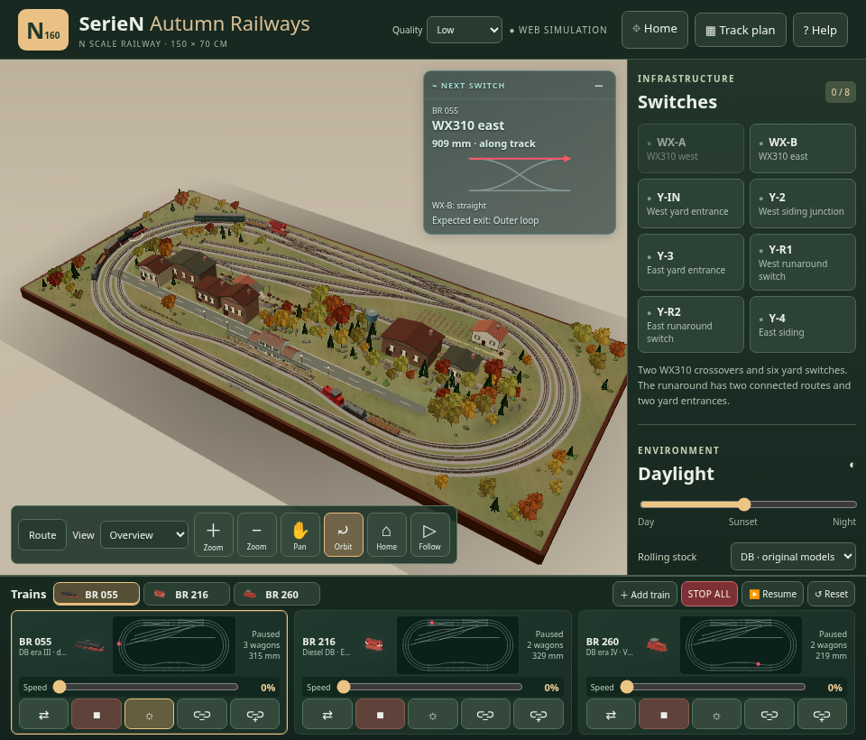
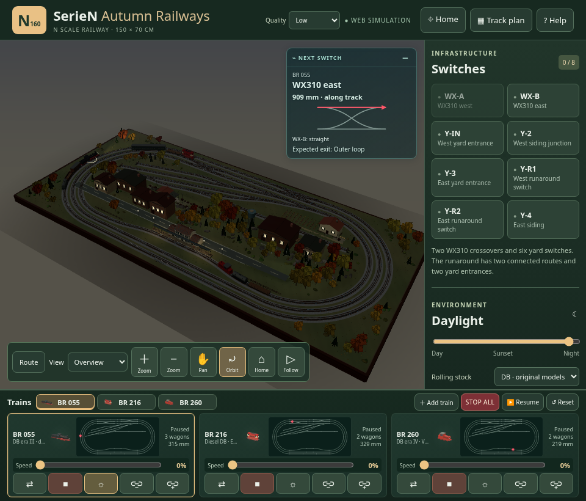
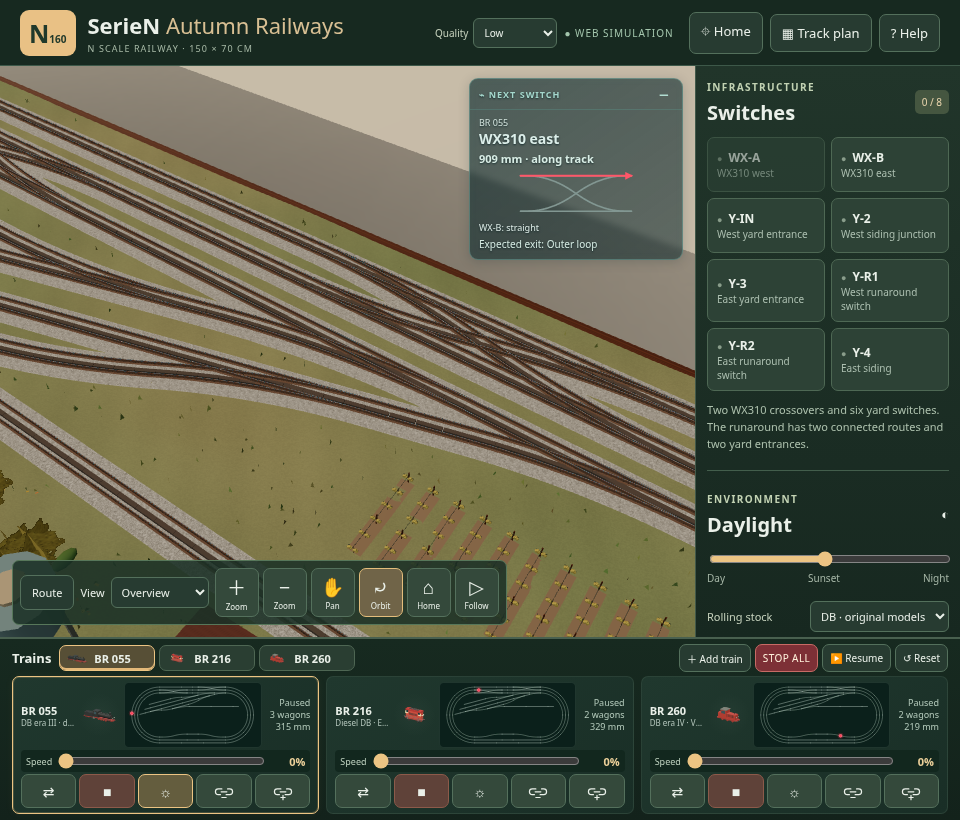
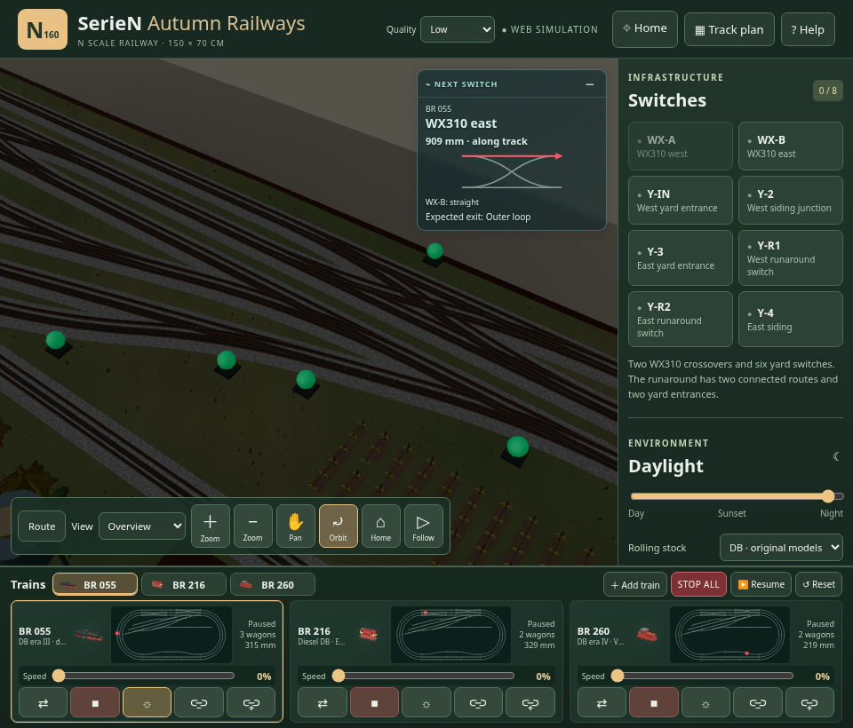
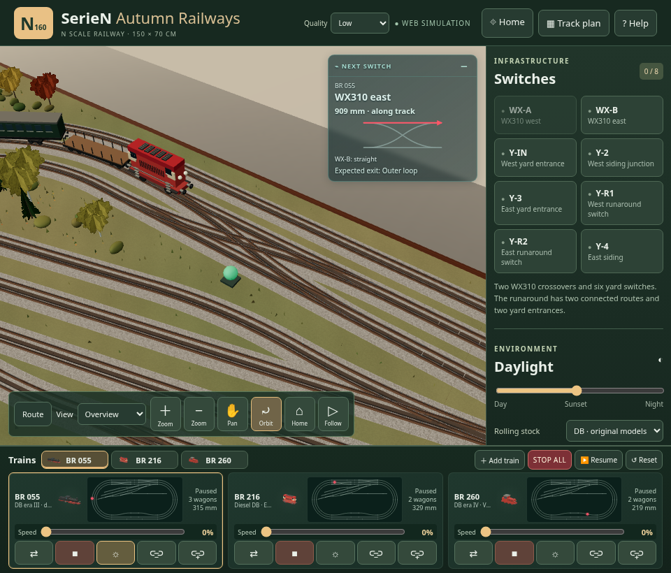
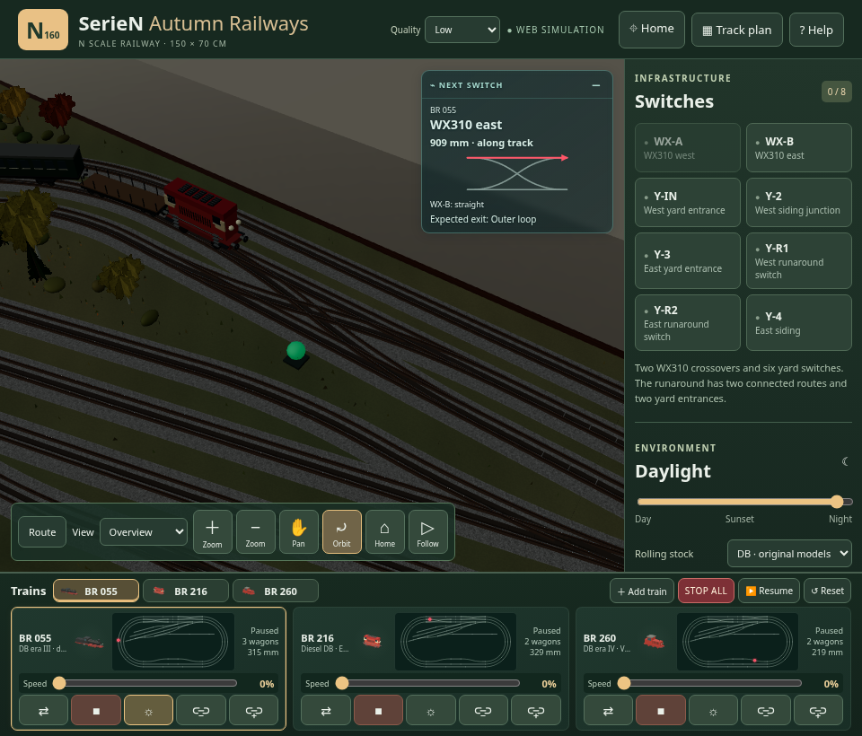
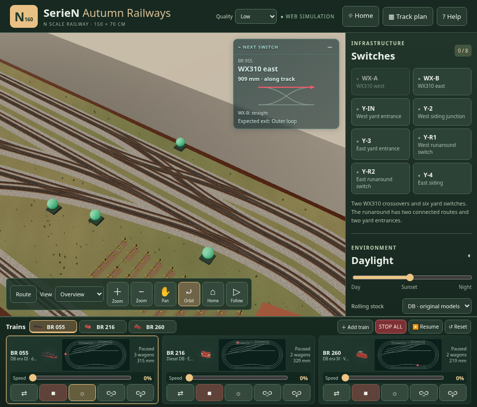
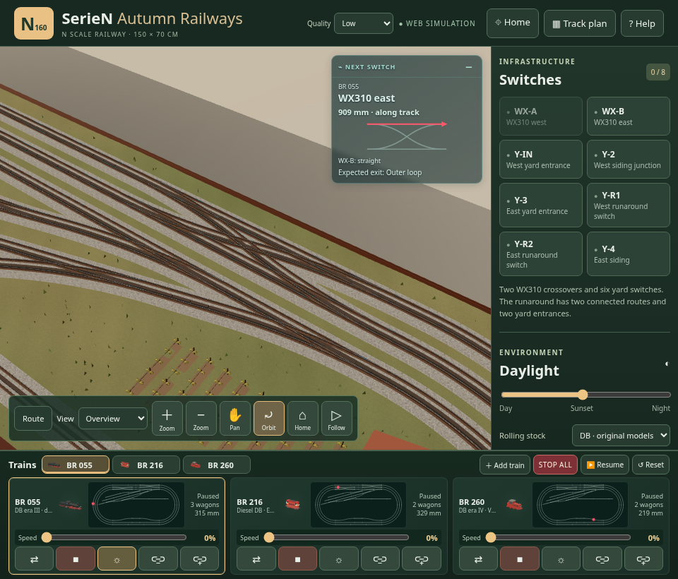
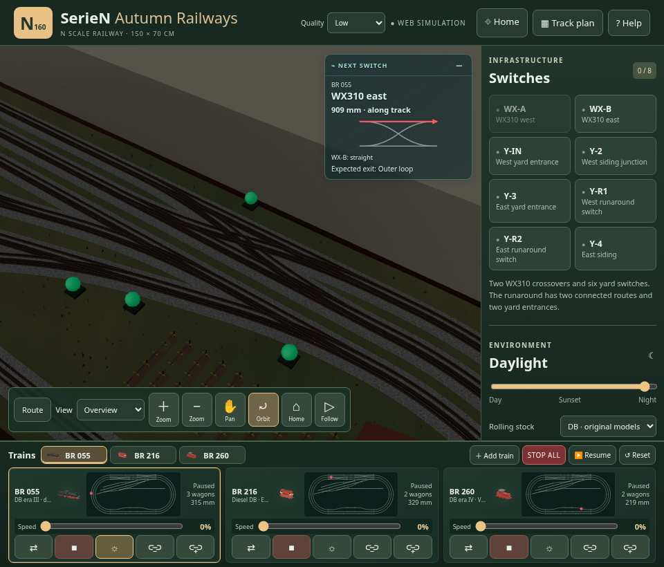
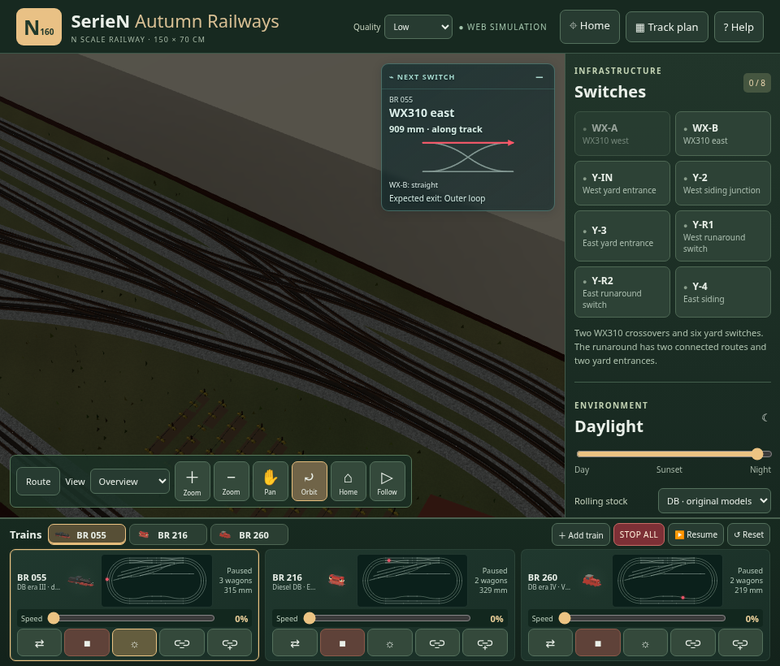

# S2 — Confronti prima/dopo

Bundle S1 e S2, medesimi seed, camera, illuminazione e qualità Low. Sono rimossi esclusivamente gli otto marker artificiali. Nessun glow, overlay o modifica ai binari. Cliccare le immagini per la dimensione originale.

| Vista | Prima (S1) | Dopo (S2) |
|---|---|---|
| overview, giorno |  |  |
| overview, notte |  |  |
| Y-IN, giorno |  |  |
| Y-IN, notte |  |  |
| WX-A, giorno |  |  |
| WX-A, notte |  |  |
| WX-B, giorno |  |  |
| WX-B, notte |  |  |

[Confronto automatico](comparison.json): otto render WebGL esattamente uguali al riferimento S1 con i soli marker nascosti. Le immagini `*-scene-*` sono readback reali dal canvas; il framebuffer è letto nello stesso turno del render. [Camera/materiali/timing](capture.json). Il primo fotogramma viene acquisito dopo warm-up della luce; i minimi scarti di antialias del DOM non vengono confusi con differenze ferroviarie.
