# S4 — Camere e stress finale

[Rapporto](../REPORT.md) · [Dati effettivi](review.json)

Tutti i render sono originali WebGL. La traccia resta statica dopo 340 ms; per ogni posa il confronto con il secondo render idle è pixel-identico. Due angoli e due zoom sui due stati di Y-IN, WX-A e WX-B.

## Y-IN — stato 0, zoom 0.8

| Opposto | Basso |
|---|---|
| 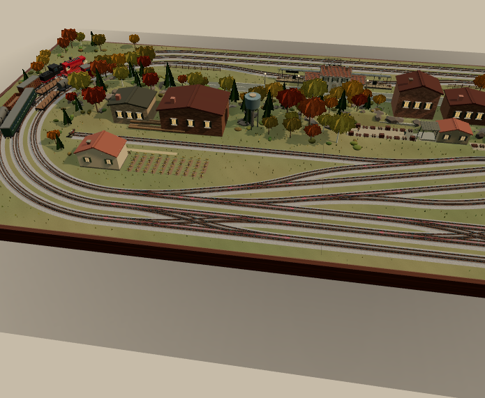 |  |

## Y-IN — stato 0, zoom 1.4

| Opposto | Basso |
|---|---|
| 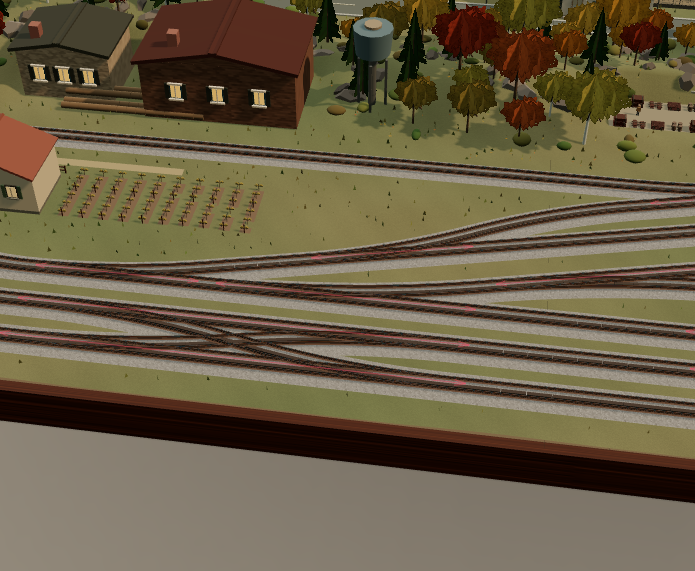 | 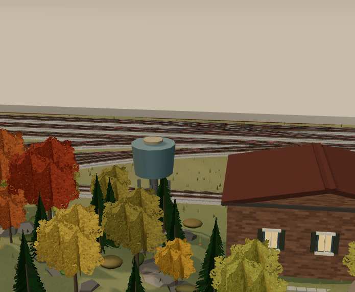 |

## Y-IN — stato 1, zoom 0.8

| Opposto | Basso |
|---|---|
|  | 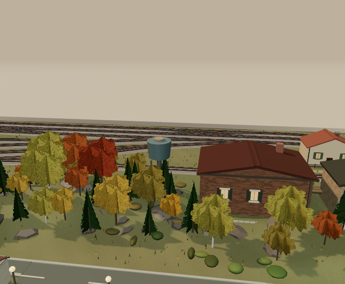 |

## Y-IN — stato 1, zoom 1.4

| Opposto | Basso |
|---|---|
| 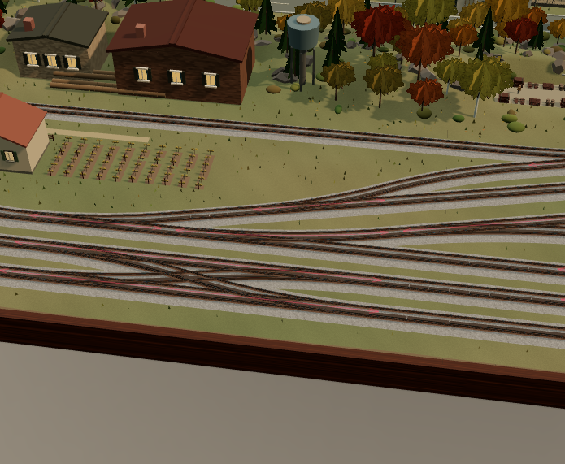 |  |

## WX-A — stato 0, zoom 0.8

| Opposto | Basso |
|---|---|
| 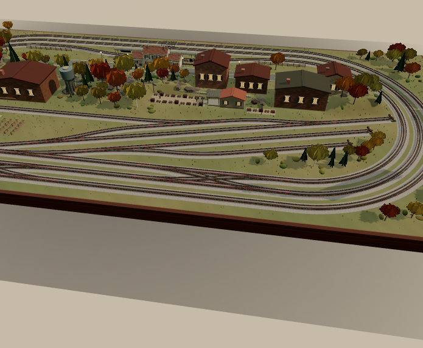 | 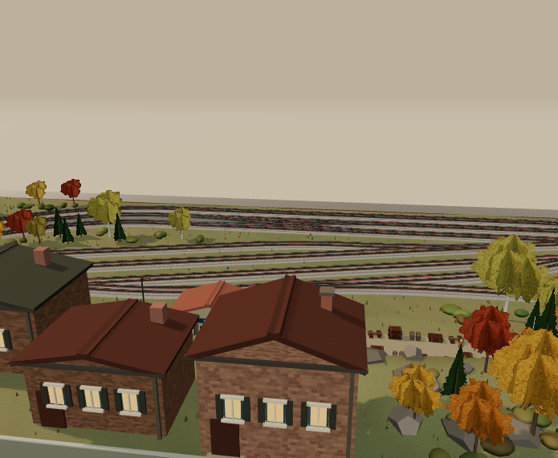 |

## WX-A — stato 0, zoom 1.4

| Opposto | Basso |
|---|---|
| 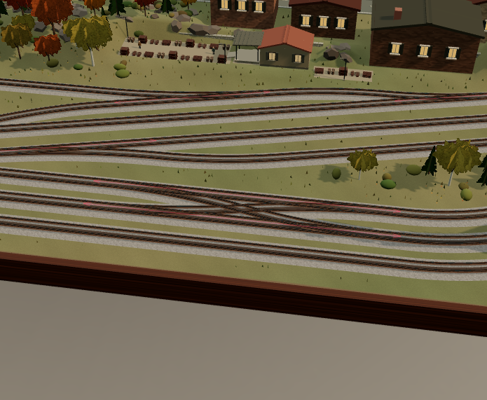 |  |

## WX-A — stato 1, zoom 0.8

| Opposto | Basso |
|---|---|
|  |  |

## WX-A — stato 1, zoom 1.4

| Opposto | Basso |
|---|---|
| 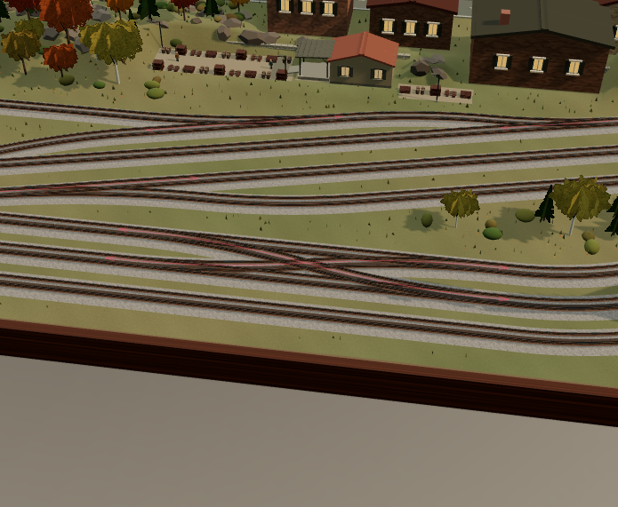 | 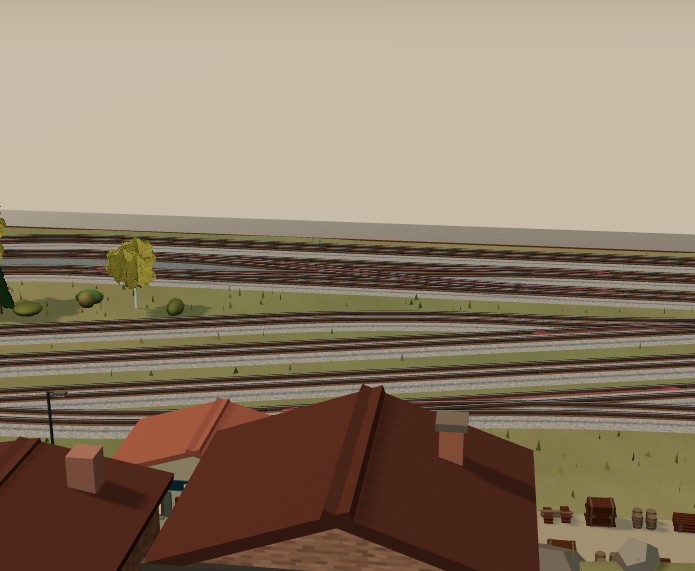 |

## WX-B — stato 0, zoom 0.8

| Opposto | Basso |
|---|---|
| 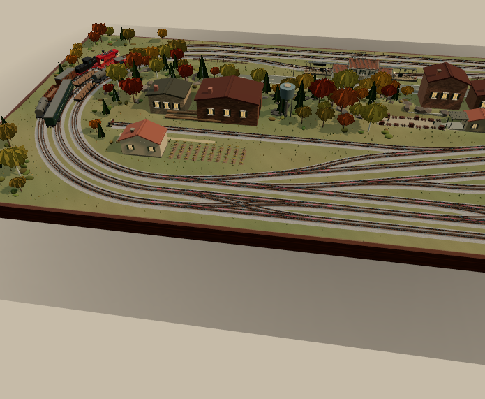 |  |

## WX-B — stato 0, zoom 1.4

| Opposto | Basso |
|---|---|
|  | 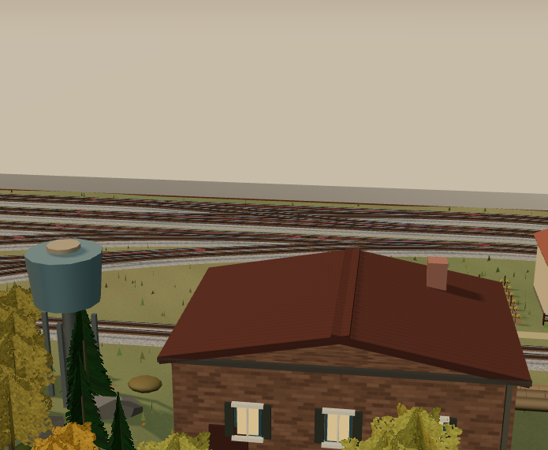 |

## WX-B — stato 1, zoom 0.8

| Opposto | Basso |
|---|---|
|  | 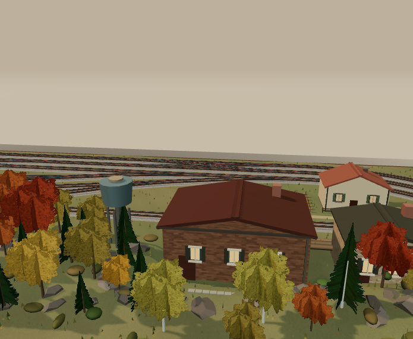 |

## WX-B — stato 1, zoom 1.4

| Opposto | Basso |
|---|---|
| 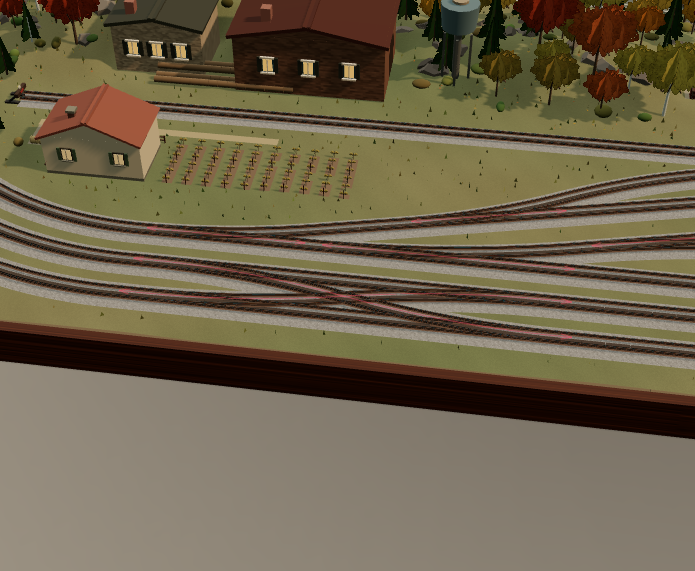 |  |

## Orbita reale e zoom con rotella

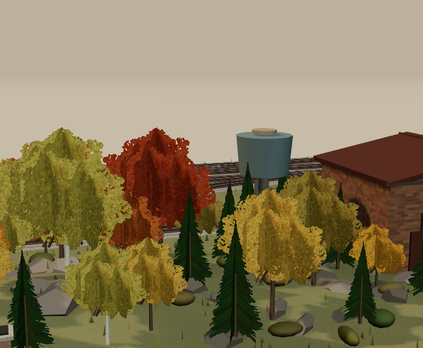

L’orbita è stata comandata dal pulsante UI e con eventi mouse/rotella reali; gli itinerari sono rimasti invariati.

## Ridimensionamento — B e rosso

### 1280 × 900

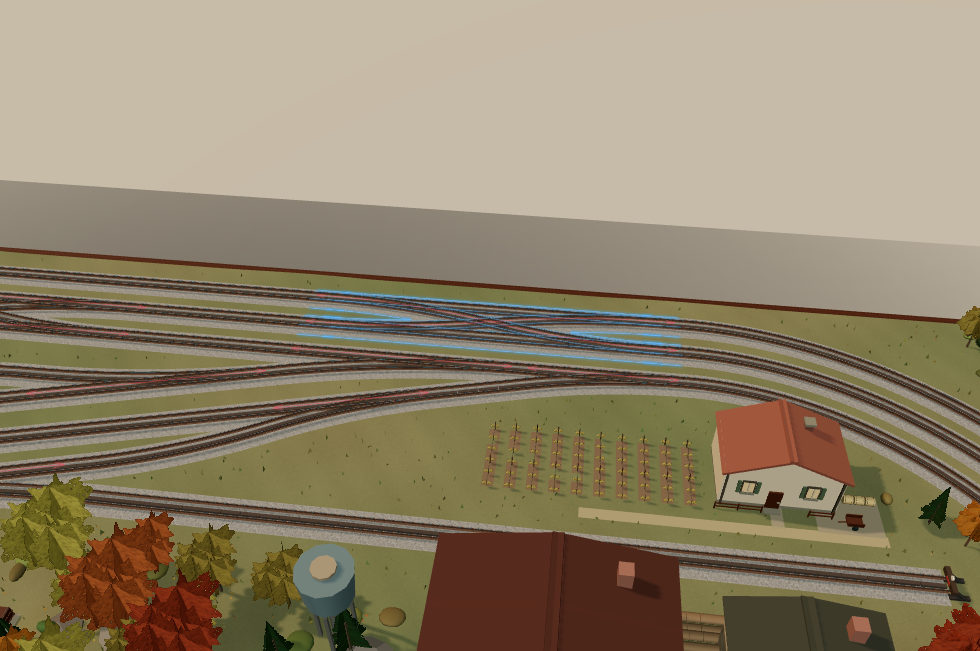

### 390 × 844

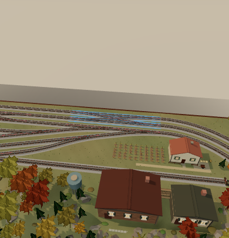

### 960 × 820

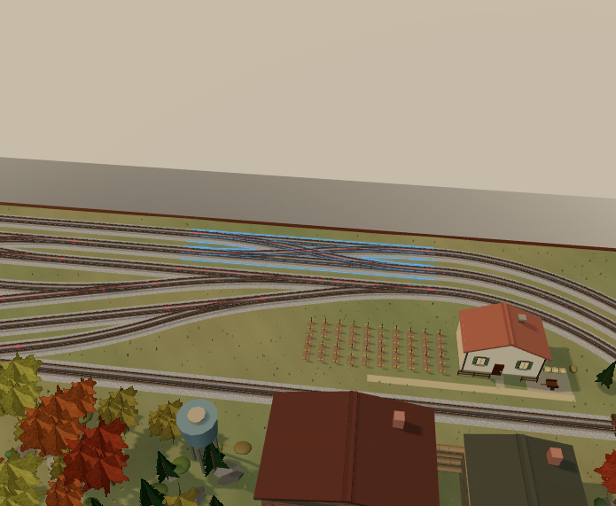
