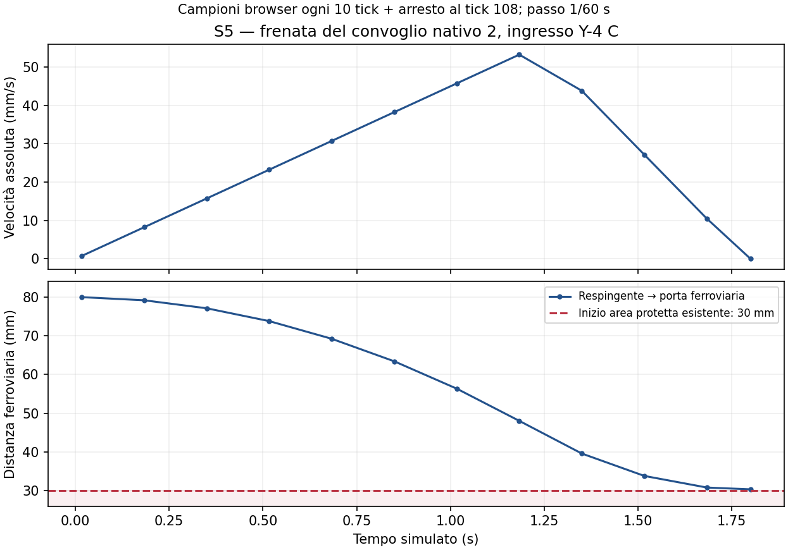

# S5 — Guardia ferroviaria e arresto deterministico

**S5 COMPLETATA tecnicamente. Tutti i sette gate PASS nel perimetro verificato. S4 esplicitamente APPROVATA; S6/S7 NON iniziate.**

## Baseline, autorizzazione e perimetro

Repository `epivic-lab/SerieN`, branch `feature/turnouts`. Baseline locale/remota pulita `a3ace86c0b8e2fe792bbc8dd4499c65d8237eafc`; checkpoint S4 precedente `c54c8c1` antenato verificato, fetch e integrità Git senza errori bloccanti. Origin/main `6487f61612818c8cd46d882741cfa1ca96ac5a16`. Baseline **195 Node,9 Python/JMRI,build PASS**, nessun problema S4 bloccante.

La richiesta corrente approva S4, inclusi B e frecce340ms, e prescrive «Non effettuare merge, deploy o push remoto senza autorizzazione esplicita». Per questa S5 il checkpoint conclusivo è quindi **locale**: nessun push, in prevalenza sulla regola generale AGENTS. Non modificata la master spec o la governance permanente.

## Implementazione e limite garantito

[Contratto dettagliato](../../S5_GUARD.md). Guardia di ammissione nel core, prima di `Journey.move` e del commit della transazione5C. Riusa il router e `traceJourney`: distanze lungo gli edge della Journey, verso effettivo, ultimo veicolo in retromarcia, ingombri coupler. Nessun nodo, spline o secondo router; nessuna autorità degli overlay.

- Il primo confine incompatibile/terminale/incerto limita lo spostamento. Per gli scambi si conserva anche l’inizio dell’area protetta esistente30mm, lasciando possibile la correzione senza indebolire i lock.
- Frenata del simulatore100mm/s², accelerazione45mm/s², velocità comando×1,5 invariati. Anticipo `v²/200 + |v|dt +45dt²`, più ingombri e tolleranza numerica. Se non basta, clamp deterministico allo spostamento ammesso. Zero tunneling attraverso giunti intermedi, inclusa storia memorizzata prima di un cambio.
- SAFE/UNSAFE/UNKNOWN sono distinti dall’intervento GUARDED_STOP. Dati grezzi non booleani non beneficiano del fallback false del router. UNKNOWN prevale alla stessa prima frontiera, anche fra deviatoi adiacenti.
- Collisioni, sweep, rollback simultaneo/cascata e occupazione restano quelli5C. Una rivalutazione readonly dell’ultimo spostamento rifiutato mantiene il rischio di occupazione a treno fermo; i probe non entrano nelle proposte e non prenotano spazio contro convogli che possono allontanarsi. Predicati fisici condivisi, senza una seconda regola di collisione. Un lock di manovra non vieta un attraversamento lecito e non si considera occupazione altrui quella del proprio treno.
- Prenotazioni: il progetto non possiede un relativo servizio. Solo adattatore interno opzionale di intervalli canonici con proprietario; nessun registro o servizio inventato. Casi owner/foreign/malformed testati nel core.
- Rischio risolto e inversione compatibile rilasciano la guardia. L’arresto automatico completo azzera il comando attivo come nella5C; serve un **riarmo esplicito**. L’ultima richiesta rimane un’osservazione separata. STOP manuale, velocità0 e STOP ALL non vengono annullati dal rilascio.

## File modificati e motivazione

| File | Scopo |
|---|---|
| src/railway-guard.js (nuovo) | Valutazione pura, stati, distanze ferroviarie, margine e clamp |
| src/railway-step.js | Applicazione prima del movimento, osservazione congelata e mantenimento del rischio con gli stessi predicati5C |
| src/simulation.js | Solo accessor dello stato grezzo; selezione router/Journey intatti |
| src/fleet-commands.js | Richiesta separata, stop e STOP ALL autoritativi |
| app.js | Getter stato grezzo, init/reset e sola osservazione diagnostica; funzioni calde/UI intatte |
| src/railway-types.js | Campi osservativi opzionali del contratto Train |
| tests/railway-guard.test.js (nuovo) | Oracolo porta/stato/assi, cache, dt, recovery, UNKNOWN, purezza e occupazione trattenuta |
| tests/browser-railway-guard.py (nuovo) | Sei casi integrati con controlli/rotabile nativi e lifecycle reale |
| tests/browser-railway-guard-performance.py (nuovo) | Confronto attivo isolato5D/S4/S5 |
| PROGRESS.md, STATUS.md, S5_GUARD.md, evidence/S5 | Approvazione S4, esiti e riproduzione; nessuna modifica alla Master Spec |

## Difetto riprodotto e prova di arresto

Il test indipendente della vecchia transazione riproduce una route stale: fixture0 su `T44` verso Y-4 B, velocità150mm/s, head extent1mm, margine fisico0,01mm dalla porta. La versione precedente passa su `TO4:AB` ora incompatibile, oltrepassando il limite di **2,49mm**. La nuova versione ammette **delta0**, velocità0 e mantiene intatta la storia rifiutata. Fixture ridotta del test logico, non un rotabile ridimensionato nel prodotto.

Con il **convoglio nativo2** (BR260), senza carrozze sganciate tramite i veri comandi, sul raccordo reale `T47` verso Y-4 C, ingombro di testa in retromarcia34,25mm:

| Campione | Tempo s | Velocità mm/s | Distanza respingente→porta mm | Decisione |
|---|---:|---:|---:|---|
| Inizio | 0,0167 | −0,75 | 79,9875 | SAFE |
| Avvicinamento | 1,1833 | −53,25 | 48,05 | SAFE nel tratto ammesso |
| Frenata campionata | 1,35 | −43,8333 | 39,6153 | UNSAFE / GUARDED_STOP |
| Arresto, tick108 | 1,8 | 0 | **30,3708** | UNSAFE / GUARDED_STOP |

Il pannello reale consente poi l’allineamento, la guardia torna SAFE e il treno **rimane fermo** finché l’utente non richiede di nuovo velocità. Un secondo caso nativo con150mm/s e0,01mm residui ammette zero avanzamento e conserva la storia. [Telemetria browser](browser/browser.json), [osservazioni deterministiche](tests/scenarios.json).

Campioni ogni10tick più arresto, collegati nel grafico; non una misura continua di fisica reale. [SVG esportabile](plots/braking.svg), [ricetta](recipes/plot-braking.py).

## Matrice degli scenari richiesti

| # | Scenario | Classificazione/azione attesa e verificata | Prova |
|---|---|---|---|
| 1 | Deviatoio semplice corretto | SAFE, attraversamento senza STOP | Matrice Node8controller |
| 2 | Deviatoio incompatibile | UNSAFE→GUARDED_STOP prima del limite | Matrice +telemetria |
| 3 | WX310 entrambi gli stati, quattro accessi | SAFE sui due itinerari effettivi; niente giunto centrale | Matrice WX-A/WX-B, S4 e5C |
| 4 | Verso opposto e asse Journey invertito | SAFE per gli attraversamenti leciti | Matrice104configurazioni |
| 5 | Treni compatibili | SAFE, loop simultanei e WX paralleli non arrestati | Node5C, Fase0, benchmark attivo |
| 6 | Occupazione/prenotazione incompatibile | UNSAFE→GUARDED_STOP; rollback5C o limite di intervallo | Node,5C, osservazioni occupation/reserved |
| 7 | Runaround | SAFE, due rami, inversione e ritorno alla linea | Fase0 produzione |
| 8 | Quattro tronchini | UNSAFE terminal→GUARDED_STOP, poi inversione lecita | Node breve/cinque carrozze, Fase0 |
| 9 | Inversione via dal pericolo | SAFE solo nel verso effettivo che si allontana | Node +browser nativo |
| 10 | Cambio scambio durante avvicinamento | Rivalutazione al tick successivo; niente storia stale | Node +pannello browser |
| 11 |150mm/s e0,01mm residui | Delta0, mai oltre il confine | Node +browser nativo |
| 12 | dt elevato/anomalo | Clock cap/substep; dt core fuori contratto rifiutato senza mutazioni | Node frame20/60/120Hz e spike |
| 13 | Ripresa dopo sospensione | Elapsed60s simulato e lifecycle Chromium frozen/active500ms con frame realmente ripreso, limite conservato | Node +browser |
| 14 | Rischio cessato | SAFE; nessuna riattivazione automatica dopo stop completo | Node +browser |
| 15 | Arresto volontario | Richiesta0 e velocità0 conservate dopo rilascio | Node +controllo reale |
| 16 | STOP ALL durante guardia | Autorità conservata dopo rilascio e resume | Node +browser |
| + | Unknown: stati, ingresso inattivo, giunto condiviso | UNKNOWN→GUARDED_STOP |78casi raw-state +ambiguità/dati invalidi |
| + | API pura | Valutazione deterministica con train/Journey congelati, nessuna mutazione | Node API readonly |

I104casi sono26porte ×2stati ×2assi di Journey:80attraversamenti ammessi (48semplici,32WX) e24ingressi non ammessi. Si usa un oracolo fisico indipendente dal campo requiredState. Le prove5C già includono consist corti/lunghi, mezzi nativi/GLB e conflitti fra proposte. Non si pretende la verifica di ogni possibile consist e configurazione globale.

## Suite e gate finali

| Verifica finale | Esito / evidenza |
|---|---|
| npm test | **217 PASS**,0fail/skip/cancel — [log](tests/node-tests.txt) |
| Python/JMRI | **9 PASS** — [log](tests/python-tests.txt) |
| npm run build | **PASS** — [log](tests/build.txt) |
| S5 +legacy mirati | **40 PASS** (22S5+18esistenti) — [log](tests/focused-final.txt) |
| Browser S5 | **6 PASS**: nativo/pannello, stale150mm/s, reverse/resume, UNKNOWN, lifecycle reale, occupazione trattenuta e partenza compatibile — [dati](browser/browser.json), [log](tests/s5-browser.txt) |
| Browser S4 | **PASS**, tutte8/stati/WX, hoverB,340ms/reduced motion/UNKNOWN, rifiuti e risorse — [dati](tests/arrows-browser.json) |
| Browser S1 | **PASS**,150rotaie/75letti rispettoS0 e comandi reali — [dati](tests/contract.json) |
| Browser S2 | **PASS**,20rami, mouse/tastiera/touchCDP, zoom/orbita/drag/cancel, picking e selezione — [dati](tests/interaction.json) |
| Browser5C | **PASS**,11scenari, ingombri, carrozze/GLB, conflitti, equivalenza frame e comandi — [esiti](5c/acceptance.json) |
| Fase0 | **PASS**,tre circuiti reali nei due versi, runaround entrambi i rami, quarto treno/LRU, HUD/minimappe e4viewport — [dati](phase0/browser-result.json) |
| Integrità/profilo | **PASS**,65file bloccati, router/Journey,5funzioni calde e sorgenti core del profilo esatti — [invarianti](tests/invariants.json), [source map](tests/profile-source-check.json) |
| Performance attiva | **PASS nel campione software**,vedi dati e limiti sotto |

[Driver finale: cinque suite tutte exit0](tests/regressions.json). Nessun errore JavaScript/console o richiesta fallita nei sei scenari S5 monitorati. Nessun errore WebGL osservato. La sospensione Chromium500ms è reale, seguita da un RAF verificato; i60s sono un ulteriore input temporale deterministico, non un’attesa fisica di60s.

**Gate1Safety,2Routing,3Recovery,4Autorità utente,5Regressioni,6Stabilità misurata e7Evidenze: PASS.** Hardware GPU/touch e matrice completa5D NOT VERIFIED e non dichiarati come gate eseguiti. Nessun blocco tecnico residuo rilevato.

## Invarianti e sicurezza minima

Canonico rigenerato senza diff, SHA-256 `e233b168afdb05482ed448a09133ff8f085c3039d5225b52286898e73aaad0cc`.65file bloccati byte-identici aS4: geometrie/asset, B, frecce340ms, picking e view-model S1–S4, dipendenze, UI e backend. Router/Journey identici salvo accessor readonly; cinque funzioni calde applicative identiche, inclusi advanceFleet/renderVehicles/dispatcher. Inventario originale150rotaie+75letti confrontato nel browser S1. [Invarianti](tests/invariants.json).

Nessuna modifica a massicciata, paesaggio, cataloghi/Train Composer, Supabase, altri repository, produzione o reti ferroviarie fisiche. Nessuna dipendenza di prodotto, nuova luce, listener/RAF, risorsa GPU, cartello STOP o audio. Scan mirato dei sorgenti modificati senza pattern di segreti; nessun hook temporaneo nei bundle di produzione. Non è l’audit5E completo.

## Performance e risorse

| Build attiva | RAF p50 ms | p95 ms | CPU mediana ms/passo flotta | Draw call |
|---|---:|---:|---:|---:|
| 5D | 1983.35 | 2199.90 | 0.1125 | 367 |
| S4 | 1983.20 | 2016.60 | 0.1000 | 353 |
| S5 | 1999.90 | 2166.50 | 0.1690 | 353 |

**PASS entro soglie** +10%p50/+15%p95 sia contro5D sia controS4. S5 rispetto aS4: p50+0.84%,p95+7.43%. Incremento CPU misurato **+0.0690ms/passo flotta** (circa+69.0% del solo piccolo core misurato, non del frame). La quota aggiunta equivale aritmeticamente a circa0.41% di un budget16,67ms, senza stimare gli FPS hardware. Tre treni attivi, direzioni miste, nessun arresto falso: ciascuno percorre441mm durante i RAF osservati, poi ulteriori1.600passi fissi per il campione CPU. Nessun’altra suite browser o CPU simultanea.

Un Chromium/SwiftShader, contesti sequenziali5D/S4/S5, viewport650×760/DPR1, Low/giorno48, camera fissa, seed516. Sedici intervalli RAF dopo tre warmup; CPU: mediana di16medie da100passi advanceFleet, senza rendering. Questi tempi software non sono FPS fisici né una certificazione hardware e non ripetono l’intera matrice5D. È il campione finale dopo mantenimento occupazione e validazione stretta degli ID; i precedenti campioni intermedi sono esclusi dalle prove finali.

S4 eS5 hanno gli stessi353draw call,467.856triangoli,348geometrie e44texture nel benchmark. Nel distinto contesto funzionale S4 risorse stabili368geometrie/45texture/48programmi; dispose overlay →348/45/47, con20geometrie,8materiali e1programma rilasciati. S5 non crea oggetti GPU. [Dati](tests/performance.json), [log](tests/performance.txt), [lifecycle](tests/arrows-browser.json).

## Limiti dichiarati

Il modello numerico documentato del simulatore non è una certificazione della frenata di rotabili reali. Un clamp può fermare bruscamente il convoglio in una situazione già troppo vicina al limite: la sicurezza precede la fluidità. Clock e dt restano quelli5C; non viene recuperato tutto il tempo perso durante sospensione. Fuori dal dominio cinematico del motore si fallisce UNKNOWN con movimento0.

SAFE autorizza solo il tratto necessario alla proposta corrente, non un itinerario globale o una prenotazione. Le prenotazioni opzionali sono provate nel core: nessun servizio di prenotazione era presente o è stato collegato. STOP completo richiede riarmo; un semplice rilascio della guardia non è un comando di avvio.

Hardware GPU/touch fisico e matrice completa5D NOT VERIFIED. La prova di lifecycle Chromium non equivale a tutte le sospensioni di sistema operativo su ogni dispositivo. Nessuna approvazione S6 dedotta da questi risultati.

## Commit e consegna

Commit locale dedicato `feat(safety): prevent invalid turnout traversals`, branch `feature/turnouts`. Il vero SHA viene consegnato dopo il commit ed è risolvibile con `git log -1 --format=%H -- docs/_active/turnouts/evidence/S5/REPORT.md`. SHA effettivo e pulizia del working tree nella verifica conclusiva successiva al commit. Remoto preservato al checkpoint S4 `a3ace86c0b8e2fe792bbc8dd4499c65d8237eafc`, main6487f61: sola verifica read-only finale, **nessun push autorizzato o effettuato**. Nessun merge/rebase/reset/deployment.

[Comandi e provenienza](commands.json), [hash evidenze](evidence-sha256.json), [handoff](RESUME.md). Documentazione attiva/PDF conservati fino aS7. **STOP dopo S5. Non iniziare S6.**
