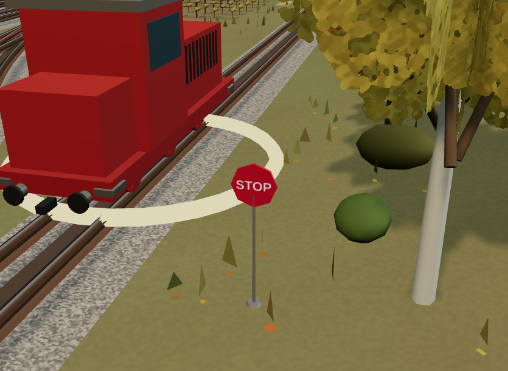
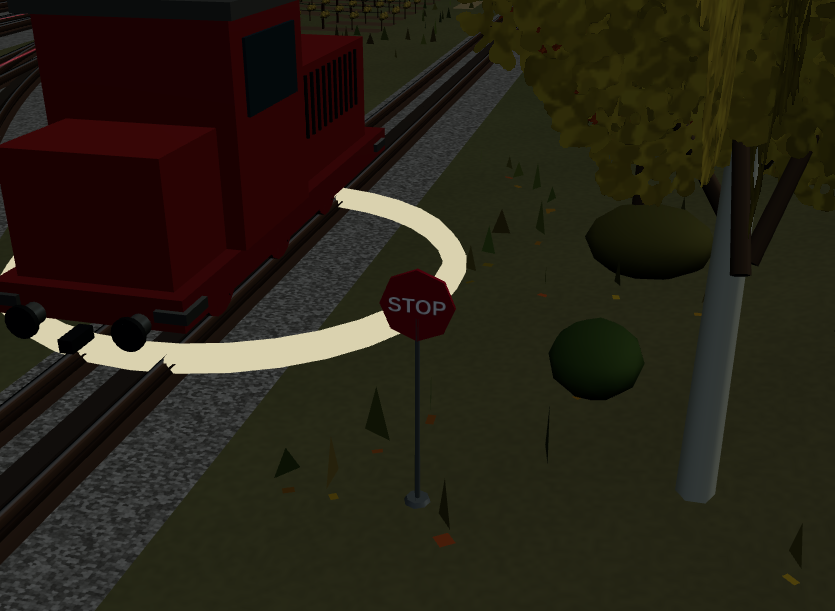
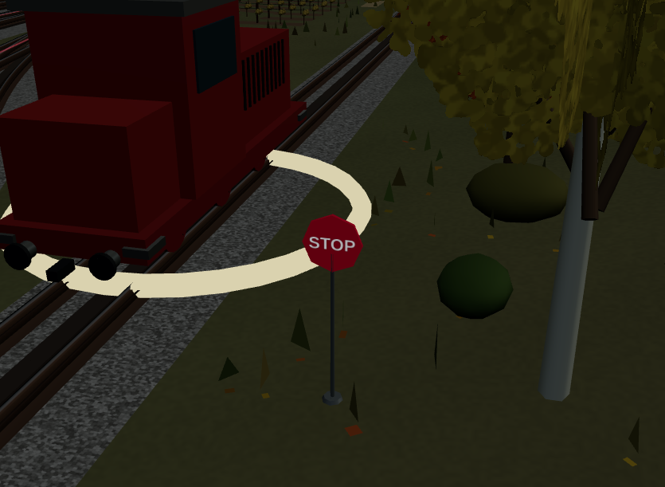

# S6.1 — Night Visibility Refinement

Baseline pulita e remoto verificato `ddd874ac3f9f1ec7e689408a6345d2f422659ded`, branch feature/turnouts. Solo S6.1 autorizzata; S7 NON iniziata. Review artistica della Regia PENDING.

## Correzione locale

Una sola riga runtime modificata in `src/guarded-stop-scene.js`: fondo rosso MeshStandardMaterial con emissive dello stesso colore e intensità0.22; scritta bianca con emissive bianco0.28 e **la stessa texture esistente** come emissiveMap. La maschera trasparente conserva esclusivamente la scritta. Nessuna texture/geometria aggiunta, nessuna luce, bloom, modifica al ciclo giorno/notte o illuminazione del terreno. Proprietà costanti: nessuna discontinuità al passaggio giorno/notte. Diff inverso delle sole proprietà dei materiali uguale byte per byte alla baseline; ogni altra fonte runtime resta invariata.

## Rendering effettivo

Stessa camera S6, distanza/zoom/posa del treno e cartello: originale WebGL835×611, luce48 giorno/95 notte. Il confronto con le PNG S6 cambia **solo** il rettangolo del cartello (379,268)–(456,342), identico nei due casi: tutti i pixel esterni, terreno incluso, rimangono esattamente invariati. Nessun alone. Rosso notturno campionato(410,320): RGB35/0/3 →95/0/14; scritta(417,306):75/81/89 →171/171/173. Di giorno: rosso157/5/26 →185/19/36, scritta205/193/184 →222/214/210, senza clipping nei campioni. Fondo rosso riconoscibile, STOP leggibile, bordo e spessore continuano a ricevere la luce fisica. Prima soluzione mantenuta, nessuna variante aggiuntiva.

| Vista | S6 precedente | S6.1 |
|---|---|---|
| Giorno |  |  |
| Notte |  |  |

## Test e regressioni

- `npm test`:220 PASS, zero fail/skip.
- `npm run build`:PASS.
- Browser `tests/browser-guarded-stop.py` con bundle S6.1:PASS. Include giorno/notte e pixel realmente renderizzati, animazione, reduced motion, mouse/Enter/touch CDP MUTE, audio, due guardie/risoluzione indipendente, STOP ALL/reset/dispose e motore S5 operativo dopo rimozione totale S6. Nessun errore JS.
- Invarianti: solo le due proprietà materiali cambiano; posizionamento, clearance/collisioni, dimensioni/texture, guardia/routing/Journey,150rotaie/75letti/WX310, glowB/frecce, audio/lifecycle, plancia/scena/backend/dipendenze invariati. Canonico hash in [invariants.json](invariants.json).
- Confronto risorse prima/dopo con lo stesso fixture in [before-resources.json](before-resources.json) e [after-resources.json](after-resources.json). Nessuna nuova geometria/texture/draw call.

## Riproduzione e limiti

Comandi: `npm test`; `npm run build`; builder versionato S6 con output temporaneo `/workspace/work/s61/profile.js`; server HTTP8003; `S6_OUTPUT=/workspace/work/s61 python3 tests/browser-guarded-stop.py`. `visual-check.py` riprende il fixture S6 per la sola acquisizione e contatori; impostare S6_BUNDLE/S6_OUTPUT per confrontare bundle baseline e attuale. Baseline profiler preservato prima della modifica, non incluso nel commit. Le immagini S6 originali e tutti i loro hash restano intatti.

GPU fisica e giudizio estetico finale:NOT VERIFIED/PENDING. Python/JMRI, suite browser storiche aggiuntive,40test S7 e audit completo5D non ripetuti: modifica esclusivamente ai materiali e regressione S6 già superata. Non dichiarati nuovi risultati per queste suite. Nessuna regressione rilevata nel perimetro verificato. Checkpoint remoto normale obbligatorio, senza merge/main/deploy. **STOP S6.1: attendere giudizio della Regia sulle nuove immagini; S7 non autorizzata.**
