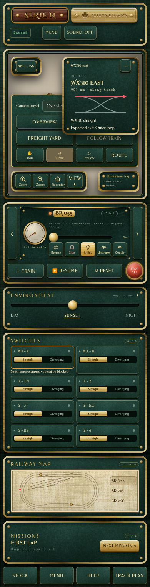
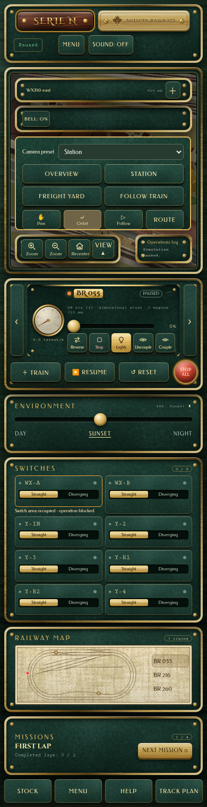
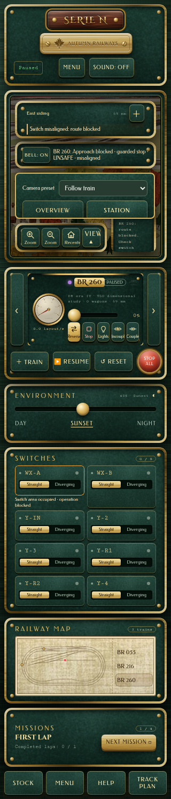

# HUD / Camera mobile collision — PASS tecnico

Baseline `6e62967356df836df27de59f352496511769d591`; PR #8 Draft. Solo correzione del blocker, nessun merge/deploy. Il commit atomico è quello individuato da `git log -1 --format=%H -- docs/_active/ui-v21/VISUAL_PARITY_REPORT.md`; SHA effettivo e checkpoint remoto sono consegnati alla Regia.

| Prima — HUD expanded copre Station | Dopo — Station azionato, HUD temporaneamente compatto |
| --- | --- |
|  |  |

Il dopo include la risposta reale del comando Station, quindi la camera della scena è intenzionalmente diversa. Non è un confronto pixel-perfect della scena. [Riproduzione prima](before.json), [ricevute browser finali](browser-results.json), [log](browser.txt).

Prima:198×102,734375px, Station interamente coperto, trial click intercettato da `.nextSwitchPosition`; bundle714aac… corrispondente alla baseline autorizzata. Dopo:42misure d'intersezione camera/HUD e camera/Bell tutte0px². Il test scorre il menu quando il poco spazio sotto gli allarmi richiede uno scroll interno; nessun preset è disabilitato e gli allarmi non vengono coperti. Il centro di ogni preset raggiunge il controllo reale con `elementFromPoint`, seguono click trusted, valore del preset, `aria-pressed` e frame reale della camera; per Station viene verificato il cambiamento di posizione/target.

| Gate nuovo | Risultato |
| --- | --- |
| Node | [254 PASS, zero fail/skipped](node-tests.txt) |
| Python JMRI | [9 PASS](python-tests.txt) |
| Build | [PASS](build.txt),1.092.265byte, SHA256 `1ac2022b781311ca3fcc03e6373a55fc56c45eabd714c56694e7107d12352378` |
| Sequenze A/B |320×700,375×812,390×844,430×932,768×1024,1692×877; stato expanded/compact e intenzione utente preservati |
| Camera |Station/Overview/Freight yard/Follow train reali, senza sostituire controller o snapshot |
| Tastiera |Enter,Tab,Escape da select e HUD, focus restituito a View,12aperture/chiusure, nessun ripristino stale |
| Resize/orientation |View aperto attraverso390×844→844×390→768×1024→390×844; ripristino quando esce dal layout stretto |
| Occupazione |Dispositivo reale Y-4 disabilitato, ragione motore e warning originali disponibili |
| Guarded Stop |Allarme reale generato quando View è già aperto; nodo warning identico, testo del motore preservato, tutti i preset nei sei viewport |
| Cleanup |pagehide durante View aperto; listener osservati rimossi, ResizeObserver scollegato, overlay rimosso;0pageerror/HTTP failure |
| Ferrovia |Snapshot ferroviario invariato prima/dopo i segmenti di sola UI/camera; le predisposizioni diagnostiche di pericolo sono isolate e dichiarate |
| Protezioni |[132file del manifest originale e138file protetti](invariants.json) byte-identici alla baseline; canonico e domini invariati |
| Desktop/tablet |[Geometria, testi e stili calcolati identici](desktop/results.json), normale/HUD expanded+View,1692×877 e768×1024 |



[Guarded Stop390×844](guarded-390x844.png). Gli avvisi nei due riquadri superiori sono i nodi originali, non copie del rischio. CSS solo nel contesto di coordinamento; in landscape corto si usa l'altezza della riga300px già riservata dalla griglia, durante View, al posto del46dvh frozen. L'altezza del Train Dock e la griglia desktop restano invariate.

## Provenienza e limiti

Test [browser-ui-v21-overlay-collision.py](../../../../../tests/browser-ui-v21-overlay-collision.py) contro `dist/game.js` reale e invariato su disco. Bootstrap Auth esclusivamente localhost, RAF originale controllato per gli scenari deterministici; nessun observer bundle, credenziale cloud, fixture in produzione o camera/HUD fittizio. I comandi diagnostici predispongono stati ferroviari reali soltanto localmente. Gli11gruppi finali sono esecuzioni nuove sul bundle1ac202…; le precedenti suite ferroviarie estese non sono state rieseguite e rimangono prove storiche.

La [ricetta desktop](desktop-regression.py) ricostruisce la baseline tramite il solo modulo overlays originale, ottenendo esattamente714aac…; il bundle candidato è1ac202…. Stesso CSS finale nei due casi: i nuovi selettori richiedono un contesto mobile che resta assente a1692/768. Sono confrontati header, viewport, sidebar, dock, HUD, Bell, camera, console e targhe. Quattro confronti con geometria/testi/stili identici. Raster diagnostico832pixel UI diversi a1692 e0a768; non è un gate pixel-perfect fra frame nativi indipendenti. Le immagini originali sono conservate in [desktop/](desktop/) e ispezionate direttamente. Nessun risultato raster viene attribuito a hardware fisico.

Recuperi: [prima iterazione landscape](failures/landscape-first/results.json) rilevava ancora intersezione nel riquadro46dvh, corretta usando la riga esistente e maggiore specificità del contesto; [selettore occupazione](failures/occupied-selector/results.json) era ambiguo tra wrapper e pulsante, reso esatto senza modificare la protezione attesa. Le ricevute fallite e screenshot sono preservati. La prima ipotesi di uguaglianza raster è stata sostituita da un confronto esplicito di geometria/testi/stili, mantenendo il raster diagnostico e senza dichiarare pixel-perfect. Nessuna asserzione ferroviaria preesistente indebolita; tutti i vecchi test conservati.

OAuth remoto, GPU/touch/audio fisici, screen reader, altri browser, certificazione WCAG completa e audit5E NOT VERIFIED. Nessuna scrittura backend o deploy eseguito.

## Riproduzione locale

Dal repository, eseguire `npm run build` e avviare `python3 -m http.server 8051 --bind 127.0.0.1`. In un secondo terminale:

```sh
SERIEN_URL=http://127.0.0.1:8051/ OVERLAY_OUTPUT=/workspace/work/hud-camera-check python tests/browser-ui-v21-overlay-collision.py
npm test
python -m unittest tests/jmri_audit_test.py
```

La ricetta desktop conserva i percorsi Cloud effettivi. Per predisporre `/workspace/work/hud-camera/baseline-game.js`, usare il modulo `src/ui/overlays.js` dal commit iniziale6e629… in un build esbuild di `app.js` che risolve solo quell'import verso il modulo storico. Verificare SHA714aac… prima di eseguire la ricetta: il bundle baseline non sostituisce mai `dist/game.js`. Il confronto usa route locali distinte nello stesso server.
