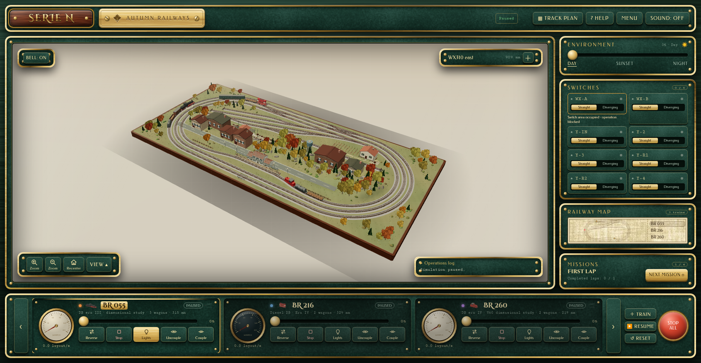
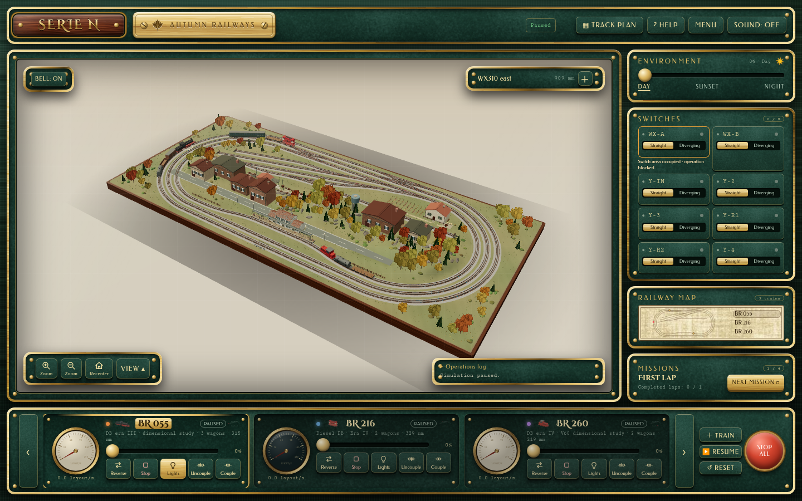
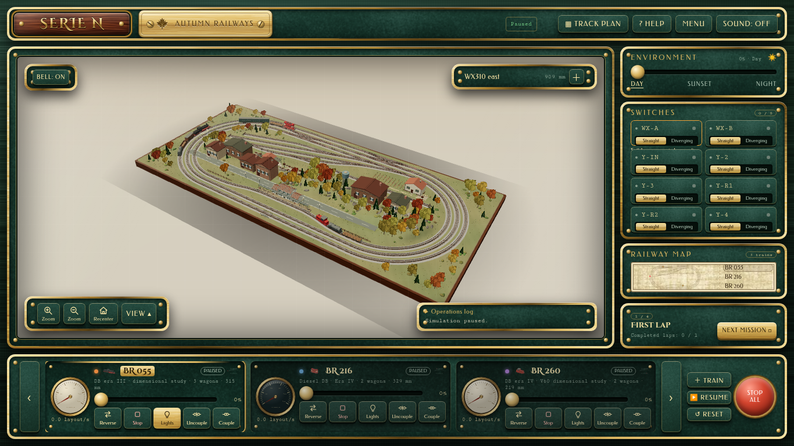
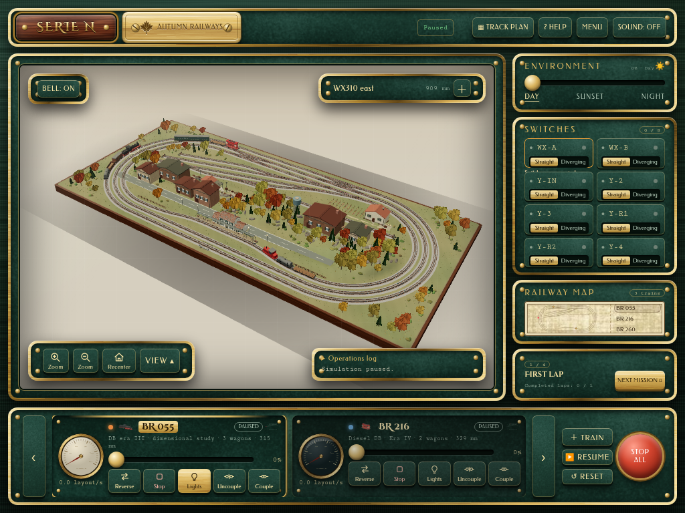
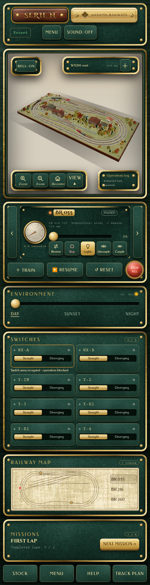
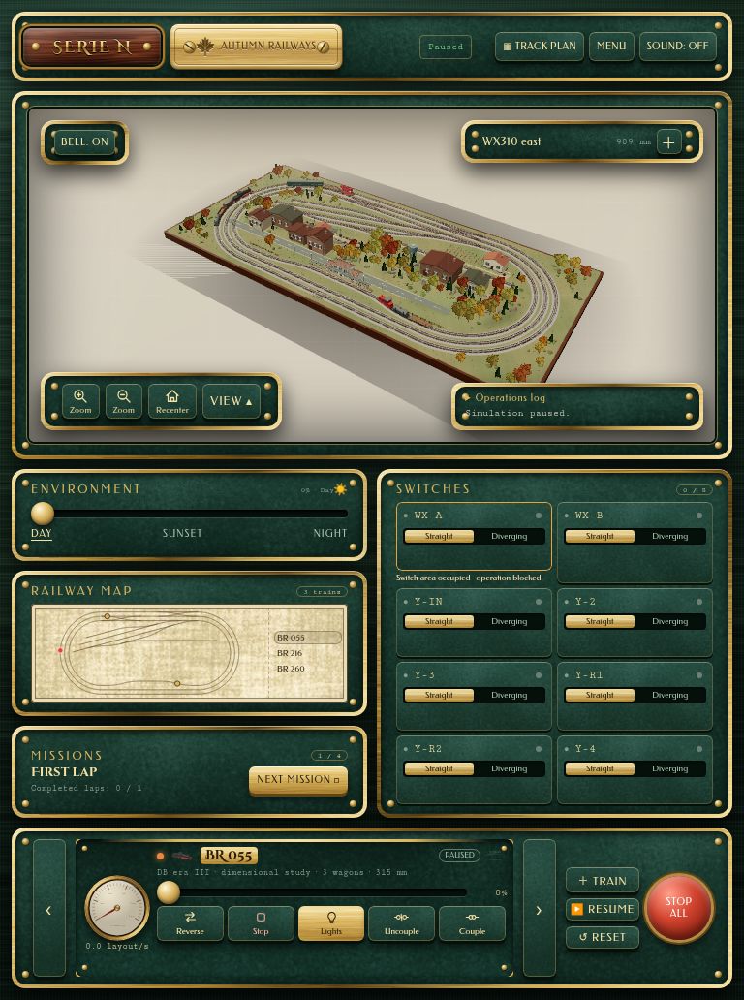

# Visual parity — confronti definitivi

Reference originale cf2c29a, font locali, qualità UI High. Runtime reale prima/dopo con bootstrap Auth locale dichiarato, scena ferroviaria inclusa e renderer software. Confronti a pari viewport e Day0; nessuna prova OAuth.

Overlay: fusione 50/50 senza maschere. Diff: rosso dove la differenza supera 24/255; escluso soltanto l’interno dinamico comune della scena, con HUD/Bell/camera/log mantenuti. Nessun valore UI mascherato. Il diff completo resta visibile anche per gli adattamenti responsivi motivati.

## 1692x877

| Claude originale | UI precedente | UI corretta |
| --- | --- | --- |
| [Apri](reference-1692x877.png) | [Apri](baseline-1692x877.png) | [Apri](current-1692x877.png) |

[Overlay 50/50](overlay-1692x877.png) · [Diff UI completo](diff-1692x877.png) · [Maschera dinamica ispezionabile](dynamic-mask-1692x877.png)

Pixel UI divergenti, soglia24: precedente 42.03%; corretta 15.37%. Il valore comprende contenuti/stati reali e adattamenti consentiti; non è una dichiarazione pixel-perfect.

## 1648x895

| Claude originale | UI precedente | UI corretta |
| --- | --- | --- |
| [Apri](reference-1648x895.png) | [Apri](baseline-1648x895.png) | [Apri](current-1648x895.png) |

[Overlay 50/50](overlay-1648x895.png) · [Diff UI completo](diff-1648x895.png) · [Maschera dinamica ispezionabile](dynamic-mask-1648x895.png)

Pixel UI divergenti, soglia24: precedente 41.93%; corretta 15.59%. Il valore comprende contenuti/stati reali e adattamenti consentiti; non è una dichiarazione pixel-perfect.

## 1440x900

| Claude originale | UI precedente | UI corretta |
| --- | --- | --- |
| [Apri](reference-1440x900.png) | [Apri](baseline-1440x900.png) | [Apri](current-1440x900.png) |

[Overlay 50/50](overlay-1440x900.png) · [Diff UI completo](diff-1440x900.png) · [Maschera dinamica ispezionabile](dynamic-mask-1440x900.png)

Pixel UI divergenti, soglia24: precedente 43.21%; corretta 18.72%. Il valore comprende contenuti/stati reali e adattamenti consentiti; non è una dichiarazione pixel-perfect.

## 1366x768

| Claude originale | UI precedente | UI corretta |
| --- | --- | --- |
| [Apri](reference-1366x768.png) | [Apri](baseline-1366x768.png) | [Apri](current-1366x768.png) |

[Overlay 50/50](overlay-1366x768.png) · [Diff UI completo](diff-1366x768.png) · [Maschera dinamica ispezionabile](dynamic-mask-1366x768.png)

Pixel UI divergenti, soglia24: precedente 52.99%; corretta 24.52%. Il valore comprende contenuti/stati reali e adattamenti consentiti; non è una dichiarazione pixel-perfect.

## 1024x768

| Claude originale | UI precedente | UI corretta |
| --- | --- | --- |
| [Apri](reference-1024x768.png) | [Apri](baseline-1024x768.png) | [Apri](current-1024x768.png) |

[Overlay 50/50](overlay-1024x768.png) · [Diff UI completo](diff-1024x768.png) · [Maschera dinamica ispezionabile](dynamic-mask-1024x768.png)

Pixel UI divergenti, soglia24: precedente 54.94%; corretta 25.77%. Il valore comprende contenuti/stati reali e adattamenti consentiti; non è una dichiarazione pixel-perfect.

## 390x844

| Claude originale | UI precedente | UI corretta |
| --- | --- | --- |
| [Apri](reference-390x844.png) | [Apri](baseline-390x844.png) | [Apri](current-390x844.png) |

[Overlay 50/50](overlay-390x844.png) · [Diff UI completo](diff-390x844.png) · [Maschera dinamica ispezionabile](dynamic-mask-390x844.png)

Pixel UI divergenti, soglia24: precedente 78.65%; corretta 64.70%. Il valore comprende contenuti/stati reali e adattamenti consentiti; non è una dichiarazione pixel-perfect.

## 768x1024

| Claude originale | UI precedente | UI corretta |
| --- | --- | --- |
| [Apri](reference-768x1024.png) | [Apri](baseline-768x1024.png) | [Apri](current-768x1024.png) |

[Overlay 50/50](overlay-768x1024.png) · [Diff UI completo](diff-768x1024.png) · [Maschera dinamica ispezionabile](dynamic-mask-768x1024.png)

Pixel UI divergenti, soglia24: precedente 77.35%; corretta 52.06%. Il valore comprende contenuti/stati reali e adattamenti consentiti; non è una dichiarazione pixel-perfect.
