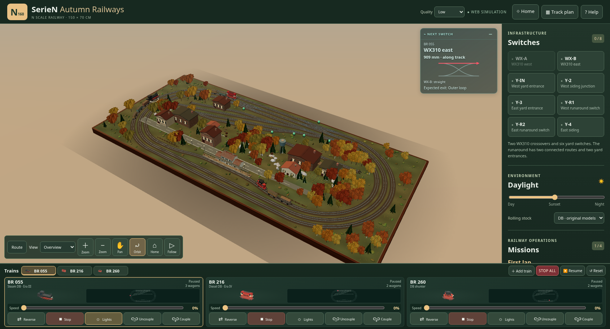
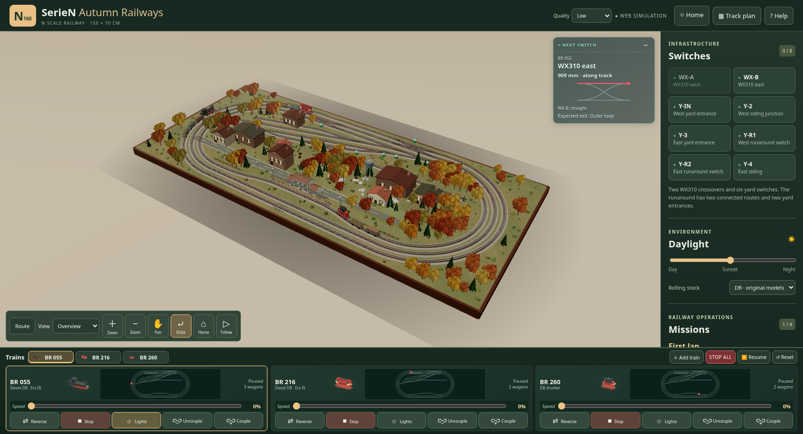

# Fase 2 — Fondamenta grafiche · v0.10

Il brief originale definisce questa fase così: «Migliora terreno, illuminazione, materiali ferroviari, ombre e camera, senza modificare le logiche operative». La richiesta successiva aggiunge l'inquadratura più alta, la plancia a riga unica e il lampeggio degli indicatori degli scambi. Baseline di confronto: v0.9, commit `97f35d1`.

## Camera e plancia

Home e avvio condividono lo stesso preset: il plastico è spostato verso l'alto, mantenendo orientamento e zoom. La verifica usa tutti gli otto vertici del tavolato, compreso l'angolo inferiore destro precedentemente tagliato, proiettati dalla camera effettiva del browser.

Ogni consolle dispone sulla stessa riga nome, miniatura reale, minimappa e stato. Il pannello mantiene l'altezza precedente; la minimappa passa da **40 a 66 px**, sfruttando lo spazio recuperato dall'intestazione. Restano cinque comandi, slider indipendenti, selezione recente dei tre convogli e aggiornamento delle posizioni dal motore ferroviario. Nei dispositivi stretti i testi lunghi hanno tooltip; le consolle scorrono orizzontalmente sui telefoni.

| Viewport | Altezza plancia v0.9 → v0.10 | Altezza minimappa | Scala effettiva del disegno SVG |
|---|---:|---:|---:|
| 1690×914, screenshot utente | 183 → 183 px | 40 → 66 px | — |
| 1440×1000, desktop | 183 → 183 px | 40 → 66 px | +72,2% |
| 1024×900, tablet | 183 → 183 px | 40 → 66 px | +72,2% |
| 768×1024, verticale | 183 → 183 px | 40 → 66 px | +34,7% |
| 390×844, telefono | 212 → 212 px | 40 → 66 px | +72,2% |

In emulazione touch 768×1024 la plancia conserva **189 px** e i quindici pulsanti delle tre consolle mantengono **40 px** di altezza.

La scala effettiva confronta la trasformazione SVG corrente con l'area interna delle mappe rilevata nel collaudo v0.9: il binario risulta più grande, oltre al contenitore. [Misure browser](browser-result.json).

## Individuazione degli scambi

Il passaggio del mouse sui comandi laterali fa lampeggiare la sola lampada associata, in arancione `#ff8b16`, con periodo di 700 ms. All'uscita del puntatore si ripristina il colore dello stato corrente. Il feedback usa il ciclo principale esistente, senza timer né renderer aggiuntivi, e non cambia il valore dello scambio, l'instradamento o le protezioni.

Il contenitore riceve il passaggio del mouse anche quando il pulsante è disabilitato per occupazione o avvicinamento. Il pulsante rimane disabilitato. I controlli non vengono ricreati a ogni aggiornamento della plancia, per conservare il feedback durante il cambio di selezione. Blur, pagina nascosta e rilascio della scena ripristinano gli indicatori; il touch non mantiene un lampeggio attivo.

## Fondamenta grafiche

- Terreno reale della scena con rilievi continui meno regolari, chiazze cromatiche e microdettaglio di superficie. Restano piatti i corridoi ferroviari e libere le aree di edifici e strade.
- Massicciata con texture originale deterministica, colore e dati di rilievo/rugosità separati; colori sRGB e dati materiali lineari.
- Rotaie con testa più chiara e metallica e corpo ossidato più ruvido. Il materiale riguarda esclusivamente i binari e conserva quello dei rotabili; miniature native ancora corrispondenti ai modelli.
- Illuminazione diretta, cielo, ambiente, esposizione e foschia coordinati fra giorno e notte. Conservate luci di stazione, finestre e fari.
- Volume delle ombre adattato al tavolato e agli elementi scenici, mantenendo la mappa 2048² e riducendo il distacco delle ombre dagli oggetti. I profili Low/High/Cinema continuano a gestire il costo grafico.

Le texture sono procedurali originali: nessun nuovo download o dipendenza esterna. Non sono stati introdotti gallerie, renderer per le miniature o cicli di simulazione separati. Gli interventi sulle cinque zone scenografiche appartengono alla fase successiva del brief.

## Verifiche e confronto

- [Test Node](node-tests.txt): tutti i 19 file passano, compresi camera, materiali, ombre, lampeggio, rete ferroviaria, rotabili e miniature.
- Parser XML: 9 verifiche passate. Rigenerazione canonica riproducibile: 70 nodi, 75 archi, una componente, quattro terminali; nessuna variazione dei file generati.
- [Conservazione geometria](railway-preservation.json): confrontati posizione e indici di tutti i **150 mesh delle rotaie**, identici alla baseline. Grafo canonico, rete e simulazione invariati.
- [Test browser riproducibile](../../tests/browser-phase-two.py): dimensioni responsive, quattro componenti sulla stessa riga, minimappe reali, otto bersagli hover, comando occupato, mancato azionamento degli scambi, continuità dei convogli nascosti, controlli della plancia e rendering High diurno/notturno.
- [Esito browser](browser-result.json): **PASS**, nessun errore JavaScript o di compilazione shader rilevato, un solo contesto WebGL. Il confronto Low con tre convogli usa 349 draw call e circa 467 mila triangoli; questi contatori non sono una misura degli FPS.

Confronto panoramico con stessa risoluzione, luce e qualità Low:

| v0.9 | v0.10 |
|---|---|
|  |  |

Ulteriori schermate: [tablet verticale](tablet-portrait.png), [telefono](phone.png), [High diurno](high-day.png), [High notturno](high-night.png). Il collaudo High comprende anche il quarto convoglio; il confronto Low sopra mantiene i tre convogli iniziali.

Le prove browser usano Chromium/SwiftShader. Verificano geometria proiettata, eventi, interfaccia e resa degli shader; non certificano FPS o prestazioni di una GPU tablet fisica. Questa fase migliora le fondamenta del diorama, senza dichiarare equivalenza visiva con Train Station 3. Restano i limiti fisici già documentati della Fase 0 accettata.
