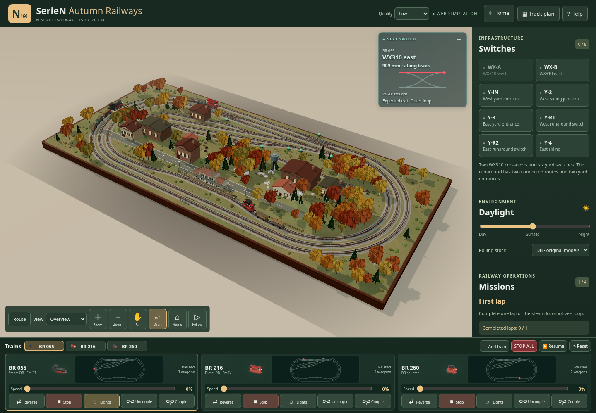
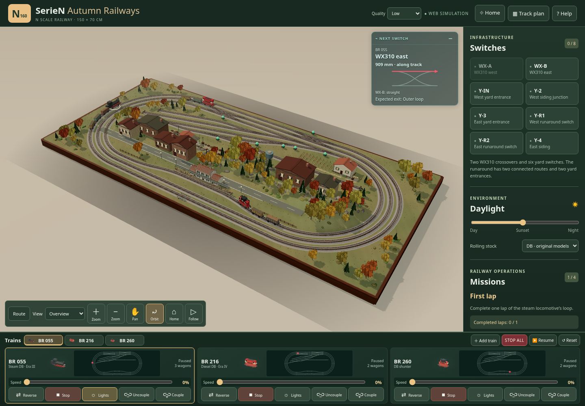

# Fase 3 — Paesaggio e integrazione · v0.11

Ripresa della v0.10, commit `04bebcdf6e54869bf7523391d2de2c906c00d073`. Lavorazione nell'ordine richiesto: boschi e rilievi, stazione e scalo, campagna e integrazione finale. Nessuna galleria, nuovo asset remoto o nuova dipendenza.

## Recupero e conservazione

All'inizio il checkout `work` era pulito. I commit `a93083a` ed `e0a5e96` non erano presenti negli oggetti locali, nei reflog o negli oggetti non referenziati verificati con `git fsck --full --no-reflogs --unreachable`. Non sono stati trovati altri checkout del progetto sotto `/workspace`. La baseline è stata conservata separatamente per costruire e servire il confronto v0.10. Nessun reset, cancellazione di lavoro locale o intervento su `first`.

[Confronto dei sorgenti protetti](preservation.json): `app.js`, grafo canonico, rete, motore, composizioni, profilo delle rotaie, HUD, plancia, navigazione, fabbricato di stazione, marciapiede e CSS sono identici alla v0.10. Confrontate anche posizione e indici di tutti i **150 mesh delle rotaie**, identici alla baseline. `index.html` cambia soltanto le versioni delle URL degli asset. Le dipendenze restano Three.js 0.163.0 ed esbuild 0.25.12; nei manifest cambia soltanto la versione del progetto.

## 1. Boschi e rilievi

Rilievi più articolati sul margine ovest e nella parte centrale e orientale. La funzione di quota mantiene piano il corridoio ferroviario, le strade, i fabbricati e i piazzali di lavoro. Il bosco usa gruppi deterministici di alberi con altezze diverse e radure; il margine delle chiome rispetta un corridoio di 18 mm dalle linee ferroviarie e la leggibilità degli scambi. Restano liberi edifici, stazione, vigneto e superfici riservate.

Betulle e querce hanno volumi differenti. Le conifere usano quattro strati volumetrici in High/Cinema e sagome incrociate in Low; tronchi e chiome sono instanziati. Sottobosco e foglie cadute seguono i gruppi di alberi. Le rocce mantengono un margine maggiore dai binari. Nessun nuovo ciclo di simulazione o contesto WebGL.

## 2. Stazione e scalo

Piazzali livellati condivisi fra terreno, pavimentazione e maschere di vegetazione: il vecchio piazzale merci poteva essere attraversato dai rilievi. I carichi sono ora in due file con una corsia centrale libera di almeno 16 mm, più una piccola zona manutenzione. Il magazzino ha una banchina coperta e una rampa; lampade con superfici emissive notturne e due addetti completano lo scalo. Non sono state aggiunte luci puntuali o animazioni artificiali.

La stazione conserva edificio, marciapiede, pensilina e illuminazione esistenti. Sono aggiunti pannelli informativi e tre biciclette sul piazzale anteriore. Il vecchio capannone `factory-north`, il cui ingombro intersecava il fascio diagonale, passa da `(430,168)` a `(480,440)`, senza cambiare il tracciato.

## 3. Campagna e integrazione

Cascina spostata da `(1020,430)` a `(1174,183)`, vigneto dalla metà anteriore al retro, centro `(1050,186)`: dieci filari con suolo coltivato aderente al terreno, pali e fili. Una strada poderale, accesso alla cascina, cortile, carro, balle e breve recinzione collegano la campagna. Gli elementi sono procedurali originali, in scala con gli altri dettagli.

## Collaudo

- [95 verifiche Node](node-tests.txt), tutte passate: rete, simulazione, materiali, camera, HUD, plancia, modelli, ingombri delle chiome, piazzali e integrazione della campagna.
- 9 test Python dell'audit JMRI passati. Rigenerazione canonica su copia temporanea identica ai quattro file pubblicati: 70 nodi, 75 archi, una componente, quattro terminali.
- `npm run build` e controllo delle differenze senza errori.
- [Regressioni operative browser](operations-result.json): tre circuiti in entrambi i sensi, quarto convoglio e plancia MRU, manovre sui due rami del runaround, inversioni, scambi protetti, HUD e STOP ALL passati. Quattro viewport senza overflow, HUD dentro la vista e un solo contesto WebGL.
- [Collaudo grafico Fase 3](browser-result.json), script [browser-phase-three.py](../../tests/browser-phase-three.py): viste responsive, Home senza tagli del tavolato, plancia invariata, tre minimappe da 66 px, posizioni della cascina e del capannone, Low/High/Cinema, giorno/notte, un solo contesto WebGL e nessun errore JavaScript, shader o richiesta fallita.

Il rendering è verificato con Chromium/SwiftShader. Non sono certificati FPS su GPU fisiche, prestazioni su tablet reali o interazioni touch fisiche. Restano i limiti metrologici documentati della Fase 0: profili WX310, fouling e lunghezze utili da verificare sul plastico. Il fabbricato di stazione mantiene l'ingombro preesistente a 17 mm dal centro del binario più vicino, segnalato dal controllo conservativo a 18 mm; non viene spostato in questa fase.

## Confronto visivo

| v0.10 | v0.11 |
|---|---|
|  |  |

[Stazione](station.png) · [Scalo](yard.png) · [Tablet](after-tablet.png) · [Telefono](after-phone.png) · [High diurno](high-day.png) · [High notturno](high-night.png) · [Cinema](cinema.png).
